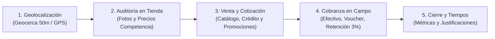

# Contexto Integral de UYAPAY B2C y Hoja de Ruta para la Reestructuración de Casos

> **Documento de Contexto y Trabajo Continuo**  
> **Fecha:** Septiembre 2026  
> **Proyecto:** Plataforma Interactiva de Capacitación, Simulación Móvil y Evaluación UYAPAY B2C  
> **Ubicación:** `Capacitador-interactivo-UYAPAY`  
> **Referencias:**  
> - Manual Oficial: `C:\Users\orfav\Downloads\SOLAR\UYAPAY\B2C\User_Manual.pdf`  
> - Repositorio de la App Móvil: `C:\Users\orfav\Documents\Repositorios\uyapay-b2c\appSellerV1`  
> - Repositorio Backend: `C:\Users\orfav\Documents\Repositorios\uyapay-b2c\solar-web-app-backend`  
> - Documento de Requisitos: `PRDv2.md`

---

## 1. ¿Qué es UYAPAY B2C?

**UYAPAY** es la aplicación móvil y ecosistema tecnológico corporativo de la empresa **SOLAR** (distribuidor oficial de lubricantes Shell/Lubritek, neumáticos Michelin/Hankook, baterías y repuestos en Perú).

Está diseñada para ser la herramienta de trabajo en campo de los **asesores comerciales (fuerza de ventas en ruta)** para los canales **B2C (minorista)** y **B2B (corporativo)**.

### Arquitectura Tecnológica del Ecosistema
1. **App Móvil (`appSellerV1`):**
   * **Framework:** Flutter / Dart para Android (orientada a pantallas de 6.7" con Android 13.0, uso obligatorio de GPS y conectividad).
   * **Patrón de Estado:** BLoC (`flutter_bloc`).
   * **Persistencia y Datos:** SQLite (`local_data_base_handler`), SharedPreferences, Flutter Secure Storage y Singletons de estado en memoria (`CustomerSingleton`, `SellerSingleton`, `AlldataSingleton`).
   * **Comunicación:** REST API (`http` con Bearer Tokens JWT) y servicios Multipart para carga masiva de evidencias fotográficas.
2. **Backend Corporativo (`solar-web-app-backend`):**
   * **Framework:** ASP.NET Core (.NET 7/8 / C#) con SQL Server y conexión ERP.
   * **Controladores Clave:** `CustomerController`, `OrderCustomerController`, `ProductController`, `PromotionController`, `SellerController`, `ShoppingCartController`, `UserController`.

---

## 2. ¿Para qué se usa UYAPAY? (Ciclo Comercial y Operativo)

UYAPAY digitaliza y estandariza las 5 etapas críticas del trabajo del vendedor en ruta:



1. **Control de Presencia y Ruta:** Valida la llegada al cliente por geocerca (< 50 metros), permite corregir coordenadas con fotografía o registrar llamadas remotas (máximo 5 llamadas permitidas al día).
2. **Trade Marketing e Inteligencia de Mercado:** Obliga al vendedor a registrar fotográficamente el *Antes* y *Después* de la exhibición de la marca y a levantar precios de marcas competidoras (Castrol, Mobil, etc.).
3. **Gestión de Pedidos y Políticas de Venta:** Aplica listas de precios (Oficina, 1, 2, 3, 4 en B2C; 5 a 8 en B2B), segregación estricta de pedidos por marca, condiciones de pago (Contado o Crédito 15/30/45/60 días), promociones por volumen y venta segura.
4. **Recuperación de Cartera (Cobranzas):** Permite liquidar facturas vencidas o por vencer mediante efectivo, depósitos bancarios (con número de operación y voucher), cheques o comprobantes de retención SUNAT (3% fijo), emitiendo recibos electrónicos inmutables.
5. **Auditoría Postventa:** Permite consultar estados de cuenta, proyecciones de venta por familias de productos y documentos electrónicos emitidos.

---

## 3. Estructura de Módulos de UYAPAY

| Módulo / Feature | Alcance Funcional | Tareas en el Simulador |
| :--- | :--- | :--- |
| **`visits_plan`** (Plan de Visitas) | Agenda diaria de clientes con filtros: *Pendientes, Realizados, No visitados, No compran, Con deuda*. | Inicio de visita automática o manual, verificación de distancia GPS. |
| **`section.visit`** (Carrusel de Tareas) | Motor principal de la visita en progreso: | |
| ↳ **Inicio / Perfil** | Muestra scoring comercial/cobranza (*A/1*), RUC, deuda vencida, saldo a favor y línea de crédito. | Lectura de perfil, validación de condiciones de crédito. |
| ↳ **Fotos (Exhibición)** | Carga de fotos del Antes y Después de productos y publicidad. | Carga obligatoria de fotos y uso del menú de opciones para comentarios. |
| ↳ **Precios (Tracking)** | Comparativa de precios de productos competidores. | Registro de precios encontrados o motivo de no registro. |
| ↳ **Pedidos / Cotizaciones** | Catálogo comercial, selección padre/hijo, condiciones de pago, promociones y venta segura. | Configuración precisa de condición, marca, SKU, cantidades y promociones. |
| ↳ **Cobranzas (Collect Debt)** | Liquidación de facturas con multi-método: Efectivo, Depósito, Cheque y Retención (3%). | Selección de factura, llenado de voucher/operación, retención SUNAT y emisión de recibo. |
| ↳ **Tareas especiales** (en código) | `credit_line_request` (ampliación de crédito) y `complete_documentation` (datos del cliente). | Casos borde y solicitudes administrativas. |
| ↳ **Cierre de Visita** | Resumen de tiempo de atención y traslado. | Justificación obligatoria en caso de tareas omitidas. |
| **`section.my_customers`** | Cartera completa de clientes, estados de cuenta descargables (PDF/Imagen) y gráficos de deuda. | Consulta de historial y saldos. |
| **`sales_projection`** | Metas por familia (Rimula Multigrado, Spirax, Shell Premium, Neumáticos, Repuestos). | Hito de proyecciones y cuotas. |
| **`guaranteed_debts`** | Gestión de deudas donde el asesor o un tercero es aval. | Auditoría crediticia. |
| **`electronic_documents`** | Visor de facturas, letras, notas de crédito/débito y recibos de cobro. | Seguimiento de comprobantes. |

---

## 4. El Nuevo Sistema de Puntuación (PRDv2)

Para que los casos sean compatibles con el motor de evaluación oficial, deben regirse bajo las siguientes reglas:

1. **Puntaje Vigesimal Oficial (0 a 20):**
   * **60% Avance / Completitud:** Puntos por completar las tareas obligatorias del flujo.
   * **40% Calidad Operativa:** Deducciones progresivas por cometer infracciones tipificadas.
2. **Motor de Infracciones (Rule Engine):**
   * **`[CLIC INDEBIDO]` (-0.5 pts):** Clics fuera del área activa, toques en menús descontextualizados o intentar avanzar sin guardar tareas previas obligatorias.
   * **`[ERROR OPERATIVO]` (-1.0 a -2.0 pts):** Mezclar marcas en un mismo pedido, exceder la línea de crédito o plazo autorizado, omitir foto de voucher bancario, digitar porcentaje de retención distinto al 3%, o cerrar la visita sin justificar tareas omitidas.
3. **Bolsa Única de XP y Niveles de Simulador:**
   * La plataforma tiene 3 niveles en simulador (**Básico, Intermedio, Avanzado**).
   * Al aprobar un nivel ($\ge 12/20$ o $60\%$), se suman los puntos proporcionales de XP a la bolsa global del asesor.
   * Cada caso no resuelto u omitido califica con **00 puntos**.

---

## 5. Hoja de Ruta para Reestructurar los Casos desde Cero

Los casos anteriores eran monótonos y repetitivos porque todos seguían casi la misma secuencia con leves variaciones de producto, sin medir habilidades progresivas ni contemplar casos borde.

### A. Estructura Progresiva por 3 Niveles de Dificultad

```
┌─────────────────────────────────────────────────────────────────────────────────┐
│ Nivel 1: Básico (Operativa Estándar y Venta Limpia)                              │
│ • Visita presencial normal (geocerca válida).                                   │
│ • Cliente al día, venta Contado o Crédito estándar dentro de línea.             │
│ • Cumplimiento de tareas secuenciales (Fotos obligatorias + Catálogo simple).    │
├─────────────────────────────────────────────────────────────────────────────────┤
│ Nivel 2: Intermedio (Políticas Comerciales, Promociones y Depósitos Bancarios)   │
│ • Venta a Crédito con plazos específicos (15 o 30 días) y control de línea.     │
│ • Aplicación de promociones por volumen (regalo o descuento en dinero).         │
│ • Manejo de Cliente Padre vs. Sucursal Hijo y Venta Segura vs. Cotización.      │
│ • Cobranza por depósito bancario (exige banco, fecha, núm. operación y voucher).│
├─────────────────────────────────────────────────────────────────────────────────┤
│ Nivel 3: Avanzado (Excepciones, SUNAT, Casos Borde y Resolución de Conflictos)  │
│ • Cliente con deuda vencida > 30 días y bloqueo preventivo.                     │
│ • Aplicación estricta de Agente de Retención SUNAT (3% obligatorio).            │
│ • Manejo de visita por llamada telefónica (límite 5/día) o reajuste GPS.        │
│ • Prevención de trampa de mezclar marcas en un mismo carrito.                   │
│ • Cierre justificado de visita con tareas no completadas.                       │
└─────────────────────────────────────────────────────────────────────────────────┘
```

### B. Plantilla Modular Estándar de Cada Caso

Cada caso debe diseñarse bajo una ficha técnica modular independiente:

```markdown
### [CASO-XX] [NIVEL] - Título Descriptivo del Escenario
* **1. Metadatos:** Código, Nivel (Básico/Intermedio/Avanzado), Tiempo estimado (minutos).
* **2. Enunciado para el Asesor:** Instrucción comercial clara (lo que lee en pantalla).
* **3. Mock Data / Precondiciones:**
  - Cliente (Razón social, RUC, tipo Padre/Hijo, scoring comercial/cobranza).
  - Estado financiero (Línea de crédito total/disponible, deudas vencidas/por vencer).
  - Contexto de visita (Ubicación GPS: <50m o remota).
* **4. Flujo Paso a Paso Canónico:**
  1. Paso a paso numerado de las pantallas e interacciones requeridas.
* **5. Trampas y Validaciones de Calidad (Motor de Reglas):**
  - Clics indebidos posibles en este caso.
  - Errores operativos a penalizar (ej. no cambiar de Contado a Crédito, omitir voucher).
* **6. Criterio de Puntuación:**
  - Desglose de 60% avance / 40% calidad específico para este caso.
* **7. Resultado Esperado en el Sistema:**
  - Pedido/cotización generado con montos exactos, cobranza registrada y visita cerrada.
```

---

## 6. Puntos Pendientes de Decisión para Continuar Mañana

Para arrancar mañana con la redacción de los casos desde cero, revisaremos:
1. **Cantidad total de casos:** Definir si la batería final tendrá **9 casos** (3 por nivel) o **12 casos** (4 por nivel).
2. **Catálogo de clientes fijos:** Confirmar si fijamos 3 o 4 clientes canónicos con perfiles contrastados para reutilizarlos en los casos.
3. **Formato de entrega:** Definir si los casos se guardarán en un archivo consolidado o en archivos Markdown separados por nivel dentro de una carpeta `/casos/`.
