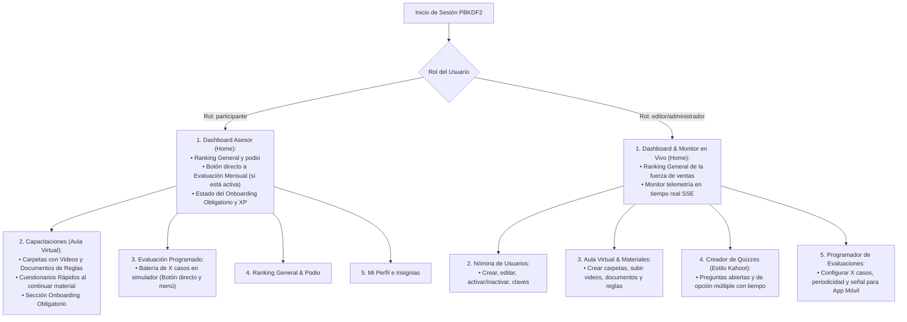
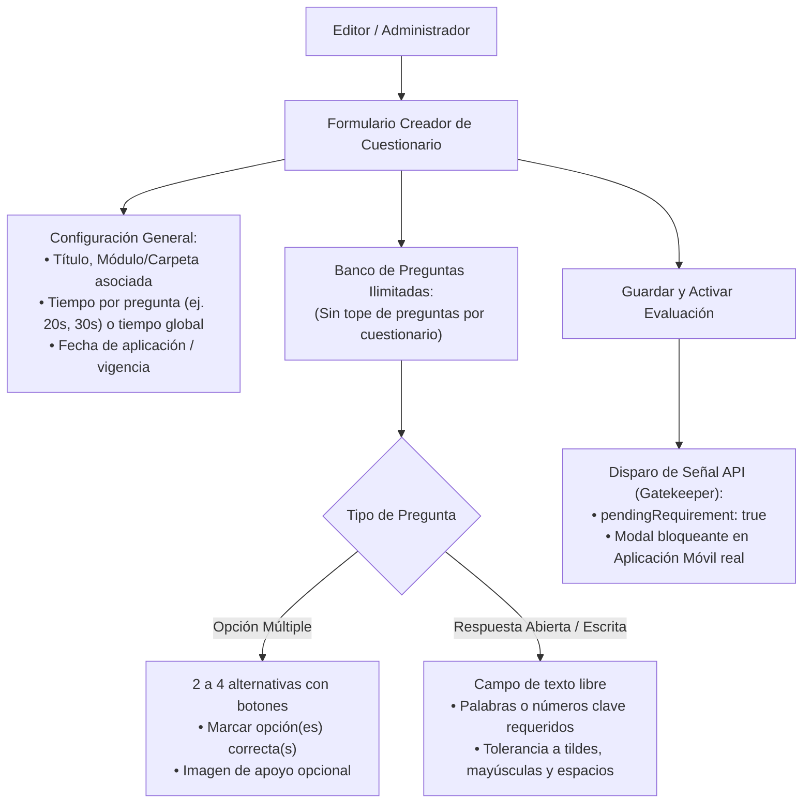
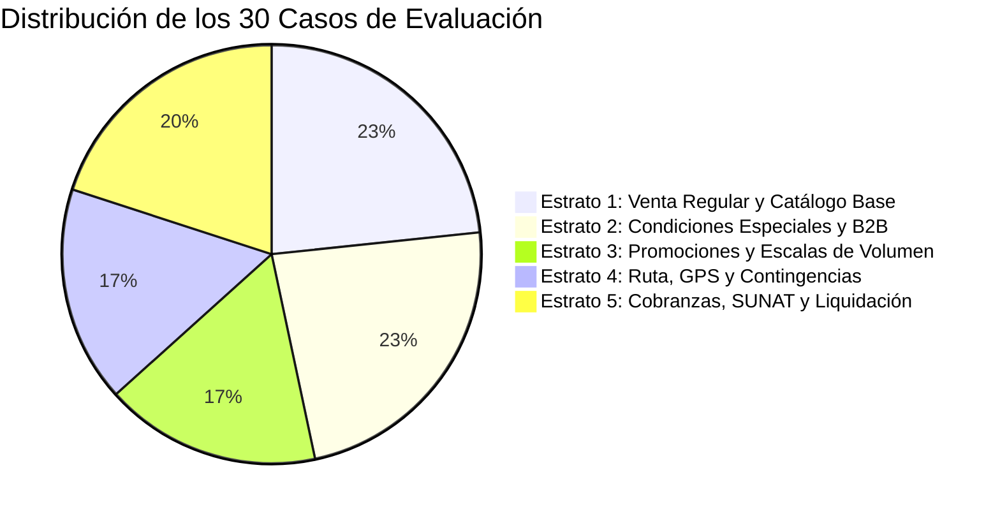
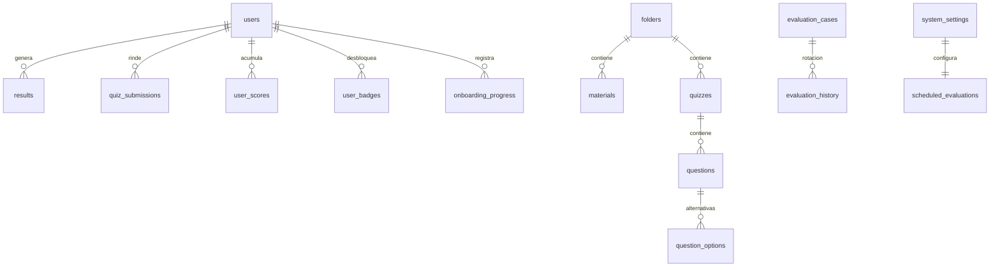

# Documento de Requisitos de Producto (PRD)
## Plataforma Interactiva de Capacitación, Simulación Móvil y Evaluación UYAPAY B2C

* **Versión del Documento:** 3.0 (Versión Definitiva Aprobada para Desarrollo Frontend y Backend)
* **Fecha de Aprobación:** 22 de Septiembre, 2026
* **Estado:** Aprobado / En Construcción Activa
* **Documentos Fuente y Referencia Oficial:**
  * `User_Manual.pdf` (Manual de Usuario Oficial UYAPAY, Julio 2025, 23 páginas).
  * Repositorio `uyapay-b2c` (`appSellerV1` - Arquitectura de pantallas y modelos Flutter).
  * `Propuesta__Plataforma_de_capacitacion_interactiva_UYAPAY.pdf` (Propuesta comercial y alcance contractual).
  * `Requisitos.pdf` (Especificación técnica formal de 48 RF, 10 SIM, 10 RNF y 16 entidades).
  * `REQUISITOS DEL MVP.md` y `Casos de Prueba — Simulador UYAPAY Asesor.md`.

---

## 1. Visión y Propósito del Producto

La **Plataforma Interactiva UYAPAY B2C** es una solución web integral diseñada para capacitar, inducir, certificar y evaluar a la fuerza comercial (asesores de ventas en ruta) de la distribuidora oficial de lubricantes Shell, neumáticos Michelin / BFGoodrich y repuestos automotrices Hyundai.

El sistema garantiza que los asesores dominen con precisión técnica: 
(capacitar-gestionar-evaluar)
1. El uso operativo riguroso de la aplicación móvil de ventas en ruta (desarrollada originalmente en Flutter).
2. El cumplimiento de las políticas comerciales (listas de precios, promociones combo, ventas de contado vs. crédito y descuentos).
3. La disciplina operativa en ruta (geocerca satelital de 50 metros, justificación fotográfica y uso auditado de la visita telefónica).
4. El procedimiento legal y financiero de cobranzas (efectivo, depósitos con voucher, cheques y retenciones SUNAT del 3%).

---

## 2. Definición Estricta de Roles y Arquitectura de Navegación (participante, editor, revisor, administrador)

A fin de simplificar la operación y maximizar la efectividad pedagógica, el sistema opera bajo **exactamente dos roles**:



### 2.1. Rol `participante` (Asesor Comercial)
* **Pantalla de Inicio (Home / Dashboard):**
  * Al autenticarse, la pantalla principal es el **Dashboard de Desempeño Personal**, que despliega:
    1. **Tarjeta de Última Evaluación Rendida:** Calificación vigesimal obtenida ($20 \rightarrow 0$), tiempo empleado, cantidad de faltas cometidas y estado (`APROBADO` o `DESAPROBADO`).
    2. **Posición Oficial:** Lugar ocupado en el ranking corporativo y distancia respecto al primer puesto.
    3. **Banner de Llamado a la Acción (CTA):** Si la empresa ha programado una Evaluación Mensual o un Cuestionario Rápido pendiente, se despliega un botón prominente **"Iniciar Evaluación Pendiente ➔"**.
    4. **Barra de Estado de Inducción:** Progreso de cumplimiento del Onboarding obligatorio.
* **Menú Superior de Navegación:**
  1. `Dashboard (Home)`: Resumen personal y accesos rápidos.
  2. `Capacitaciones`: Aula virtual interactiva con carpetas de videos, reglas y documentos.
  3. `Evaluación Mensual`: Acceso a la arena de examen del simulador (habilitado cuando está programado).
  4. `Ranking & Podio`: Tabla general de posiciones y visualización del podio olímpico Top 3.
  5. `Mi Perfil`: Bolsa de puntos de gamificación (XP), historial de pruebas e insignias desbloqueadas.

### 2.2. Rol `editor/administrador` (Control Operativo y Pedagógico Total)
* **Pantalla de Inicio (Home / Dashboard):**
  * Al autenticarse, la pantalla principal es el **Dashboard Ejecutivo & Monitor en Vivo**, que consolida:
    1. **Ranking General Completo:** Clasificación en vivo de todos los asesores evaluados.
    2. **Monitor SSE de Telemetría:** Feed de eventos en tiempo real de los asesores que están rindiendo pruebas (paso actual, clics y errores detectados).
    3. **Métricas Clave:** Total de evaluaciones, tasa de aprobación porcentual y listado de casos críticos con mayor incidencia de fallas.
    4. **Interruptor de Podio:** Control de publicación (`podium_visible`) para mostrar u ocultar los ganadores.
* **Menú Superior de Navegación:**
  1. `Dashboard & Monitor`: Telemetría y ranking en tiempo real.
  2. `Usuarios`: Nómina, altas, bajas, reseteo de claves y control de estados.
  3. `Aula Virtual (Materiales)`: Administrador de carpetas, videos formativos, guías y reglas comerciales.
  4. `Creador de Cuestionarios`: Formulador de preguntas y evaluaciones rápidas tipo Kahoot.
  5. `Programador de Evaluaciones`: Configuración de casos de simulador, periodicidad y disparador para apps móviles.

---

## 3. Módulo de Capacitación y Aula Virtual (Pilar 1)

El módulo de capacitación opera bajo el modelo de un **Aula Virtual Educativa**, permitiendo al `editor/administrador` estructurar contenidos y al `participante` consumir información organizada pedagógicamente.

### 3.1. Estructura Jerárquica de Carpetas y Recursos
* **Sistema de Carpetas Temáticas:** Los contenidos se organizan en carpetas y subcarpetas navegables (ej. *Ventas B2C*, *Políticas de Crédito y Cobranzas*, *Ruta y Geocercas*, *Documentos Electrónicos*).
* **Tipos de Recursos Disponibles en Cada Carpeta:**
  1. **Videos Formativos:** Cápsulas audiovisuales (almacenadas en servidor/CDN del cliente) con reproductor integrado.
  2. **Documentos y Fichas de Reglas de Negocio:** Guías técnicas, tablas de políticas de crédito, exclusión de combos y listas de precios oficiales redactadas por el editor.
  3. **Archivos Multimedia e Infografías:** Diagramas y resúmenes gráficos para consulta rápida.

### 3.2. Flujo de Estudio y Transición a Cuestionario Rápido
1. El asesor ingresa al módulo `Capacitaciones` y selecciona la carpeta o módulo de su interés (visualización en modo galería de tarjetas o lista).
2. Se abre el recurso (video o documento de regla de negocio).
3. Al finalizar la lectura o reproducción, se habilita el botón principal **"Continuar al Cuestionario Rápido ➔"**.
4. Se despliega un quiz interactivo de refuerzo con límite de tiempo, evaluando inmediatamente los conceptos explicados.

---

## 4. Especificación Exhaustiva del Onboarding Asistido (Pilar 2)

El módulo de Onboarding es una **sección obligatoria dentro de Capacitaciones para todo usuario nuevo**. Su propósito es capacitar paso a paso en toda la aplicación móvil antes de enfrentarse a la operativa real.

El flujo sigue estrictamente la arquitectura funcional del manual [`User_Manual.pdf`](file:///C:/Users/orfav/Downloads/SOLAR/UYAPAY/B2C/User_Manual.pdf) y la aplicación Flutter [`uyapay-b2c/appSellerV1`](file:///C:/Users/orfav/Documents/Repositorios/uyapay-b2c):

```mermaid
flowchart TD
    subgraph Acceso["1. Inicio de Sesión"]
        P1["Paso 1: Pantalla de Login en Simulador\n(Ingreso de usuario, clave y selección de Agencia)"]
    end
    subgraph Navegacion["2. Reconocimiento de Interfaz"]
        P2["Paso 2: Interfaz Principal\n(Dashboard, Plan de Visitas, Pedidos y TC: S/ 3.65)"]
        P3["Paso 3: Menú Lateral Drawer\n(Mis Clientes, Historial 6 meses, Documentos Electrónicos)"]
    end
    subgraph Ruta["3. Preparación de Visita"]
        P4["Paso 4: Plan de Visitas y Geocerca\n(Geocerca 50m, Reestablecer con Foto o Visita Telefónica)"]
        P5["Paso 5: Proyección de Ventas\n(Fijación de metas por familia: Shell, Michelin, Repuestos)"]
    end
    subgraph Tareas["4. Las 5 Tareas de Visita en Ruta (T1 a T5)"]
        T1["T1: Perfil del Cliente\n(Scoring comercial y financiero: A / 1)"]
        T2["T2: Exhibición de Marca\n(Foto de antes y después con '+' y menú '...')"]
        T3["T3: Tracking de Precios\n(Registro de precios de marcas competidoras)"]
        T4["T4: Toma de Pedidos B2C\n(Contado/Crédito, Lista Precios, SKU, Promos, Cotización Tipo 3)"]
        T5["T5: Cobranzas y Liquidación\n(Efectivo, Depósito/Voucher, Cheque, Retención SUNAT y Consolidado)"]
    end
    subgraph Cierre["5. Cierre y Evaluación"]
        P7["Paso 7: Finalizar Visita\n('¡Visita completada!', registro de tiempo o justificación)"]
        Exam["Evaluación Final de Inducción:\n1 Caso Integral de Principio a Fin (T1 a T5)"]
    end

    P1 --> P2 --> P3 --> P4 --> P5 --> T1 --> T2 --> T3 --> T4 --> T5 --> P7 --> Exam
```



### 4.1. Desglose Paso a Paso en el Simulador Móvil

#### Paso 1: Inicio de Sesión y Credenciales (Manual pág. 1)
* El simulador arranca en la pantalla de bienvenida de la app móvil.
* El asistente interactivo guía al asesor para ingresar sus credenciales y seleccionar la agencia comercial correspondiente (ej. *Arequipa*).

#### Paso 2: Interfaz Principal y Tipo de Cambio (Manual pág. 1)
* Se resaltan los 3 accesos de la barra inferior: `Inicio`, `Visitas` y `Pedidos`.
* Se instruye sobre la lectura del tipo de cambio oficial del día (`TC: S/ 3.6500`).

#### Paso 3: Menú Secundario / Drawer Lateral (Manual pág. 2-5)
* El asesor aprende a desplegar el menú lateral izquierdo:
  * **Mis Clientes:** Búsqueda por Razón Social o RUC, relación cliente padre vs. cliente hijo, teléfonos, direcciones, deudas vencidas/por vencer y estado de cuenta descargable (PDF/Imagen).
  * **Historial de Visitas:** Consulta de visitas realizadas en los últimos 6 meses, agrupadas por mes, semana y filtro de estado (*Pendientes*, *No visitados*, *No compran*, *Con deuda*).
  * **Documentos Electrónicos:** Consulta y reenvío digital de facturas, letras de cambio, notas de crédito, notas de débito y recibos de cobro.

#### Paso 4: Plan de Visitas, Geocerca y Contingencias (Manual pág. 6, 10-11)
* El asesor selecciona un cliente de su lista diaria.
* Se explican y ejecutan las 3 reglas de localización:
  1. *Inicio Automático:* Cuando el dispositivo se encuentra dentro del radio de **50 metros** del punto de venta.
  2. *Reestablecer Ubicación:* Si el GPS no coincide con el local físico, se toma una fotografía del local y se pulsa `Guardar` para calibrar las coordenadas.
  3. *Visita por Llamada Telefónica:* Si no se puede acudir físicamente al local, se activa la opción justificada de llamada (con un tope estricto de **máximo 5 llamadas telefónicas al día**).

#### Paso 5: Proyección de Ventas (Manual pág. 9-10)
* Registro de objetivos comerciales previos a la interacción de compra: selección de familia de productos (*Rimula Multigrado*, *Spirax*, *Shell Premium*, *Repuestos Hyundai*), ingreso de unidades proyectadas y confirmación del resumen.

#### Paso 6: Secuencia de Tareas en Ruta (T1 a T5) (Manual pág. 12-21)
1. **Tarea 1 — Perfil y Scoring del Cliente (Manual pág. 12):**
   * Inspección de la ficha: calificación de ventas y cobranza (ej. *A / 1*), RUC, condición habitual, lista autorizada y saldo pendiente.
2. **Tarea 2 — Exhibición de Marca (Manual pág. 12-13):**
   * Obligatoriedad de registrar la presentación visual: botón `+` para capturar la foto inicial (*antes*), foto final (*después*), y uso del menú contextual `...` para agregar comentarios o corregir imágenes. Pulsar `Guardar`.
3. **Tarea 3 — Tracking de Precios de Competencia (Manual pág. 13-14):**
   * Registro comparativo de precios de mercado (ej. *Rimula R4X vs. Castrol*), ingreso de montos numéricos y verificación en el resumen de productos trackeados.
4. **Tarea 4 — Toma de Pedidos B2C (Manual pág. 14-17):**
   * Selección de factura a nombre del cliente padre o cliente hijo.
   * Elección de condición de pago: **Contado** (con 5% de descuento comercial) o **Crédito** (con plazo en días: 15, 30, 45 o 60 días según línea autorizada).
   * Selección de la lista de precios correcta: *Lista OF* (obligatoria para clientes nuevos), *Lista 1*, *Lista 2*, *Lista EC* (empresas corporativas) o *Lista 3*.
   * Selección de línea de negocio (*Lubricantes*, *Neumáticos*, *Baterías*, *Repuestos*) y marca (*Shell*, *Michelin*, *Honda*, *Lubritek*).
   * Adición de ítems: búsqueda por SKU o texto, ajuste de cantidad con botones `+`/`-`, aplicación de **bonificaciones y regalos** (toggle de promoción) o descuentos por volumen autorizados.
   * Ventana de confirmación: dirección de entrega, fecha de entrega programada, toggle de *Venta segura* y confirmación como **Orden de Compra definitiva** o **Cotización Comercial (Tipo 3)** si falta la aprobación del decisor.
5. **Tarea 5 — Cobranzas y Liquidación (Manual pág. 17-21):**
   * Consulta de facturas pendientes en la cartera de deudas.
   * Procedimiento de cobro según el canal seleccionado:
     * **Efectivo:** Moneda (Soles o Dólares), monto exacto y registro de foto del recibo.
     * **Depósito Bancario:** Banco (BCP, BBVA, Interbank), fecha, número de operación y foto obligatoria del voucher bancario y del recibo.
     * **Cheque:** Cheque a la vista o diferido, banco emisor, fecha, número y moneda.
     * **Comprobante de Retención SUNAT:** Para comprobantes que superen los S/ 700, registro de la serie, correlativo y aplicación de la tasa del **3%**.
   * Emisión de los recibos provisionales individuales y ejecución del **Consolidado de Cobranza (Generar documento)** para el cierre formal de tesorería.

#### Paso 7: Cierre y Finalización de la Visita (Manual pág. 21-22)
* Pulsar `Finalizar visita` para registrar la duración exacta del contacto ("¡Visita completada!").
* Si alguna tarea no pudo realizarse por motivos del cliente (ej. cliente ocupado descargando mercadería o sin dinero para pedidos), se debe seleccionar formalmente la **justificación de tarea omitida**.

### 4.2. Evaluación Final de Onboarding
* **Estructura del Test de Inducción:** Se rinde al completar los 7 pasos. Consiste en **un único caso integral completo** que exige al asesor resolver en el simulador móvil una visita de principio a fin sin pistas en pantalla (desde la llegada y geocerca hasta la cobranza y cierre).
* **Calificación y Desbloqueo:** Requiere una calificación mínima de **14 / 20 puntos**.
* Al aprobar, el sistema:
  1. Otorga automáticamente la insignia oficial **Pionero UYAPAY** (`bdg-pioneer`).
  2. Acredita **100 XP** a su perfil.
  3. Registra su estado como habilitado para las evaluaciones mensuales y el uso de la aplicación móvil.

---

## 5. Simulador Móvil y Evaluación Mensual (Pilar 3)

### 5.1. Cero Entrenamiento Libre en Simulador
* **Regla de Negocio:** No se permite entrenamiento libre ni repetición ad-hoc de los casos del simulador móvil. Esto garantiza que la prueba mensual mida competencia real y no memoria fotográfica de respuestas.
* **Canal Exclusivo de Refuerzo:** Los asesores que deseen prepararse o repasar deben estudiar en el **Aula Virtual** mediante los videos formativos, las guías de reglas de negocio y los cuestionarios rápidos.

### 5.2. Política de Frecuencia y Configuración Dinámica de Casos
* **Frecuencia Oficial:** La evaluación con el simulador móvil se rinde **una vez al mes**, convocada oficialmente por la administración.
* **Número de Casos Configurable desde Base de Datos:**
  * El sistema no tiene amarrado a código el número de casos. Se define mediante el parámetro `cases_per_evaluation` en la base de datos (por defecto configurado en **5 casos**, pero modificable por el administrador a 3, 4, 5 o $X$ casos).
* **Algoritmo de Rotación Equilibrada sin Repetición:**
  1. El sistema evalúa el historial previo de casos rendidos por el asesor.
  2. Selecciona $X$ casos distribuidos de forma homogénea entre las áreas comerciales (Venta base, B2B, promociones, GPS y cobranzas).
  3. **Filtro Estricto Anti-Repetición:** Ningún caso rendido en evaluaciones anteriores puede volver a asignarse al asesor hasta que **se hayan agotado los 30 casos del banco oficial**.
  4. **Reinicio Cíclico:** Una vez que el asesor ha rendido la totalidad de los 30 casos, el contador de cobertura se reinicia a cero, volviendo a barajar la batería de 30 casos de manera balanceada.

### 5.3. Fórmula Oficial de Calificación Vigesimal
La nota final de la evaluación en simulador (0 a 20) se calcula combinando avance y calidad técnica:

$$\text{Nota Final} = (0.60 \times \text{Avance Operativo}) + (0.40 \times \text{Calidad Técnica})$$

Donde:
* **Avance Operativo (60% / máx. 12 pts):** Proporción de tareas y pasos completados satisfactoriamente en los $X$ casos.
* **Calidad Técnica (40% / máx. 8 pts):** Puntuación de precisión disminuida por faltas operativas (selección de lista errónea, omisión de voucher, descuento no permitido):
  $$\text{Calidad Técnica} = \max(0, 8 - (4 \times \text{Número de Errores}))$$
* **Criterio de Aprobación:** Nota $\ge 11 / 20$.

---

## 6. Creador de Cuestionarios y Evaluaciones Rápidas (Estilo Kahoot!)

El `editor/administrador` dispone de un módulo para construir evaluaciones teóricas y evaluaciones rápidas que complementan al simulador.



### 6.1. Características del Creador de Quizzes
* **Capacidad Ilimitada:** El editor puede agregar la cantidad de preguntas que considere necesarias (sin el límite de 3 preguntas de los micro-videos).
* **Temporizadores Flexibles:** Configuración de tiempo límite por pregunta (cuenta regresiva estilo Kahoot de 20s, 30s, 60s) o temporizador global para todo el cuestionario.
* **Soporte de Preguntas de Opción Múltiple:** Interfaz ágil con botones táctiles (estilo ▲■●◆ de Kahoot!) y visualización de acierto/error instantáneo.

### 6.2. Motor de Calificación de Respuestas Abiertas / Escritas (Opción A)
Para preguntas abiertas (donde el asesor debe escribir un texto, cifra o código), el motor aplica una **calificación automática determinista basada en normalización y palabras clave**:
1. **Normalización del Texto:**
   * Se eliminan signos de puntuación (puntos, comas, signos de interrogación, guiones).
   * Se convierten todas las letras a minúsculas.
   * Se eliminan tildes y diéresis (`á` $\rightarrow$ `a`, `é` $\rightarrow$ `e`, `ñ` preservada).
   * Se eliminan espacios en blanco duplicados al inicio, medio y final (`trim()`).
2. **Validación por Palabras/Números Clave:**
   * El editor define la lista de términos indispensables (ej. `["retencion", "3%"]` o `["lista oficina", "of"]`).
   * La respuesta es declarada correcta si el texto normalizado del asesor contiene las palabras o números clave requeridos, sin exigir coincidencia sintáctica rígida.

### 6.3. Integración con las Apps Móviles Reales (Modal Bloqueante vía Gatekeeper)
* **Endpoint Expuesto:** `GET /api/integration/user-status/:username`
* **Flujo de Activación:**
  1. Al llegar la fecha de aplicación fijada por el editor, el sistema marca la evaluación como activa y pendiente para la nómina de asesores convocada.
  2. La app móvil de ventas UYAPAY B2C consulta el endpoint al iniciar jornada.
  3. Si la respuesta contiene `pendingRequirement: true`, la app móvil despliega un **modal obligatorio no descartable** con el mensaje: *"Tienes una evaluación comercial obligatoria pendiente. Ingresa a la plataforma de capacitación para resolverla."*
  4. **Condición de Desbloqueo:** El modal en la app móvil **no desaparece** hasta que el asesor rinda la prueba en la plataforma web y la base de datos registre su puntaje final.

---

## 7. Registro de Notas, Ranking Oficial y Podio (Pilar 4)

### 7.1. Tabla General de Ranking con Selector de Tipo de Evaluación
El Ranking oficial no mezcla datos incompatibles; incorpora una pestaña o selector para alternar entre:
1. **Ranking de Evaluación Mensual (Simulador Móvil):** Calificación trifactorial obtenida en la arena de $X$ casos prácticos.
2. **Ranking de Cuestionarios Rápidos / Evaluaciones Teóricas:** Clasificación obtenida en los quizzes tipo Kahoot creados por el editor.

### 7.2. Criterio Oficial de Ordenamiento y Desempate
En ambos tipos de evaluación, el ordenamiento se rige por la regla trifactorial oficial:
1. **1° Criterio (Puntaje Oficial):** Mayor calificación vigesimal (`numeric_score DESC`).
2. **2° Criterio (Desempate Primario):** Menor duración total de resolución (`duration_seconds ASC`).
3. **3° Criterio (Desempate Secundario):** Menor cantidad de errores o respuestas incorrectas (`errors ASC`).

### 7.3. Podio Olímpico Top 3 y Ceremonia de Publicación Controlada
* **Podio Olímpico:** Reconocimiento visual a los 3 primeros puestos (🥇 Oro al centro elevado, 🥈 Plata a la izquierda, 🥉 Bronce a la derecha).
* **Control de Publicación (`podium_visible`):**
  * Mientras los asesores rinden sus evaluaciones, el podio permanece en estado de expectativa (*"El podio oficial será revelado por el Administrador al término de la sesión"*).
  * Una vez concluida la jornada, el administrador activa el interruptor en su dashboard.
  * El sistema emite un evento en tiempo real vía **Server-Sent Events (SSE)** que desbloquea simultáneamente el podio con animación y confeti en las pantallas de todos los usuarios conectados sin necesidad de recargar la página.

### 7.4. Auditoría Forense Diferenciada
Al hacer clic en cualquier evaluación del ranking o del historial:
* **En Evaluaciones de Simulador:** Se despliega el desglose caso por caso, el tiempo por caso y las fallas operativas específicas cometidas en el smartphone virtual.
* **En Cuestionarios Rápidos:** Se despliega la lista de preguntas formuladas, la opción/texto ingresado por el asesor, si fue calificada como correcta o incorrecta, y la respuesta esperada.

---

## 8. Catálogo Oficial de los 30 Casos de Prueba (CP-01 a CP-30)

El banco oficial se compone de **30 casos de evaluación** distribuidos estratégicamente en 5 estratos comerciales:



### Relación Completa de Casos (CP-01 al CP-30):
* **Estrato 1 (Venta Regular y Catálogo Base):**
  1. `CP-01`: Venta al contado con regalo y entrega programada (*Ferretería Los Andes S.A.C.* - Shell HX7).
  2. `CP-04`: Registro de precios de la competencia con fotografía obligatoria (*Inversiones San Antonio*).
  3. `CP-06`: Consulta de historial de visitas previo a la toma del pedido (*Bodega y Ferretería Dos Hermanos*).
  4. `CP-12`: Venta de repuestos automotrices Hyundai sin beneficio de promociones al contado (*Frenos y Repuestos El Chaski*).
  5. `CP-15`: Revisión de visitas anteriores y estado de cartera antes de emisión (*Bodega Dos Hermanos*).
  6. `CP-20`: Venta al contado con obsequio por escala de volumen (*Comercializadora Industrial del Sur*).
  7. `CP-25`: Venta multi-ítem de repuestos Hyundai para kit de frenos al contado (*Taller Automotriz San Antonio*).
* **Estrato 2 (Condiciones Especiales, Políticas y B2B):**
  8. `CP-02`: Cotización a crédito 30 días con escala por volumen (*Distribuidora Kanchis EIRL* - Michelin).
  9. `CP-05`: Consulta de documentos electrónicos y estado de cuenta (*Constructora Vial Perú SAC* - F001-55048).
  10. `CP-11`: Asignación obligatoria de Lista Oficina (OF) para cliente nuevo (*Repuestos Central Chincha*).
  11. `CP-13`: **[TRAMPA]** Intento de venta a crédito a cliente con línea suspendida reconducido a contado (*Servicentro Las Vegas*).
  12. `CP-14`: Venta B2B con descuento corporativo y crédito 60 días (*Constructora Vial Perú SAC*).
  13. `CP-18`: Emisión de cotización comercial Tipo 3 ante ausencia del decisor de compra (*Transportes Rápidos del Sur*).
  14. `CP-24`: Venta B2B con Lista Especial Corporativa (EC) a crédito 45 días sin descuento financiero (*Transportes Pesados del Altiplano*).
* **Estrato 3 (Políticas Promocionales, Bonificaciones y Escalas):**
  15. `CP-03`: Promoción combo con regalo y entrega en almacén secundario (*Lubricentro San Juan*).
  16. `CP-07`: Promoción por escala y gestión de geocerca a 250m mediante Visita Telefónica (*Distribuidora Lubrimotor*).
  17. `CP-10`: Bloqueo de promociones concurrentes por exclusión mutua de combos (*Comercial San Jerónimo*).
  18. `CP-19`: Venta a crédito 30 días con escala de volumen y fecha programada (*Ferretería y Lubricantes Sur*).
  19. `CP-30`: Venta mayorista con escala escalonada de descuento por tramos Michelin (*Lubricantes San Pedro*).
* **Estrato 4 (Gestión de Ruta, Visitas, GPS y Contingencias):**
  20. `CP-08`: Registro numérico de precio de Castrol con foto de cotización (*Transportes Pepito SRL*).
  21. `CP-09`: Visita fuera de ruta con pedido contado Shell y cobranza mixta (*Comercial Vega Hnos.*).
  22. `CP-17`: Activación y registro de Visita Telefónica justificada fuera de rango (*Lubricentro San Cristóbal*).
  23. `CP-22`: **[Fuera de Ruta]** Alta de visita fuera de ruta para despacho urgente en zona (*Autopartes El Rápido*).
  24. `CP-27`: **[GPS]** Inicio asistido por falla satelital en zona remota (*Minera Los Nevados*).
* **Estrato 5 (Cobranzas, SUNAT, Liquidación y Cierre Operativo):**
  25. `CP-16`: Gestión de cobranza en ruta con cheque y depósito bancario (*Comercial El Carmen*).
  26. `CP-21`: Auditoría de cartera morosa y consulta de perfiles crediticios (*Cartera General de Asesor*).
  27. `CP-23`: **[Liquidación]** Arqueo y cierre consolidado de cobranzas al término de la jornada (*Liquidación General de Ruta*).
  28. `CP-26`: Cobranza fraccionada multimoneda: Soles + Dólares + Depósito BBVA con validación de voucher (*Comercial El Triunfo*).
  29. `CP-28`: **[TRAMPA]** Rechazo de descuento estratégico excesivo superior al margen permitido (*Lubricentro El Veloz*).
  30. `CP-29`: Cobranza con retención SUNAT del 3% en comprobante > S/ 700 (*Constructora Andina SRL*).

---

## 9. Matriz de Requisitos Funcionales y Técnicos (`Requisitos.pdf` vs PRD v3.0)

| Código | Módulo | Requisito Oficial | Especificación Técnica en PRD v3.0 | Estado |
|---|---|---|---|:---:|
| **RF-001** | Acceso | Inicio de sesión | Autenticación con credenciales y PBKDF2 en base propia SQLite. | 100% Operativo |
| **RF-002** | Acceso | Gestión de sesiones | Bearer Tokens criptográficos de 24h y protección de rutas API. | 100% Operativo |
| **RF-003** | Usuarios | Crear usuario | Formulario de alta para `participante` o `editor/administrador`. | 100% Operativo |
| **RF-004** | Usuarios | Editar usuario | Edición de datos personales, correo y credenciales. | 100% Operativo |
| **RF-005** | Usuarios | Activar/desactivar | Inhabilitación inmediata de acceso al portal y bloqueo en API. | 100% Operativo |
| **RF-006** | Roles | 2 Roles Oficiales | Asignación directa de roles `participante` o `editor/administrador`. | 100% Operativo |
| **RF-007** | Roles | Acceso por rol | Dashboard y menús diferenciados según rol autenticado. | Especificado / En UI |
| **RF-008** | Capacitación | Aula Virtual y Videos | Carpetas temáticas organizadas con videos y documentos. | Especificado / En UI |
| **RF-009** | Capacitación | Acceso por rol | Contenidos formativos habilitados para participantes y editores. | 100% Operativo |
| **RF-010** | Capacitación | Quizzes de Refuerzo | Cuestionarios interactivos asociados a contenidos formativos. | 100% Operativo |
| **RF-011** | Capacitación | Registro respuestas | Almacenamiento granular de respuestas emitidas por el asesor. | 100% Operativo |
| **RF-012** | Capacitación | Calificación quiz | Cálculo vigesimal (0-20), retroalimentación y abono de XP. | 100% Operativo |
| **RF-013** | Capacitación | Temas sugeridos | Recomendación pedagógica basada en fallas de evaluación. | 100% Operativo |
| **RF-014** | Capacitación | Onboarding guiado | Recorrido guiado en simulador paso a paso según `User_Manual.pdf`. | Especificado / En UI |
| **RF-015** | Capacitación | Avance onboarding | Porcentaje de avance de tareas T1 a T5 guardado en base de datos. | Especificado / En UI |
| **RF-016** | Capacitación | Test de inducción | 1 caso completo de principio a fin con insignia `bdg-pioneer`. | Especificado / En UI |
| **RF-017** | Contenido | FAQs operativas | Consultas frecuentes organizadas por carpetas y categorías. | 100% Operativo |
| **RF-018** | Contenido | Reglas de negocio | Fichas de políticas comerciales editables por el rol editor. | 100% Operativo |
| **RF-019** | Evaluaciones | 30 Casos de Stock | Batería oficial de 30 casos en 5 estratos comerciales. | 21 Operativos / 9 en cierre |
| **RF-020** | Simulador | Réplica B2C Flutter | Marco smartphone web desacoplado que emula `appSellerV1`. | 100% Operativo |
| **RF-021** | Simulador | Navegación fluida | Navegación entre pantallas mediante eventos postMessage. | 100% Operativo |
| **RF-022** | Simulador | Ejecución acciones | Interacción con inputs, selects, fotos, cheques y vouchers. | 100% Operativo |
| **RF-023** | Evaluaciones | Asignación dinámica | Selección balanceada de $X$ casos configurables en BD sin repetición. | Especificado / En UI |
| **RF-024** | Evaluaciones | Telemetría eventos | Protocolo `SIMULATOR_EVENT` con registro de clics y tiempos. | 100% Operativo |
| **RF-025** | Evaluaciones | Validación acciones | Motor desacoplado que valida secuencia, datos y faltas. | 100% Operativo |
| **RF-026** | Evaluaciones | Resultado por caso | Autopsia detallada de cada caso (aprobado/reprobado, faltas). | 100% Operativo |
| **RF-027** | Evaluaciones | Calificación oficial | Fórmula vigesimal oficial (60% avance / 40% calidad técnica). | 100% Operativo |
| **RF-028** | Evaluaciones | Tiempo cronómetro | Cronómetro ininterrumpido que actúa como criterio de desempate. | 100% Operativo |
| **RF-029** | Evaluaciones | Feedback inteligente | Detección automática de módulos a reforzar según fallas. | 100% Operativo |
| **RF-030** | Evaluaciones | Evaluaciones rápidas | Creación de cuestionarios tipo Kahoot sin tope de preguntas. | Especificado / En UI |
| **RF-031** | Evaluaciones | Periodicidad | Evaluación mensual de simulador programable desde BD. | Especificado / En UI |
| **RF-032** | Evaluaciones | Prueba obligatoria | Bloqueo en app móvil si la evaluación mensual está pendiente. | 100% Operativo en API |
| **RF-033** | Evaluaciones | Gatekeeper API | Endpoint `GET /api/integration/user-status/:username`. | 100% Operativo |
| **RF-034** | Ranking | Ranking trifactorial | Ordenamiento por Nota > Menor Tiempo > Menos Errores. | 100% Operativo |
| **RF-035** | Ranking | Podio Olímpico | Podio Top 3 interactivo con publicación controlada por SSE. | 100% Operativo |
| **RF-036** | Seguimiento | Puntaje global | Consolidación de XP por evaluaciones, quizes y onboarding. | 100% Operativo |
| **RF-037** | Seguimiento | Histórico de puntos | Trazabilidad por origen de puntaje en tabla `user_scores`. | 100% Operativo |
| **RF-038** | Seguimiento | 6 Insignias Oficiales | Catálogo de insignias automáticas por mérito comercial. | 100% Operativo |
| **RF-039** | Seguimiento | Vista de perfil | Visualización de insignias y puntaje en perfil del asesor. | 100% Operativo |
| **RF-040** | Seguimiento | Monitor supervisor | Consola en vivo con feed SSE y analítica de casos críticos. | 100% Operativo |
| **RF-041** | Seguimiento | Historial forense | Registro histórico inmutable y exportación a CSV / Excel XML. | 100% Operativo |
| **RF-042** | Administración | Gestión de videos | Carga de URLs, descripción y carpeta en Aula Virtual. | Especificado / En UI |
| **RF-043** | Administración | Gestión de quizes | Editor tipo Kahoot con opción múltiple o respuestas abiertas. | Especificado / En UI |
| **RF-044** | Administración | Gestión de casos | Mantenimiento y configuración del banco de 30 casos. | Especificado / En UI |
| **RF-045** | Administración | Gestión de FAQs | Creación, categorización y edición de preguntas frecuentes. | 100% Operativo |
| **RF-046** | Administración | Gestión de reglas | Redacción y actualización de reglas comerciales. | 100% Operativo |
| **RF-047** | Administración | Programador test | Asignación de fecha y parámetro $X$ de casos para la prueba mensual. | Especificado / En UI |
| **RF-048** | Administración | Gestión de carpetas | Estructura modular de carpetas en Aula Virtual según rol. | Especificado / En UI |

---

## 10. Catálogo de Entidades de Datos Relacionales (SQLite WAL)



### Tablas Principales de la Base de Datos:
1. **`users`:** `id`, `username`, `password_hash` (PBKDF2), `name`, `email`, `role` (`participante` | `editor/administrador`), `status` (`active` | `inactive`).
2. **`system_settings`:** `key` (`cases_per_evaluation`, `podium_visible`), `value`.
3. **`folders`:** `id`, `name`, `description`, `parent_folder_id`, `order_num`.
4. **`materials`:** `id`, `folder_id`, `title`, `type` (`video`, `document`, `rule`), `content_text`, `media_url`, `order_num`.
5. **`quizzes`:** `id`, `folder_id`, `title`, `time_limit_seconds`, `time_mode` (`per_question`, `total`), `scheduled_date`, `status`.
6. **`questions`:** `id`, `quiz_id`, `question_text`, `question_type` (`multiple_choice`, `open_text`), `open_keywords_json`, `time_seconds`, `explanation`.
7. **`question_options`:** `id`, `question_id`, `option_text`, `is_correct`.
8. **`evaluation_cases`:** `id`, `code`, `stratum`, `title`, `client_name`, `instructions_json`, `status`.
9. **`user_case_history`:** `id`, `user_id`, `case_id`, `evaluated_at`, `evaluation_id`. *(Control de rotación sin repetición hasta agotar los 30 casos).*
10. **`results`:** `id`, `username`, `evaluation_type` (`SIMULATOR_MONTHLY`, `QUIZ_FAST`), `score`, `numeric_score`, `duration_seconds`, `errors`, `status`, `cases_details_json`.
11. **`badges` & `user_badges`:** Catálogo de 6 insignias y fecha de asignación.
12. **`onboarding_progress`:** `user_id`, `step_number`, `completed`, `exam_score`, `completed_at`.

---

## 11. Catálogo Oficial de Insignias y Gamificación

1. 🏆 **Calificación Perfecta (`bdg-perfect`):** Calificación de 20 / 20 puntos en la evaluación mensual de simulador.
2. 🛡️ **Precisión Impecable (`bdg-zero-errors`):** Completó la evaluación mensual con exactamente 0 faltas operativas.
3. ⚡ **Velocista Comercial (`bdg-speedster`):** Resolvió la evaluación completa en menos de 4 minutos (240 segundos).
4. 🎓 **Maestro Teórico (`bdg-quiz-master`):** Aprobó con calificación $\ge 16/20$ todos los cuestionarios y evaluaciones rápidas del Aula Virtual.
5. 💼 **Especialista en Cobranzas (`bdg-collection-pro`):** Resolvió sin ningún error los casos de cobranza mixta, recibos provisionales, vouchers y retención SUNAT.
6. 🌟 **Pionero UYAPAY (`bdg-pioneer`):** Completó el recorrido guiado del Onboarding paso a paso y aprobó la evaluación integral de inducción con nota $\ge 14/20$.

---

## 12. Cronograma de Cierre y Entregables

| Entregable | Fecha | Alcance Comprometido |
|---|---|---|
| **Alineación PRD v3.0** | 22 Sep | Cierre formal de requerimientos, roles, flujos y algoritmos sin ambigüedades. (**Completado**) |
| **Aula Virtual & Quizzes** | 28 Sep | Módulo de carpetas, visualizador de documentos/videos y creador de cuestionarios tipo Kahoot con opción múltiple y texto abierto normalizado. |
| **Onboarding Paso a Paso** | 05 Oct | Recorrido guiado de 7 pasos en simulador móvil según `User_Manual.pdf` y examen integral de 1 caso de principio a fin. |
| **Evaluación Mensual & Rotación** | 12 Oct | Implementación del parámetro `cases_per_evaluation` en BD, rotación balanceada sin repetición y 9 casos finales para completar los 30 de stock. |
| **Dashboard y Vistas Finales** | 19 Oct | Dashboard del participante con su última evaluación, Dashboard del editor con telemetría SSE y ranking filtrable por tipo de evaluación. |
| **Gatekeeper & Cierre Final** | 30 Oct | Integración del modal bloqueante con apps móviles UYAPAY B2C, QA responsive integral y despliegue final en hosting de cliente. |


---

## 13. Especificación Técnica Rigurosa para Generación de Backend

---

### 13.1. Estado de Construcción Real: Lo Construido vs. Lo que el Nuevo Backend Debe Implementar

| Módulo / Capacidad | Estado en Frontend (`index.html` + `js/`) | Qué Espera el Frontend del Nuevo Backend |
|---|---|---|
| **Autenticación** | Envía credenciales vía `POST /api/auth/login`. Almacena en `localStorage.getItem('uyapay_session')` un objeto con `{ token, user }`. Envía header `Authorization: Bearer <token>` en todas las peticiones posteriores. | Endpoint `POST /api/auth/login` con validación de hash PBKDF2 y token Bearer válido por 24 horas. |
| **Sesión Actual** | Al recargar página, invoca `GET /api/auth/me` con el token Bearer para validar vigencia y recuperar perfil. | Endpoint `GET /api/auth/me` que retorna `{ success: true, user: { id, username, name, role } }` o 401 si expiró. |
| **Nómina de Usuarios** | Modal de alta y edición (`openEditUserModal`, `saveUser`, `toggleUserStatus`). Consume `/api/users-mgmt`. | Endpoints REST: `GET /api/users-mgmt`, `POST /api/users-mgmt`, `PUT /api/users-mgmt/:id`, `PATCH /api/users-mgmt/:id/toggle-status`, `POST /api/users-mgmt/:id/reset-password`. |
| **Ranking General & Podio** | Consume `GET /api/leaderboard?type=SIMULATOR_MONTHLY` o `type=QUIZ_FAST`. Espera lista ordenada con puestos calculados al vuelo. | Endpoint `GET /api/leaderboard` que agrupa por usuario, selecciona su mejor intento y ordena por criterio trifactorial. |
| **Control de Podio** | Switch visual en dashboard admin que envía `POST /api/settings/podium` con `{ visible: true|false }`. Consulta estado con `GET /api/settings/podium`. | Endpoints de configuración de podio y emisión inmediata de evento SSE `PODIUM_STATUS_CHANGED`. |
| **Telemetría en Vivo** | Conexión EventSource a `/api/live-monitor/stream`. Simulador envía eventos a `POST /api/live-monitor/event`. | Servicio Server-Sent Events (SSE) con `text/event-stream` y broadcast de eventos de clics y evaluaciones terminadas. |
| **Evaluación Mensual** | Arena de $X$ tabs. Al finalizar envía `POST /api/results`. Para cargar casos pide `GET /api/evaluations/next-cases/:username`. | Endpoint `GET /api/evaluations/next-cases/:username` con rotación balanceada sin repetición y `POST /api/results` con autopsia de casos. |
| **Gatekeeper Móvil** | La app Flutter externa llama a `GET /api/integration/user-status/:username`. | Devuelve `{ allowed: boolean, pendingRequirement: boolean, evaluationId, message }`. |
| **Aula Virtual & Material** | Navegación por carpetas (`GET /api/lms/folders`), lectura de materiales (`GET /api/lms/materials`), y reglas (`GET /api/knowledge/rules`). | Endpoints de carpetas, materiales multimedia y documentos de reglas con operaciones de lectura y guardado. |
| **Creador de Quizzes** | Formulario administrativo que envía `POST /api/lms/quizzes` con preguntas de opción múltiple o abiertas. | Motor de almacenamiento de preguntas y evaluador de respuestas con normalización de texto y palabras clave. |

---

### 13.2. DDL SQL Completo y Oficial (SQLite WAL / Compatible SQL Estándar)

El backend debe contener el siguiente esquema de base de datos relacional con `PRAGMA journal_mode = WAL;` y `PRAGMA busy_timeout = 5000;`:

```sql
-- 1. Tabla de Usuarios del Sistema (Roles: participante o editor/administrador)
CREATE TABLE IF NOT EXISTS users (
  id TEXT PRIMARY KEY,
  username TEXT UNIQUE NOT NULL,
  password_hash TEXT NOT NULL,
  name TEXT NOT NULL,
  email TEXT,
  role TEXT NOT NULL DEFAULT 'participante', -- 'participante' | 'editor/administrador'
  status TEXT NOT NULL DEFAULT 'active',    -- 'active' | 'inactive'
  created_at TEXT NOT NULL DEFAULT CURRENT_TIMESTAMP,
  updated_at TEXT NOT NULL DEFAULT CURRENT_TIMESTAMP
);

-- 2. Parámetros de Configuración del Sistema
CREATE TABLE IF NOT EXISTS system_settings (
  key TEXT PRIMARY KEY,
  value TEXT NOT NULL,
  updated_at TEXT NOT NULL DEFAULT CURRENT_TIMESTAMP
);

-- 3. Carpetas Jerárquicas del Aula Virtual (LMS)
CREATE TABLE IF NOT EXISTS folders (
  id TEXT PRIMARY KEY,
  name TEXT NOT NULL,
  description TEXT,
  parent_folder_id TEXT,
  order_num INTEGER DEFAULT 1,
  created_at TEXT NOT NULL DEFAULT CURRENT_TIMESTAMP,
  FOREIGN KEY (parent_folder_id) REFERENCES folders(id) ON DELETE CASCADE
);

-- 4. Materiales de Capacitación y Reglas de Negocio
CREATE TABLE IF NOT EXISTS materials (
  id TEXT PRIMARY KEY,
  folder_id TEXT NOT NULL,
  title TEXT NOT NULL,
  type TEXT NOT NULL, -- 'video' | 'document' | 'rule'
  content_text TEXT,  -- Texto explicativo, contenido de regla o markdown
  media_url TEXT,     -- URL de streaming (video o asset en servidor cliente)
  duration_seconds INTEGER DEFAULT 0,
  order_num INTEGER DEFAULT 1,
  status TEXT DEFAULT 'active',
  created_at TEXT NOT NULL DEFAULT CURRENT_TIMESTAMP,
  FOREIGN KEY (folder_id) REFERENCES folders(id) ON DELETE CASCADE
);

-- 5. Cuestionarios y Evaluaciones Rápidas (Estilo Kahoot!)
CREATE TABLE IF NOT EXISTS quizzes (
  id TEXT PRIMARY KEY,
  folder_id TEXT,
  title TEXT NOT NULL,
  description TEXT,
  time_mode TEXT NOT NULL DEFAULT 'per_question', -- 'per_question' | 'total'
  time_limit_seconds INTEGER DEFAULT 30,          -- Tiempo por pregunta o total
  scheduled_date TEXT,                            -- Fecha límite / aplicación
  is_mandatory INTEGER DEFAULT 1,
  status TEXT DEFAULT 'active',                   -- 'draft' | 'active' | 'closed'
  created_at TEXT NOT NULL DEFAULT CURRENT_TIMESTAMP,
  FOREIGN KEY (folder_id) REFERENCES folders(id) ON DELETE SET NULL
);

-- 6. Banco de Preguntas para Quizzes
CREATE TABLE IF NOT EXISTS questions (
  id TEXT PRIMARY KEY,
  quiz_id TEXT NOT NULL,
  question_text TEXT NOT NULL,
  question_type TEXT NOT NULL, -- 'multiple_choice' | 'open_text'
  open_keywords_json TEXT,     -- Array JSON con palabras clave requeridas: ["retencion", "3%"]
  time_seconds INTEGER DEFAULT 30,
  explanation TEXT,            -- Explicación pedagógica mostrada tras responder
  order_num INTEGER DEFAULT 1,
  FOREIGN KEY (quiz_id) REFERENCES quizzes(id) ON DELETE CASCADE
);

-- 7. Alternativas para Preguntas de Opción Múltiple
CREATE TABLE IF NOT EXISTS question_options (
  id TEXT PRIMARY KEY,
  question_id TEXT NOT NULL,
  option_text TEXT NOT NULL,
  is_correct INTEGER NOT NULL DEFAULT 0, -- 1 si es correcta, 0 si no
  order_num INTEGER DEFAULT 1,
  FOREIGN KEY (question_id) REFERENCES questions(id) ON DELETE CASCADE
);

-- 8. Envíos y Calificaciones de Cuestionarios
CREATE TABLE IF NOT EXISTS quiz_submissions (
  id TEXT PRIMARY KEY,
  quiz_id TEXT NOT NULL,
  user_id TEXT NOT NULL,
  score INTEGER NOT NULL,      -- Nota vigesimal (0 a 20)
  max_score INTEGER NOT NULL DEFAULT 20,
  passed INTEGER NOT NULL,     -- 1 aprobado, 0 desaprobado
  answers_json TEXT,           -- Detalle de respuestas emitidas
  duration_seconds INTEGER DEFAULT 0,
  submitted_at TEXT NOT NULL DEFAULT CURRENT_TIMESTAMP,
  FOREIGN KEY (quiz_id) REFERENCES quizzes(id),
  FOREIGN KEY (user_id) REFERENCES users(id)
);

-- 9. Catálogo de los 30 Casos de Prueba Oficiales para el Simulador
CREATE TABLE IF NOT EXISTS evaluation_cases (
  id TEXT PRIMARY KEY,
  code TEXT UNIQUE NOT NULL,    -- 'CP-01' a 'CP-30'
  stratum INTEGER NOT NULL,     -- 1 a 5 (Estrato comercial)
  title TEXT NOT NULL,
  client_name TEXT NOT NULL,
  client_address TEXT,
  instructions TEXT NOT NULL,
  rules_json TEXT NOT NULL,     -- Reglas del evaluador para el simulador
  scoring_json TEXT NOT NULL,
  status TEXT DEFAULT 'active'
);

-- 10. Historial de Casos Evaluados por Usuario (Control de Rotación sin Repetición)
CREATE TABLE IF NOT EXISTS user_case_history (
  id TEXT PRIMARY KEY,
  user_id TEXT NOT NULL,
  case_id TEXT NOT NULL,
  evaluation_id TEXT NOT NULL,
  evaluated_at TEXT NOT NULL DEFAULT CURRENT_TIMESTAMP,
  FOREIGN KEY (user_id) REFERENCES users(id),
  FOREIGN KEY (case_id) REFERENCES evaluation_cases(id)
);

-- 11. Registro Inmutable de Resultados de Evaluación (Simulador y Quizzes)
CREATE TABLE IF NOT EXISTS results (
  id TEXT PRIMARY KEY,
  username TEXT NOT NULL,
  advisor_name TEXT NOT NULL,
  evaluation_type TEXT NOT NULL DEFAULT 'SIMULATOR_MONTHLY', -- 'SIMULATOR_MONTHLY' | 'QUIZ_FAST'
  score TEXT NOT NULL,                -- Formato visual '18 / 20'
  numeric_score INTEGER NOT NULL,     -- Calificación numérica 0 a 20
  duration_seconds INTEGER NOT NULL,  -- Segundos totales (criterio desempate)
  formatted_duration TEXT NOT NULL,   -- 'mm:ss'
  errors INTEGER NOT NULL DEFAULT 0,  -- Total faltas o errores
  status TEXT NOT NULL,               -- 'Aprobado' (>=11) | 'Desaprobado' (<11)
  cases_details TEXT,                 -- Array JSON con autopsia de casos
  created_at TEXT NOT NULL DEFAULT CURRENT_TIMESTAMP
);

-- 12. Registro de Eventos en Tiempo Real (Telemetría SSE)
CREATE TABLE IF NOT EXISTS live_events (
  id INTEGER PRIMARY KEY AUTOINCREMENT,
  evaluation_id TEXT,
  advisor TEXT NOT NULL,
  case_id TEXT,
  step TEXT NOT NULL,
  event_name TEXT NOT NULL,
  errors INTEGER DEFAULT 0,
  payload_json TEXT,
  created_at TEXT NOT NULL DEFAULT CURRENT_TIMESTAMP
);

-- 13. Catálogo Oficial de Insignias
CREATE TABLE IF NOT EXISTS badges (
  id TEXT PRIMARY KEY,
  code TEXT UNIQUE NOT NULL,
  name TEXT NOT NULL,
  description TEXT NOT NULL,
  icon TEXT NOT NULL,
  criteria TEXT NOT NULL
);

-- 14. Insignias Ganadas por Usuario
CREATE TABLE IF NOT EXISTS user_badges (
  id TEXT PRIMARY KEY,
  user_id TEXT NOT NULL,
  badge_id TEXT NOT NULL,
  awarded_at TEXT NOT NULL DEFAULT CURRENT_TIMESTAMP,
  UNIQUE(user_id, badge_id),
  FOREIGN KEY (user_id) REFERENCES users(id),
  FOREIGN KEY (badge_id) REFERENCES badges(id)
);

-- 15. Acumulador Histórico de Puntos Gamificados (XP)
CREATE TABLE IF NOT EXISTS user_scores (
  id TEXT PRIMARY KEY,
  user_id TEXT NOT NULL,
  source_type TEXT NOT NULL, -- 'EVALUATION' | 'QUIZ' | 'ONBOARDING'
  source_id TEXT,
  points INTEGER NOT NULL,
  description TEXT,
  created_at TEXT NOT NULL DEFAULT CURRENT_TIMESTAMP,
  FOREIGN KEY (user_id) REFERENCES users(id)
);

-- 16. Estado del Onboarding Guiado Obligatorio por Usuario
CREATE TABLE IF NOT EXISTS onboarding_progress (
  user_id TEXT PRIMARY KEY,
  completed_steps_json TEXT DEFAULT '[]', -- Array con números de pasos [1,2,3,4,5,6,7]
  exam_passed INTEGER DEFAULT 0,          -- 1 si aprobó el caso integral
  exam_score INTEGER DEFAULT 0,
  completed_at TEXT,
  updated_at TEXT NOT NULL DEFAULT CURRENT_TIMESTAMP,
  FOREIGN KEY (user_id) REFERENCES users(id)
);
```

#### Semilla Obligatoria de Configuración Inicial (Seed Data):
```sql
-- Configuración del sistema
INSERT OR IGNORE INTO system_settings (key, value) VALUES ('cases_per_evaluation', '5');
INSERT OR IGNORE INTO system_settings (key, value) VALUES ('podium_visible', '0');

-- Insignias oficiales
INSERT OR IGNORE INTO badges (id, code, name, description, icon, criteria) VALUES
  ('bdg-perfect', 'PERFECT_SCORE', 'Calificación Perfecta', 'Obtuvo 20 / 20 en la evaluación de simulador', '🏆', 'numeric_score = 20'),
  ('bdg-zero-errors', 'ZERO_ERRORS', 'Precisión Impecable', 'Completó la evaluación con exactamente 0 errores', '🛡️', 'errors = 0'),
  ('bdg-speedster', 'SPEEDSTER', 'Velocista Comercial', 'Resolvió la evaluación en menos de 4 minutos', '⚡', 'duration_seconds < 240'),
  ('bdg-quiz-master', 'QUIZ_MASTER', 'Maestro Teórico', 'Aprobó todos los cuestionarios teóricos del Aula Virtual', '🎓', 'quizzes_passed_all'),
  ('bdg-collection-pro', 'COLLECTION_PRO', 'Especialista en Cobranzas', 'Resolvió casos de cobranza mixta y voucher sin errores', '💼', 'collection_cases_clean'),
  ('bdg-pioneer', 'PIONEER', 'Pionero UYAPAY', 'Completó la inducción y aprobó la evaluación de onboarding', '🌟', 'onboarding_exam_passed');
```

---

### 13.3. Contratos de la API REST (Endpoints, Headers, Request y Response)

Todos los endpoints (salvo `/api/auth/login` y `/api/integration/user-status/:username`) exigen el header:
`Authorization: Bearer <token>`

#### 1. Autenticación y Sesiones
* **`POST /api/auth/login`**
  * **Request Body:**
    ```json
    { "username": "alvaro", "password": "123" }
    ```
  * **Response 200 OK:**
    ```json
    {
      "success": true,
      "token": "eyJhbGciOi...",
      "user": {
        "id": "usr-1",
        "username": "alvaro",
        "name": "Alvaro Rodriguez",
        "email": "alvaro@solardistribuciones.com",
        "role": "participante",
        "status": "active"
      }
    }
    ```
  * **Response 401 Unauthorized:**
    ```json
    { "success": false, "message": "Credenciales inválidas o usuario inactivo." }
    ```

* **`GET /api/auth/me`**
  * **Headers:** `Authorization: Bearer <token>`
  * **Response 200 OK:** `{ "success": true, "user": { ... } }`

#### 2. Gestión de Usuarios (Rol `editor/administrador`)
* **`GET /api/users-mgmt`**
  * **Response 200 OK:** Array de usuarios:
    ```json
    [
      { "id": "usr-1", "username": "alvaro", "name": "Alvaro Rodriguez", "email": "...", "role": "participante", "status": "active" }
    ]
    ```
* **`POST /api/users-mgmt`**
  * **Request Body:** `{ "username": "percy", "name": "Percy Diaz", "email": "...", "password": "123", "role": "participante" }`
  * **Response 201 Created:** `{ "success": true, "message": "Usuario creado exitosamente.", "id": "usr-..." }`
* **`PUT /api/users-mgmt/:id`**
  * **Request Body:** `{ "name": "Percy Diaz M.", "email": "percy@solar.pe", "role": "participante" }`
  * **Response 200 OK:** `{ "success": true, "message": "Usuario actualizado." }`
* **`PATCH /api/users-mgmt/:id/toggle-status`**
  * **Response 200 OK:** `{ "success": true, "newStatus": "inactive" }`
* **`POST /api/users-mgmt/:id/reset-password`**
  * **Request Body:** `{ "newPassword": "123" }`
  * **Response 200 OK:** `{ "success": true, "message": "Contraseña restablecida." }`

#### 3. Evaluaciones, Resultados y Ranking
* **`GET /api/evaluations/next-cases/:username`**
  * **Descripción:** Ejecuta el algoritmo de rotación de $X$ casos balanceados (configurable vía `cases_per_evaluation`) excluyendo los casos previamente rendidos en `user_case_history`.
  * **Response 200 OK:**
    ```json
    {
      "success": true,
      "casesCount": 5,
      "cycleReset": false,
      "cases": [
        { "id": "case-1", "code": "CP-01", "stratum": 1, "title": "...", "client": "...", "instructions": "..." }
      ]
    }
    ```
* **`POST /api/results`**
  * **Request Body (Emitido por Evaluator al terminar):**
    ```json
    {
      "username": "alvaro",
      "advisorName": "Alvaro Rodriguez",
      "evaluationType": "SIMULATOR_MONTHLY",
      "score": "18 / 20",
      "numericScore": 18,
      "durationSeconds": 185,
      "formattedDuration": "03:05",
      "errors": 1,
      "status": "Aprobado",
      "casesDetails": [
        {
          "caseId": "case-1",
          "caseCode": "CP-01",
          "title": "Venta al contado con regalo",
          "status": "Aprobado",
          "score": 4,
          "errors": 0,
          "durationSeconds": 38,
          "faults": []
        }
      ]
    }
    ```
  * **Response 201 Created:** `{ "success": true, "id": "eval-1727000000" }`
  * *Acción Interna del Backend:* Registra en `results`, almacena los casos en `user_case_history`, verifica y otorga insignias automáticas (`checkAndAwardBadges`), y emite evento SSE `EVALUATION_COMPLETED`.

* **`GET /api/leaderboard?type=SIMULATOR_MONTHLY`**
  * **Response 200 OK:**
    ```json
    [
      {
        "rank": 1,
        "username": "alvaro",
        "name": "Alvaro Rodriguez",
        "score": "20 / 20",
        "numericScore": 20,
        "formattedDuration": "02:45",
        "durationSeconds": 165,
        "errors": 0,
        "status": "Aprobado",
        "evaluatedAt": "2026-09-22T14:30:00Z",
        "casesDetails": [...]
      }
    ]
    ```

* **`GET /api/settings/podium`** $
ightarrow$ `{ "visible": false }`
* **`POST /api/settings/podium`**
  * **Request Body:** `{ "visible": true }`
  * **Response 200 OK:** `{ "success": true, "visible": true }`
  * *Acción Interna:* Actualiza `system_settings` y transmite evento SSE `PODIUM_STATUS_CHANGED`.

#### 4. Aula Virtual y Creador de Quizzes (LMS)
* **`GET /api/lms/folders`** $
ightarrow$ Lista de carpetas temáticas jerárquicas.
* **`POST /api/lms/folders`** $
ightarrow$ `{ "name": "Políticas B2B", "description": "...", "parentFolderId": null }`.
* **`GET /api/lms/materials?folderId=:id`** $
ightarrow$ Lista de videos, guías y reglas dentro de la carpeta.
* **`POST /api/lms/materials`** $
ightarrow$ `{ "folderId": "f-1", "title": "...", "type": "video|document|rule", "contentText": "...", "mediaUrl": "..." }`.
* **`POST /api/lms/quizzes` (Creador estilo Kahoot):**
  * **Request Body:**
    ```json
    {
      "folderId": "f-1",
      "title": "Evaluación Rápida de Retenciones SUNAT",
      "timeMode": "per_question",
      "timeLimitSeconds": 30,
      "scheduledDate": "2026-09-25",
      "questions": [
        {
          "questionText": "¿Cuál es la tasa de retención SUNAT aplicable a facturas > S/. 700?",
          "questionType": "open_text",
          "openKeywords": ["3%", "tres por ciento"],
          "timeSeconds": 20,
          "explanation": "El Decreto Supremo N° 037-2002-EF fija la retención en 3%."
        },
        {
          "questionText": "Seleccione el documento a emitir si el decisor no está presente:",
          "questionType": "multiple_choice",
          "timeSeconds": 30,
          "options": [
            { "text": "Cotización Tipo 3", "isCorrect": true },
            { "text": "Orden de Compra Definitiva", "isCorrect": false }
          ],
          "explanation": "Las cotizaciones Tipo 3 no comprometen cupo de crédito."
        }
      ]
    }
    ```
  * **Response 201 Created:** `{ "success": true, "quizId": "quiz-..." }`

* **`POST /api/lms/quizzes/:id/submit`**
  * **Request Body:** `{ "answers": { "q-1": "Se aplica 3%", "q-2": "opt-1" }, "durationSeconds": 45 }`
  * **Response 200 OK:**
    ```json
    {
      "success": true,
      "score": 20,
      "numericScore": 20,
      "formattedScore": "20 / 20",
      "passed": true,
      "correctAnswers": 2,
      "totalQuestions": 2,
      "feedback": [...]
    }
    ```

#### 5. Gatekeeper API (Integración con App Móvil UYAPAY B2C)
* **`GET /api/integration/user-status/:username`**
  * **Response 200 OK (Si tiene prueba obligatoria pendiente):**
    ```json
    {
      "allowed": false,
      "pendingRequirement": true,
      "reason": "EVALUATION_PENDING",
      "evaluationId": "quiz-1727000000",
      "message": "Tienes una evaluación comercial obligatoria pendiente. Ingresa a la plataforma web para completarla."
    }
    ```
  * **Response 200 OK (Si está habilitado y aprobado):**
    ```json
    {
      "allowed": true,
      "pendingRequirement": false,
      "reason": "EVALUATION_APPROVED",
      "message": "El asesor cuenta con evaluación aprobada vigente.",
      "lastEvaluation": { "score": "18 / 20", "numericScore": 18, "date": "2026-09-20" }
    }
    ```

---

### 13.4. Especificación del Stream de Eventos en Tiempo Real (SSE)

* **Endpoint:** `GET /api/live-monitor/stream`
* **Protocolo:** Server-Sent Events (`Content-Type: text/event-stream; Cache-Control: no-cache; Connection: keep-alive`).
* **Estructura de Envío:**
  ```
  data: {"type":"<NOMBRE_EVENTO>","payload":{...}}


  ```
* **Catálogo de Eventos Transmitidos:**
  1. `PODIUM_STATUS_CHANGED`:
     * Payload: `{ "visible": true }` o `{ "visible": false }`
     * Disparado cuando el admin conmuta el podio.
  2. `LIVE_INTERACTION`:
     * Payload: `{ "advisor": "alvaro", "caseId": "case-1", "step": "FOTOS", "eventName": "PHOTO_TAKEN", "errors": 0 }`
     * Disparado en cada clic del asesor dentro del smartphone virtual.
  3. `EVALUATION_COMPLETED`:
     * Payload: `{ "username": "alvaro", "advisorName": "Alvaro Rodriguez", "numericScore": 18, "score": "18 / 20", "durationSeconds": 185, "errors": 1, "status": "Aprobado" }`
     * Disparado al terminar un examen para refrescar los dashboards de los administradores conectados.

---

### 13.5. Algoritmos Núcleo en Pseudo-código

#### 1. Algoritmo de Normalización y Calificación de Preguntas Abiertas (Opción A)
```javascript
function evaluateOpenAnswer(userAnswerText, requiredKeywordsArray) {
  if (!userAnswerText || typeof userAnswerText !== 'string') return false;

  // Paso 1: Convertir a minúsculas
  let normalized = userAnswerText.toLowerCase();

  // Paso 2: Remover tildes y diacríticos (á -> a, é -> e, etc.)
  normalized = normalized.normalize("NFD").replace(/[̀-ͯ]/g, "");

  // Paso 3: Remover signos de puntuación, símbolos y caracteres especiales
  // Preserva únicamente letras a-z, números 0-9 y espacios
  normalized = normalized.replace(/[^a-z0-9\s]/g, " ");

  // Paso 4: Colapsar espacios múltiples y aplicar trim
  normalized = normalized.replace(/\s+/g, " ").trim();

  // Paso 5: Validar que contenga al menos una de las palabras/números clave
  // Si se configuran palabras compuestas como ["3", "tres por ciento"], verifica inclusión
  return requiredKeywordsArray.some(keyword => {
    let cleanKey = keyword.toLowerCase()
                          .normalize("NFD").replace(/[̀-ͯ]/g, "")
                          .replace(/[^a-z0-9\s]/g, " ")
                          .replace(/\s+/g, " ").trim();
    return normalized.includes(cleanKey);
  });
}
```

#### 2. Algoritmo de Rotación de $X$ Casos sin Repetición (Banco de 30 Casos)
```javascript
function getNextCasesForUser(userId, db) {
  // 1. Obtener parámetro X configurado en BD (por defecto 5)
  const setting = db.prepare("SELECT value FROM system_settings WHERE key = 'cases_per_evaluation'").get();
  const casesCount = setting ? parseInt(setting.value, 10) : 5;

  // 2. Consultar IDs de casos ya evaluados por este usuario
  const evaluatedRows = db.prepare("SELECT DISTINCT case_id FROM user_case_history WHERE user_id = ?").all(userId);
  const evaluatedCaseIds = evaluatedRows.map(r => r.case_id);

  // 3. Obtener casos disponibles que el usuario NO ha rendido
  let availableCases = db.prepare(`
    SELECT * FROM evaluation_cases
    WHERE status = 'active' AND id NOT IN (${evaluatedCaseIds.map(() => '?').join(',') || "''"})
    ORDER BY stratum ASC, RANDOM()
  `).all(...evaluatedCaseIds);

  let cycleReset = false;

  // 4. Si los casos restantes son menores al número requerido X, se agotan los 30 casos
  if (availableCases.length < casesCount) {
    // REINICIO CÍCLICO: Borrar historial de este usuario para reiniciar el ciclo de 30
    db.prepare("DELETE FROM user_case_history WHERE user_id = ?").run(userId);
    cycleReset = true;

    // Volver a consultar la batería completa balanceada
    availableCases = db.prepare(`
      SELECT * FROM evaluation_cases
      WHERE status = 'active'
      ORDER BY stratum ASC, RANDOM()
    `).all();
  }

  // 5. Selección estratificada: tomar 1 caso de cada estrato disponible hasta completar X
  const selected = [];
  const stratums = [1, 2, 3, 4, 5];
  for (const s of stratums) {
    if (selected.length >= casesCount) break;
    const match = availableCases.find(c => c.stratum === s && !selected.some(sel => sel.id === c.id));
    if (match) selected.push(match);
  }

  // Si faltan para X, rellenar con cualquier caso disponible restante
  for (const c of availableCases) {
    if (selected.length >= casesCount) break;
    if (!selected.some(sel => sel.id === c.id)) selected.push(c);
  }

  return { casesCount, cycleReset, cases: selected };
}
```

---

### 13.6. Auditoría Exhaustiva del Banco de 30 Casos de Evaluación

Tras auditar exhaustivamente [`js/data/cases.js`](file:///C:/Users/orfav/Downloads/SOLAR/UYAPAY/B2C/repo/Capacitador-interactivo-UYAPAY/js/data/cases.js), [`js/simulator.js`](file:///C:/Users/orfav/Downloads/SOLAR/UYAPAY/B2C/repo/Capacitador-interactivo-UYAPAY/js/simulator.js) y las reglas de negocio:

#### Estado Real del Banco de Casos:
* **Los 30 Casos (CP-01 a CP-30) YA ESTÁN DEFINIDOS** en [`js/data/cases.js`](file:///C:/Users/orfav/Downloads/SOLAR/UYAPAY/B2C/repo/Capacitador-interactivo-UYAPAY/js/data/cases.js) con títulos, escenarios comerciales, clientes, instrucciones y reglas de evaluación paso a paso.
* **16 de los 30 casos** corresponden a flujos comerciales tradicionales (Ventas, Contado/Crédito, Listas de Precios, Descuentos y Bonificaciones) y corren con total fluidez en el simulador móvil actual.

#### Tareas Técnicas Pendientes para el Cierre 100% de los Casos:
1. **Sembrado en Base de Datos (Migración Frontend &rarr; Backend):**
   * Actualmente los 30 casos residen en la variable global del navegador `window.UyapayData.CASES`.
   * **El nuevo backend debe incluir un script de sembrado inicial (Seed)** que inserte los 30 objetos JSON en la tabla `evaluation_cases` de SQLite, de modo que el backend pueda despachar los casos dinámicamente vía `GET /api/evaluations/next-cases/:username`.
2. **Item Faltante en el Catálogo de Productos (`PRODUCTS`):**
   * En el caso `CP-25` (*Taller Automotriz San Antonio*), la regla exige agregar el producto `"Kit Frenos Hyundai (Discos + Pastillas)"`.
   * En el array maestro `window.UyapayData.PRODUCTS` existen las pastillas y los discos por separado, pero no el combo unificado. Debe agregarse este SKU (`58101-KIT`, UnitPrice: S/ 95.0) en la lista maestra.
3. **Casos Especiales de Cobranza y Retención SUNAT (CP-19, CP-26, CP-29):**
   * La vista de cobranzas del simulador ya cuenta con los modales para Soles/Dólares, Voucher y Retención del 3%. Se debe verificar que al pulsar "Finalizar Pago" emita exactamente los eventos `PAYMENT_CASH_CONFIRMED`, `PAYMENT_DEPOSIT_CONFIRMED` y `PAYMENT_RETENTION_CONFIRMED` para que el evaluador otorgue el 100% de calidad operativa.
4. **Caso de Cierre de Jornada y Liquidación (CP-23):**
   * El caso `CP-23` evalúa el arqueo final del día. En el drawer secundario del simulador debe habilitarse el botón directo **"Arqueo y Liquidación de Ruta"** para cerrar la jornada sin requerir simular una visita a cliente ficticio.
