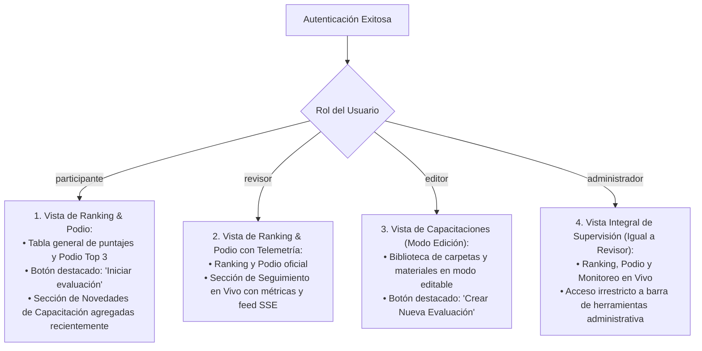

# Documento de Requisitos de Producto (PRD v2)
## Plataforma Interactiva de Capacitación, Simulación Móvil y Evaluación UYAPAY B2C

* **Versión del Documento:** 2.0 (Especificación Detallada de Flujos y Vistas)
* **Fecha:** Septiembre 2026
* **Estado:** En Definición Activa

---

## 1. Modelo de Usuarios y Matriz de los 4 Roles Oficiales

La plataforma opera bajo **4 roles especializados**, delimitando accesos, pantallas de inicio y permisos:

| Rol | Denominación | Propósito y Alcance Funcional | Pantalla de Inicio (Landing al Login) |
|---|---|---|---|
| **`participante`** | Asesor Comercial | Fuerza de ventas en ruta. Visualiza materiales de capacitación, rinde evaluaciones en simulador y cuestionarios, y verifica sus puntajes, medallas (insignias) y progreso general. | **Ranking & Podio** (con botón directo "Iniciar evaluación" y novedades de capacitación). |
| **`revisor`** | Supervisor / Auditor | Observa la interacción de los asesores con la app en vivo o en diferido. Monitorea evaluaciones en progreso, consulta evaluaciones programadas, revisa el ranking y analiza el estado y telemetría de cada usuario. | **Ranking & Podio con Seguimiento en Vivo** (telemetría en tiempo real y feed de errores). |
| **`editor`** | Creador de Contenidos | Crea y edita contenidos del Aula Virtual (videos, documentos, reglas). Diseña evaluaciones rápidas y cuestionarios tipo Kahoot, configura la frecuencia de las pruebas y define las preguntas y alternativas. | **Capacitaciones en Modo Edición** (con botón destacado para crear nueva evaluación). |
| **`administrador`** | Administrador del Sistema | Posee permisos absolutos para gestionar usuarios, roles, configuraciones generales, base de datos, contenidos, evaluaciones y publicación de podio. | **Ranking & Podio con Seguimiento en Vivo** (con acceso irrestricto a todas las suites administrativas). |

---

## 2. Índice General de Flujos del Sistema

1. **Flujo 1:** Acceso, Autenticación y Enrutamiento por Rol.
2. **Flujo 2:** Dashboard del Participante (Ranking, Podio y Novedades de Capacitación).
3. **Flujo 3:** Aula Virtual de Capacitación (Navegación por carpetas, videos y reglas de negocio).
4. **Flujo 4:** Quizzes Rápidos de Refuerzo en Capacitación (Ligados a Contenidos del Aula Virtual).
5. **Flujo 5:** Onboarding Asistido Paso a Paso (Recorrido interactivo de 7 hitos en simulador según `User_Manual.pdf`).
6. **Flujo 6:** Evaluación Mensual Práctica en Simulador Móvil (Batería balanceada de $X$ casos en pestañas con cronómetro).
7. **Flujo 7:** Ranking General, Podio Olímpico y Auditoría Forense de Resultados.
8. **Flujo 8:** Mi Perfil Comercial (Drawer lateral, bolsa de XP, historial y vitrina de insignias).
9. **Flujo 9:** Consola de Supervisión en Vivo, Telemetría SSE y Control de Podio (Revisor / Administrador).
10. **Flujo 10:** Administración de Usuarios, Nómina y Credenciales (Administrador).
11. **Flujo 11:** Gestión de Aula Virtual, Recursos Multimedia y Creador de Quizzes (Editor / Administrador).
12. **Flujo 12:** Creador de Cuestionarios, Programación de Evaluaciones y Disparador de Señal (Editor / Revisor / Administrador).


> [!IMPORTANT]
> **Diferenciación Conceptual Clave del Sistema: Quizzes vs. Cuestionarios**
> * **Quizzes (Aula Virtual / Capacitación):** Son evaluaciones cortas y ágiles de refuerzo pedagógico inmediato (de 2 a 3 preguntas de opción múltiple, 2 a 4 alternativas, con marcado de respuesta correcta, explicación pedagógica y tiempo por pregunta). Cada quiz está **estrictamente ligado a un contenido** formativo específico (video, PDF o artículo) y se crea y administra directamente dentro de dicho recurso en el Aula Virtual (**Flujo 4** y **Flujo 11**).
> * **Cuestionarios (Módulo de Evaluación):** Son exámenes teóricos independientes sobre reglas de negocio o conocimientos normativos que se administran, configuran y programan desde el menú de **Evaluación** (**Flujo 6** y **Flujo 12**). Cuentan con calendario de vigencia, intentos máximos permitidos y ponderación evaluativa formal independiente del simulador.

---

## 3. Especificación Detallada de Flujos

### Flujo 1: Acceso, Autenticación y Enrutamiento por Rol

#### 1. Objetivo y Actores
Permitir a los usuarios identificarse de forma segura en la plataforma mediante sus credenciales institucionales, validar su estado operativo y redirigirlos automáticamente a su espacio de trabajo correspondiente según uno de los 4 roles asignados.
* **Actores:** Participante, Revisor, Editor, Administrador.

---

#### 2. Pantalla de Login (Interfaz y Componentes)
* **Encabezado y Bienvenida:** Título prominente `"Bienvenido"` con subtítulo contextual de la plataforma UYAPAY B2C.
* **Campos de Entrada:**
  1. **Campo Usuario:** Input de texto para nombre de usuario (`username`), con placeholder `"Ingresa tu usuario"`.
  2. **Campo Contraseña:** Input de tipo password con botón de visibilidad integrado (icono de ojo 👁️) para conmutar entre texto oculto y visible.
* **Acciones Auxiliares:**
  * Enlace visible: `"¿Olvidaste tu contraseña?"` / `"Recuperar contraseña"`. Al pulsarlo, despliega un modal con la instrucción formal: *"Para recuperar o restablecer tu contraseña, comunícate con el área de TI o con el Administrador de la plataforma."*
* **Botón Principal:** Botón de ancho completo `"Iniciar Sesión"`. Soporta activación por clic o al presionar la tecla `Enter` desde cualquiera de los campos.

---

#### 3. Validaciones, Estados y Manejo de Errores Visuales
* **Validación de Campos Vacíos:** Si el usuario presiona "Iniciar Sesión" sin completar los datos, se resalta en rojo el campo faltante con el texto *"Por favor, completa este campo"*.
* **Credenciales Incorrectas (Usuario o contraseña no válidos):**
  * Mensaje de error en banner rojo visible sobre el formulario:
    > *"El usuario o la contraseña no son correctos"*
  * Se limpian los campos y se enfoca nuevamente el input de usuario.
* **Usuario Inactivo / Desactivado Administrativamente:**
  * Si las credenciales coinciden pero el usuario se encuentra marcado con `status = 'inactive'`, se bloquea el acceso y se muestra el mensaje específico:
    > *"Este usuario no está activo en este momento, comuníquese con el área de TI"*

---

#### 4. Enrutamiento Post-Login por Rol
Una vez autenticado exitosamente contra la base de datos (con verificación de hash PBKDF2), el sistema identifica el rol y ejecuta la redirección inmediata:



1. **Si es `participante`:**
   * Aterriza en la **Pantalla de Ranking y Podio**.
   * Elementos visibles:
     * Podio de honor con los 3 mejores puntajes y tabla general de posiciones.
     * Botón prominente de acción directa: **`"Iniciar evaluación"`** (habilitado cuando exista una evaluación programada o convocada).
     * Sección lateral o inferior: **`"Novedades de Capacitación"`** con los videos, guías o reglas de negocio subidos o actualizados recientemente.
2. **Si es `revisor`:**
   * Aterriza en la **Pantalla de Ranking y Podio con Seguimiento en Vivo**.
   * Elementos visibles:
     * Podio oficial y tabla general de notas de la fuerza de ventas.
     * Consola integrada de **Seguimiento en Vivo / Telemetría** que muestra en tiempo real quién está evaluándose, el paso actual dentro del simulador móvil y los errores cometidos.
3. **Si es `editor`:**
   * Aterriza en la **Pantalla de Capacitaciones en Modo Edición**.
   * Elementos visibles:
     * Estructura del Aula Virtual (carpetas, videos, documentos y reglas) con controles para editar, reordenar y agregar material.
     * Botón destacado superior: **`"Crear Nueva Evaluación"`** (acceso directo al creador de cuestionarios y evaluaciones rápidas tipo Kahoot).
4. **Si es `administrador`:**
   * Aterriza en la **misma vista que el Revisor** (Ranking, Podio y Seguimiento en Vivo de telemetría).
   * Tiene habilitadas en la barra de navegación superior todas las secciones de administración: Gestión de Usuarios, Aula Virtual, Creador de Quizzes, Monitoreo y Configuración global.

---

#### 5. Ciclo de Vida de la Sesión y Persistencia (Lifecycle)
* **Persistencia por Pestaña de Navegador (`sessionStorage`):**
  * La sesión permanece abierta y activa mientras la pestaña del navegador permanezca abierta.
* **Comportamiento ante Recarga de Página (F5 / Refresh):**
  * La recarga del navegador **NO cierra la sesión**.
  * El sistema lee el token de sesión almacenado, revalida la vigencia contra `/api/auth/me` y restaura el estado y la vista exacta en la que se encontraba el usuario sin perder el progreso de la evaluación o formulario en curso.
* **Cierre de Sesión (Logout):**
  * Se activa mediante dos vías:
    1. Cierre físico de la pestaña del navegador.
    2. Clic voluntario en el botón `"Cerrar sesión"` ubicado en la esquina superior derecha del menú.
  * Ambas acciones destruyen las credenciales temporales en memoria y redirigen inmediatamente a la vista de Login.

---

### Arquitectura de Navegación Global: Las 3 Vistas Principales y Drawer de Perfil

En toda la plataforma rige la regla estructural de **3 vistas / menús principales**, compartidas transversalmente por todos los roles pero con funcionalidades adaptadas según privilegios:
1. **`Capacitación`:** Aula virtual con carpetas, videos, documentos de reglas y sección obligatoria de Onboarding.
2. **`Evaluación`:** Entorno de exámenes con simulador móvil o evaluaciones teóricas programadas.
3. **`Ranking` (o `Ranking y Podio`):** Tabla de posiciones general, podio de honor y autopsia forense de resultados.

#### Barra Superior de Navegación (Top Navbar):
* **Lado Izquierdo:** Logo institucional de UYAPAY B2C.
* **Centro:** Accesos directos a las 3 vistas principales (`Ranking`, `Capacitación`, `Evaluación`).
* **Lado Derecho:** Identificación del usuario activo con su avatar y nombre. Al hacer clic, despliega una **Barra Lateral (Drawer / Sidebar)** con:
  * **Foto de Perfil:** Visualización y opción para cargar o actualizar la fotografía del usuario.
  * **Vitrina de Medallas (Insignias):** Catálogo de insignias obtenidas con icono y fecha de logro.
  * **Puntaje Total Acumulado:** Bolsa global de puntos XP consolidados en la plataforma.
  * **Cierre de Sesión:** Botón para terminar la sesión y retornar al login.

---

### Flujo 2: Dashboard del Participante (Ranking, Podio, Historial y Novedades de Capacitación)

#### 1. Objetivo y Actores
Brindar al asesor comercial un espacio principal motivador y de alta visibilidad donde pueda consultar el podio de honor, auditar el desglose de sus evaluaciones pasadas, acceder de inmediato a pruebas pendientes y descubrir novedades formativas recién publicadas.
* **Actor Principal:** Participante (`participante`).

---

#### 2. Componentes de la Pantalla Principal

```
┌────────────────────────────────────────────────────────────────────────────────────────┐
│                              BARRA DE NAVEGACIÓN SUPERIOR                              │
│ [LOGO UYAPAY]            [ RANKING ]   [ CAPACITACIÓN ]   [ EVALUACIÓN ]       [👤 ALVARO]│
├────────────────────────────────────────────────────────────────────────────────────────┤
│                                                                                        │
│                                  🏆 PODIO TOP 3                                        │
│                 ┌────────────────┐  ┌────────────────┐  ┌────────────────┐             │
│                 │   🥉 3° LUGAR   │  │   🥇 1° LUGAR   │  │   🥈 2° LUGAR   │             │
│                 │ Percy Diaz     │  │ Alvaro R.      │  │ Luis Ruiz      │             │
│                 │ Nota: 18 / 20  │  │ Nota: 20 / 20  │  │ Nota: 19 / 20  │             │
│                 │ ⏱️ 03:45 | 1 err│  │ ⏱️ 02:40 | 0 err│  │ ⏱️ 03:10 | 1 err│             │
│                 └────────────────┘  └────────────────┘  └────────────────┘             │
│                 (Izquierda - Bajo)  (Centro - Elevado)  (Derecha - Medio)              │
│                                                                                        │
│ ┌────────────────────────────────────────────────────────────────────────────────────┐ │
│ │ 🚀 [ BOTÓN DIRECTO: INICIAR EVALUACIÓN PROGRAMADA ]                                │ │
│ └────────────────────────────────────────────────────────────────────────────────────┘ │
│                                                                                        │
│ ┌─────────────────────────────────────────────────────┐ ┌────────────────────────────┐ │
│ │ TABLA DE POSICIONES (RANKING GENERAL)               │ │ AGREGADOS RECIENTEMENTE    │ │
│ ├────┬──────────────────┬──────────────┬──────────────┤ ├────────────────────────────┤ │
│ │ #  │ Asesor           │ Puntaje Total│ Última Eval. │ │ 📁 Políticas B2B Shell     │ │
│ ├────┼──────────────────┼──────────────┼──────────────┤ │ 📅 Agregado: 22 Sep        │ │
│ │ 1  │ Alvaro Rodriguez │ 20 pts ➔ [🔍]│ 20/09 14:30  │ │ ⏱️ 4 min de revisión      │ │
│ │ 2  │ Luis Ruiz        │ 19 pts ➔ [🔍]│ 20/09 15:10  │ ├────────────────────────────┤ │
│ │ 3  │ Percy Diaz       │ 18 pts ➔ [🔍]│ 21/09 09:20  │ │ 🎥 Retenciones SUNAT 3%    │ │
│ └────┴──────────────────┴──────────────┴──────────────┘ └────────────────────────────┘ │
└────────────────────────────────────────────────────────────────────────────────────────┘
```

---

#### 3. Especificación del Podio Top 3 (Diseño en Cards)
* **Composición y Alturas Diferenciadas:**
  * **🥇 1° Lugar (Centro):** Card principal más elevada, destacada con borde dorado y corona/medalla de oro.
  * **🥈 2° Lugar (Derecha):** Card ubicada a la derecha, con altura intermedia y distintivo plateado.
  * **🥉 3° Lugar (Izquierda):** Card ubicada a la izquierda, con menor elevación visual y distintivo de bronce.
* **Información Mostrada en Cada Tarjeta del Podio:**
  1. Nombre y apellido del asesor.
  2. Calificación obtenida (ej. `20 / 20`).
  3. Fecha y hora exacta de la evaluación.
  4. Cantidad total de errores cometidos (criterio clave de calidad).
  5. Tiempo total de resolución registrado por el cronómetro.
* **Criterio de Espacio:** El podio está optimizado para ser visualmente llamativo sin acaparar excesivo espacio vertical, permitiendo ver la tabla de posiciones inmediatamente debajo.

---

#### 4. Tabla de Posiciones y Acción al Clic en Puntaje

* **Columnas de la Tabla:**
  1. **`#` (Posición):** Puesto numérico calculado dinámicamente por la fórmula trifactorial oficial.
  2. **`Asesor`:** Nombre completo del participante, con la fila del usuario actual resaltada con color de fondo distintivo.
  3. **`Puntaje Acumulado`:** Total de puntos obtenidos, formateado como elemento interactivo/clicable.
  4. **`Última Evaluación`:** Fecha y hora en que rindió su última prueba.

* **Modal Nivel 1 — Desglose Histórico de Evaluaciones (Clic en Puntaje):**
  Al hacer clic sobre el puntaje de cualquier asesor, se abre un modal con el histórico completo de sus evaluaciones:
  * **Nivel de la Prueba:** Básico, Intermedio o Avanzado.
  * **Tipo de Evaluación:**
    * *Examen con Simulador Móvil* (batería de casos prácticos).
    * *Cuestionario Rápido* (evaluaciones teóricas programadas).
    * *Quiz de Capacitación* (quizzes asociados a cápsulas de video).
  * **Puntaje Obtenido:** Calificación en escala vigesimal (0 a 20).
  * **Número de Preguntas o Casos:** Cantidad de ítems evaluados.
  * **Tiempo Empleado:** Duración total en formato `mm:ss`.
  * **Errores Registrados:** Número de faltas operativas o respuestas fallidas.
  * **Estado:** Etiqueta visual verde `"Aprobado"` ($\ge 11$) o roja `"Desaprobado"` ($< 11$).
  * **Fecha y Hora de Realización.**

* **Modal Nivel 2 — Detalle Granular Ítem por Ítem:**
  Dentro del modal anterior, cada evaluación cuenta con un botón **`"Ver Detalle Completo"`**:
  * **Si es Cuestionario / Quiz:** Despliega pregunta por pregunta, indicando el texto de la pregunta, la alternativa o texto ingresado por el asesor, si fue correcta o incorrecta, y la explicación oficial.
  * **Si es Examen con Simulador:** Despliega caso por caso, el estado de resolución, los pasos completados, el tiempo empleado en ese caso y las faltas operativas cometidas en el smartphone virtual.

---

#### 5. Botón Directo `"Iniciar evaluación"`
* **Ubicación:** Banner prominente situado entre el Podio y la Tabla de Posiciones.
* **Comportamiento:**
  * **Cuando existe una evaluación programada activa:** El botón se muestra habilitado, con estilo llamativo y texto `"Iniciar Evaluación Programada ➔"`. Al hacer clic, redirige directamente a la arena de evaluación correspondiente.
  * **Cuando no hay evaluaciones activas:** El botón se presenta en estado informativo atenuado, indicando: *"Sin evaluaciones pendientes en este momento"*.

---

#### 6. Sección "Agregados Recientemente" (Novedades de Capacitación)
* **Ubicación:** Bloque destacado ubicado al costado o debajo de la tabla de posiciones.
* **Formato de Tarjetas (Cards):** Presenta los últimos módulos, videos o fichas de reglas incorporados al Aula Virtual. Cada tarjeta contiene:
  * **Nombre del Módulo o Tema:** Título del contenido nuevo (ej. *"Políticas de Descuento por Volumen Shell"*).
  * **Fecha de Agregación:** Cuándo fue publicado por el editor.
  * **Tiempo Estimado:** Duración del video o tiempo aproximado de lectura (ej. `⏱️ 3 min`).
* **Interacción:** Al hacer clic en cualquier tarjeta, el sistema navega de inmediato a la vista de **`Capacitación`**, abriendo directamente la carpeta o módulo correspondiente para que el asesor comience a consumir el material sin fricción.

---

#### 7. Drawer Lateral de Perfil de Usuario
Al hacer clic sobre el avatar/nombre del usuario en la barra superior derecha, se despliega una barra lateral flotante con animación suave:
* **Foto de Perfil:** Fotografía circular del asesor con botón de edición rápida (icono de cámara 📷) para subir una nueva imagen.
* **Vitrina de Medallas Obtenidas:** Listado gráfico de las insignias ganadas (ej. *Calificación Perfecta*, *Pionero UYAPAY*, *Maestro Teórico*) con descripción de la hazaña y fecha en que se desbloqueó.
* **Puntaje Total Acumulado (XP):** Contador numérico destacado con los puntos acumulados por todas las evaluaciones y quizes rendidos.
* **Cerrar Sesión:** Botón inferior destacado que destruye la sesión y redirige a la vista de login.

---

### Flujo 3: Aula Virtual de Capacitación (Navegación por Carpetas, Visores Multimedia y Módulo Especial de Onboarding)

#### 1. Objetivo y Actores
Proporcionar al asesor comercial un entorno formativo tipo Aula Virtual donde pueda explorar contenidos estructurados (videos, documentos PDF, artículos de reglas e infografías), validar su progreso de estudio y certificar su comprensión mediante cuestionarios vinculados.
* **Actor Principal:** Participante (`participante`).

---

#### 2. Vista General de Capacitaciones (Modo Galería vs. Modo Lista)
Al hacer clic en el acceso principal **`Capacitación`** del menú superior, el usuario accede al catálogo de módulos formativos:
* **Selector de Visualización (Toggle):** En la esquina superior derecha, el usuario puede alternar libremente entre:
  * 🔲 **Modo Galería (Cuadrícula de Tarjetas - Predeterminado):** Diseño visual en tarjetas interactivas tipo cards.
  * ☰ **Modo Lista:** Vista compacta en filas horizontales ideal para escaneo rápido.
* **Información Presentada en Cada Tarjeta / Fila de Módulo:**
  1. **Título del Módulo:** Nombre temático (ej. *"Políticas Comerciales y Promociones"*, *"Cobranzas y Liquidación de Ruta"*).
  2. **Contador de Recursos:** Número exacto de contenidos disponibles (ej. `📚 4 contenidos: 2 videos, 1 PDF, 1 regla`).
  3. **Tiempo Estimado de Desarrollo:** Duración acumulada de los contenidos del módulo (ej. `⏱️ 18 min de desarrollo`).
  4. **Barra de Avance Porcentual:** Indicador visual de progreso del asesor (`0%` a `100%`) que refleja los recursos ya revisados y evaluados.

---

#### 3. Navegación Jerárquica al Ingresar a un Módulo
Al hacer clic sobre una tarjeta de módulo:
* **Barra Lateral de Navegación de Temas (Sidebar Izquierdo o Derecho):**
  * Se despliega un panel lateral persistente que lista todos los módulos y temas de la plataforma (*Capacitación de uso de la app*, *Políticas comerciales*, *Reglas de negocio*, *Cobranzas*).
  * Permite al asesor alternar rápidamente entre diferentes módulos sin necesidad de regresar a la pantalla anterior.
* **Organización Interna Jerárquica (Carpetas y Subcarpetas):**
  * La estructura interna depende de cómo el Editor organizó la información.
  * Si un módulo contiene **subcarpetas**, estas se muestran como tarjetas internas secundarias que el usuario puede abrir.
  * Al llegar al nivel final, se despliegan los **recursos de aprendizaje individuales** en tarjetas con icono indicativo de su tipo (Video 🎥, PDF 📄, Texto de Regla 📝, Imagen 🖼️).

---

#### 4. Especificación de los Visores de Contenido

```
┌────────────────────────────────────────────────────────────────────────────────────────┐
│                              REPRODUCTOR / VISOR DE CONTENIDO                          │
├──────────────────────────┬─────────────────────────────────────────────────────────────┤
│ MENÚ DE MÓDULOS          │ [MÓDULO: REGLAS DE NEGOCIO > COBRANZAS]                     │
│ (SIDEBAR LATERAL)        │                                                             │
│                          │ ┌─────────────────────────────────────────────────────────┐ │
│ 📁 1. Uso de la App      │ │                                                         │ │
│ 📁 2. Políticas B2B      │ │        REPRODUCTOR DE VIDEO / VISOR PDF INTEGRADO       │ │
│ ▶ 📁 3. Cobranzas y Ruta │ │        (Velocidad: 0.75x a 2x, Zoom PDF, Progreso)      │ │
│    • Retención SUNAT 3%  │ │                                                         │ │
│    • Cobranza Mixta      │ └─────────────────────────────────────────────────────────┘ │
│ 📁 4. Onboarding (🔒)    │ Título: Procedimiento de Retención SUNAT en Ruta            │
│                          │ Descripción: Normativa legal para cobros superiores a S/ 700│
│                          │                                                             │
│                          │ ┌─────────────────────────────────────────────────────────┐ │
│                          │ │ [ FINALIZAR MÓDULO Y RENDIR CUESTIONARIO RÁPIDO ➔ ]     │ │
│                          │ └─────────────────────────────────────────────────────────┘ │
│                          │ (Habilitado solo al terminar video o leer completo)         │
└──────────────────────────┴─────────────────────────────────────────────────────────────┘
```

1. **Visor de Video (Reproductor Nativo):**
   * **Controles Operativos:** Botón Play / Pausa, saltar 10 segundos hacia adelante o atrás, barra interactiva de progreso temporal, control de volumen con silenciador (Mute) y botón de Pantalla Completa.
   * **Selector de Velocidad de Reproducción:** Menú desplegable para elegir `0.75x`, `1.0x (Normal)`, `1.25x`, `1.5x` o `2.0x`.
   * **Panel Informativo:** Título del video, duración exacta y descripción explicativa redactada por el editor.
2. **Visor de Documentos PDF:**
   * Lector de PDF embebido y limpio (sin complementos externos molestos):
   * Controles: Paginación anterior/siguiente, contador de páginas (`Pág. 1 de 5`), zoom in / zoom out (`+` / `-`), ajuste a ancho de pantalla y visualización fluida de tablas y gráficos.
3. **Visor de Texto Simple (Reglas Comerciales y Artículos):**
   * Formato de lectura tipo artículo o blog: diseño tipográfico legible, títulos, subtítulos, párrafos destacados, tablas de condiciones comerciales y recuadros de advertencia.
4. **Visor de Imágenes e Infografías:**
   * Muestra la infografía a tamaño real integrado.
   * Al hacer clic sobre la imagen, se abre un modal ampliado que permite realizar zoom para inspeccionar detalles pequeños (ej. diagramas de flujo de cobranza).

---

#### 5. Transición Obligatoria al Cuestionario de Refuerzo (Reglas de Bloqueo)

* **Condición de Habilitación del Botón:**
  * El botón principal **`"Finalizar Módulo"`** (o *"Continuar al Cuestionario"*) permanece **oculto o bloqueado** hasta que el usuario cumpla la condición estricta de consumo:
    * En un Video: Debe reproducirse **hasta el final** (evento `ended` o progreso $\ge 98\%$).
    * En un Documento PDF o Texto: El usuario debe hacer scroll **hasta el final de la lectura**.
* **Activación del Cuestionario Rápido:**
  * Al cumplirse la condición, el botón se enciende en color verde destacado con el texto: **`"Finalizar Módulo y Rendir Cuestionario ➔"`**.
* **Reglas Estrictas de Bloqueo durante el Quiz:**
  1. **Prohibido el Retorno al Material:** Una vez que el asesor hace clic en el botón e ingresa al cuestionario, el sistema **no permite regresar al video o documento** de estudio (evita consultar respuestas mientras se rinde la prueba).
  2. **Bloqueo de Cambio de Módulo:** Mientras el cuestionario esté en curso, la navegación lateral queda congelada; el asesor **solo puede cambiar de módulo o salir si responde el cuestionario de forma completa**.
  3. **Navegación Libre Previa:** Antes de hacer clic en iniciar el quiz, el usuario goza de libertad total para salir de la carpeta, explorar otros módulos y consultar cualquier material sin restricciones.

---

#### 6. Módulo Especial: Onboarding Obligatorio y Bloqueo de Nuevos Usuarios

* **Identificación Visual:**
  * Dentro del catálogo general de Capacitación existe una tarjeta / carpeta especial con título: **`"Onboarding: Inducción a la Aplicación UYAPAY B2C"`**.
  * Se presenta con el mismo estilo de card que los demás módulos, pero con un borde distintivo y una insignia visual que indica: **`Obligatorio - Nuevos Ingresos`**.
* **Regla de Bloqueo de Acceso para Nuevos Usuarios:**
  * Para cualquier asesor comercial que recién ingrese al sistema, **todos los demás módulos de capacitación aparecen bloqueados** con un icono de candado 🔒 y una etiqueta: *"Completa la Inducción de Onboarding para desbloquear el resto de capacitaciones"*.
  * Es requisito contractual completarlo y aprobarlo **exactamente una vez**.
* **Acceso al Recorrido Guiado:**
  * Al hacer clic en la tarjeta de Onboarding, el sistema no abre un video común, sino que transiciona directamente al entorno interactivo de **Onboarding Asistido con el Simulador Móvil** (especificado a detalle en el Flujo 5).
  * Una vez que el asesor supera con éxito el caso integral de evaluación final de inducción ($\ge 14/20$), todos los módulos de capacitación se desbloquean permanentemente.

---

### Flujo 4: Quizzes Rápidos de Refuerzo en Capacitación (Ligados a Contenidos)

#### 1. Objetivo y Actores
Evaluar de forma ágil e inmediata la comprensión de los conceptos clave abordados en cada cápsula de video o documento de reglas de negocio, premiando la excelencia con puntos de gamificación (XP) e impidiendo el avance con respuestas aprendidas de memoria mediante protección anti-spoilers.
* **Actor Principal:** Participante (`participante`).

---

#### 2. Entorno y Diseño de Pantalla
* **Disparador:** Se activa al hacer clic en el botón *"Finalizar Módulo y Rendir Cuestionario ➔"* tras culminar el consumo de un recurso formativo.
* **Modo de Presentación:** El cuestionario se abre como una vista enfocada de evaluación a pantalla completa que cubre los recursos de capacitación (sin distracciones externas).
* **Cabecera de Evaluación:**
  * Título del cuestionario y módulo asociado.
  * **Temporizador Global Visible:** Cronómetro regresivo prominente fijado en un tiempo máximo de **10 minutos** (`⏱️ 10:00` $
ightarrow$ `00:00`).
  * **Barra de Navegación de Preguntas:** Selector numérico interactivo (ej. `[ 1 ]` `[ 2 ]` `[ 3 ]`) que indica qué preguntas han sido respondidas y cuál está activa.

---

#### 3. Estructura y Navegación de Preguntas
* **Cantidad de Preguntas:** Los quizes constan de **2 a 3 preguntas** cortas de opción múltiple.
* **Tipo Exclusivo:** Son **únicamente preguntas de opción múltiple** (cada una con 2 a 4 alternativas claras).
* **Navegación Libre entre Preguntas:**
  * El asesor puede navegar hacia adelante o hacia atrás entre las 2 o 3 preguntas antes de enviar la prueba (mediante botones *"Anterior"*, *"Siguiente"* o haciendo clic en el selector numérico).
  * La navegación entre preguntas no detiene el cronómetro; el tiempo de 10 minutos corre de manera continua desde el primer segundo.

---

#### 4. Regla de Agotamiento de Tiempo (Time-Out de 10 Minutos)
* Si el cronómetro llega a `00:00` antes de que el asesor presione "Finalizar y Calificar":
  1. El sistema cierra automáticamente el intento y asigna una **calificación automática de 00 / 20 puntos**.
  2. Se muestra un banner de alerta:
     > *"El tiempo de 10 minutos ha finalizado. Tu calificación es 00 / 20. Para volver a rendir este cuestionario, debes repetir el recurso de capacitación."*
  3. El asesor queda obligado a regresar al video o documento para revisarlo nuevamente antes de que el sistema le habilite un nuevo intento.

---

#### 5. Momento de Calificación, Ponderación y Escala Vigesimal
* **Evaluación al Cierre:** El cuestionario **no muestra aciertos ni errores parciales mientras se responde**. La calificación se calcula en un solo acto al pulsar el botón principal: **`"Finalizar y Calificar Cuestionario"`**.
* **Distribución Equitativa de Puntaje:** El puntaje se distribuye en porcentajes estrictamente iguales por cada pregunta:
  * **Cuestionarios de 3 Preguntas (33.33% por pregunta):**
    * 3 respuestas correctas (100%): **20 / 20** $
ightarrow$ Aprobado con Nota Perfecta.
    * 2 respuestas correctas (66.67%): **13 / 20** $
ightarrow$ Aprobado.
    * 1 respuesta correcta (33.33%): **07 / 20** $
ightarrow$ Desaprobado.
    * 0 respuestas correctas (0.00%): **00 / 20** $
ightarrow$ Desaprobado.
  * **Cuestionarios de 4 Preguntas (25.00% por pregunta):**
    * 4 respuestas correctas (100%): **20 / 20** $
ightarrow$ Aprobado con Nota Perfecta.
    * 3 respuestas correctas (75.00%): **15 / 20** $
ightarrow$ Aprobado.
    * 2 respuestas correctas (50.00%): **10 / 20** $
ightarrow$ Desaprobado.
    * $\le 1$ respuesta correcta ($\le 25\%$): $\le$ **05 / 20** $
ightarrow$ Desaprobado.
* **Nota Mínima Aprobatoria:** **60% de rendimiento**, equivalente en escala vigesimal a una nota $\ge \mathbf{12 / 20}$.

---

#### 6. Pantalla Final de Resultados y Protección Estricta Anti-Spoilers

```
┌────────────────────────────────────────────────────────────────────────────────────────┐
│                              RESULTADO DEL CUESTIONARIO                                │
├────────────────────────────────────────────────────────────────────────────────────────┤
│                                                                                        │
│                                  🎯 CALIFICACIÓN: 20 / 20                              │
│                                      ¡APROBADO CON ÉXITO!                              │
│                         ⏱️ Tiempo Empleado: 02:45 | Aciertos: 3 de 3                   │
│                         🌟 Puntos XP Obtenidos: +20 puntos                             │
│                                                                                        │
│ ┌──────────────────────────────────────┐  ┌──────────────────────────────────────────┐ │
│ │ 👁️ [ REVELAR RESPUESTAS Y DETALLE ]  │  │ 🔄 [ INTENTAR NUEVAMENTE ]               │ │
│ └──────────────────────────────────────┘  └──────────────────────────────────────────┘ │
│                                                                                        │
└────────────────────────────────────────────────────────────────────────────────────────┘
```

El flujo posterior se bifurca de manera estricta según el resultado obtenido:

##### A. Si el Asesor APRUEBA (Nota $\ge$ 60% / $\ge$ 12 pts):
Se le presentan en pantalla dos alternativas claras:
1. **Opción 1: `"Revelar Respuestas"`:**
   * Al pulsar este botón, se desbloquea la autopsia del quiz: muestra el tiempo de resolución empleado, marca en verde las alternativas correctas y en rojo las incorrectas, y expone la explicación pedagógica oficial de cada pregunta.
   * Se consolida formalmente la nota en la base de datos y se registra el tiempo empleado.
   * El recurso en la carpeta del Aula Virtual se marca con un **check verde de completado (✅)** y suma al porcentaje de avance del módulo.
2. **Opción 2: `"Intentar Nuevamente"`:**
   * Pensado para el asesor que aprobó con nota intermedia (ej. 13/20 o 15/20) y desea buscar la **calificación perfecta (20/20)** para maximizar sus puntos XP, **antes de que el sistema le revele las respuestas**.
* **Asignación de Puntos al Puntaje Total (XP):**
  * **Con Nota Perfecta (20 / 20):** Se abonan **+20 puntos XP** íntegros a su bolsa global.
  * **Con Nota Aprobatoria Menor (ej. 13 o 15):** Se abona exactamente el puntaje obtenido (ej. +13 o +15 XP), descontando los puntos que no logró conseguir frente a la nota máxima.

##### B. Si el Asesor DESAPRUEBA (Nota $<$ 60% / $<$ 12 pts):
* **Protección Estricta Anti-Spoilers:** El sistema **bloquea completamente la opción de ver las respuestas correctas**. No se revela qué contestó bien ni en qué falló, impidiendo que memorice las opciones por descarte.
* **Mensaje Visual en Banner:**
  > *"Has obtenido [Nota] / 20. La nota mínima para aprobar es 12 / 20 (60%). No es posible visualizar las respuestas correctas. Para volver a rendir este cuestionario, debes repetir la capacitación."*
* **Acción Única Disponible:**
  * El único botón habilitado es: **`"Repetir Capacitación ➔"`**, el cual lo redirige de vuelta al video o documento inicial para que vuelva a estudiarlo completo antes de desbloquear un nuevo intento.

---

#### 7. Seguridad de Sesión y Control de Trampas (Anti-Tampering)
* El temporizador de 10 minutos se sincroniza con la marca temporal de inicio en la base de datos (`started_at`).
* Si el asesor recarga la página (F5) o intenta salir para ganar tiempo, **el cronómetro no se reinicia a 10 minutos**; continúa descontando desde el tiempo restante real.

---

### Flujo 5: Onboarding Asistido Paso a Paso en Simulador Móvil (Los 7 Hitos Oficiales)

#### 1. Objetivo y Actores
Guiar interactivamente a los nuevos asesores comerciales a través de toda la operativa real de la aplicación móvil de ventas UYAPAY B2C, utilizando el simulador web desde la pantalla de login con etiquetas explicativas paso a paso, garantizando que conozcan cada botón, flujo y contingencia antes de interactuar con clientes reales en ruta.
* **Actor Principal:** Participante (`participante`).

---

#### 2. Entorno y Mecánica de Interacción Asistida
* **Disparador:** Se activa al hacer clic en la tarjeta del módulo especial *"Onboarding"* dentro de Capacitaciones.
* **Presentación Visual:**
  * Se abre el marco del smartphone virtual cargando la aplicación desde la **pantalla de Inicio de Sesión móvil**.
* **Etiquetas y Recuadros Guiados (Paso a Paso):**
  * Las instrucciones aparecen como **etiquetas flotantes destacadas (tooltips/overlays)** superpuestas sobre el celular, señalando exactamente en qué elemento hacer clic y explicando qué abarca dicha acción.
  * Cada recuadro explicativo cuenta con un botón **`"OK"`**:
    * Al pulsar `"OK"`, el sistema valida la comprensión, avanza al siguiente paso y resalta el nuevo componente correspondiente.
* **Persistencia Automática de Avance:**
  * Si el asesor no puede culminar los 7 hitos en una sola sesión, el sistema **guarda automáticamente en base de datos en qué paso exacto se quedó** (`onboarding_progress`), permitiéndole reanudar su inducción en cualquier momento posterior sin reiniciar desde cero.
* **Consulta y Repetición Libre:**
  * El recorrido de Onboarding **no tiene evaluación final punitiva**.
  * Una vez completado por primera vez, se otorga la insignia oficial **Pionero UYAPAY** (`bdg-pioneer`) y se desbloquean de forma permanente todos los demás módulos de capacitación del Aula Virtual.
  * El asesor puede volver a entrar y repetir el Onboarding **las veces que lo desee** para refrescar sus conocimientos operativos.

---

#### 3. Especificación Exhaustiva de los 7 Hitos Operativos

```
┌────────────────────────────────────────────────────────────────────────────────────────┐
│                              RECORRIDO GUIADO DE ONBOARDING                            │
├────────────────────────────────────────────────────────────────────────────────────────┤
│                                                                                        │
│     [ PASO 1 ] ➔ [ PASO 2 ] ➔ [ PASO 3 ] ➔ [ PASO 4 ] ➔ [ PASO 5 ] ➔ [ PASO 6 ] ➔ [ PASO 7 ]
│      Login y      Interfaz      Menú Drawer   Proyección    Plan Visitas   Tareas de     Cierre y   │
│      Agencia     Principal     y Clientes     de Ventas    y Geocerca     la Visita    Seguimiento │
│                                                                                        │
│                                ┌─────────────────────────┐                             │
│                                │   MARCO DE SMARTPHONE   │                             │
│                                │ ┌─────────────────────┐ │                             │
│                                │ │ [ETIQUETA FLOTANTE] │ │                             │
│                                │ │ "Haz clic aquí para │ │                             │
│                                │ │  ver tus clientes"  │ │                             │
│                                │ │       [ OK ➔ ]      │ │                             │
│                                │ └─────────────────────┘ │                             │
│                                │                         │                             │
│                                │  Simulador Móvil Real   │                             │
│                                │   (appSellerV1 Flutter) │                             │
│                                └─────────────────────────┘                             │
└────────────────────────────────────────────────────────────────────────────────────────┘
```

##### Hito 1: Inicio de Sesión y Selección de Agencia (Manual pág. 1-2)
* **Ingreso:** El recuadro guiado indica cómo ingresar el usuario y la contraseña corporativa en el formulario móvil y presionar *"Iniciar Sesión"*.
* **Selección de Agencia (Opcional):**
  * La etiqueta explica que la selección de agencia es **opcional** y solo aplica si el asesor tiene más de una sede asignada (ej. *Arequipa*, *Cusco*).
  * El asistente guía al usuario para abrir el **menú secundario (botón sándwich ☰)** y localizar el selector de Agencia en la cabecera del drawer para conmutar de sede cuando sea necesario.

##### Hito 2: Reconocimiento de Interfaces Principales y Tipo de Cambio (Manual pág. 1)
* **Barra de Navegación Inferior:** La etiqueta resalta y explica los 3 accesos troncales:
  1. `Inicio`: Dashboard operativo con métricas diarias.
  2. `Visitas`: Plan de ruta del día y clientes asignados.
  3. `Pedidos`: Listado de pedidos y cotizaciones emitidas.
* **Tipo de Cambio Oficial:** Se señala el indicador superior del tipo de cambio del día (`TC: S/ 3.6500`), explicando que es la base para conversiones automáticas soles/dólares en pedidos y cobranzas.

##### Hito 3: Menú Secundario / Drawer Lateral Completo (Manual pág. 2-5, 23)
El asistente guía la apertura del drawer lateral y recorre sus 5 módulos clave:
1. **Mis Clientes:** Búsqueda por Razón Social o RUC, relación cliente padre vs. cliente hijo, teléfonos, direcciones registradas, deudas vencidas/por vencer y descarga del Estado de Cuenta oficial en PDF o imagen.
2. **Historial de Visitas:** Consulta de visitas realizadas en los últimos 6 meses, con filtros por mes, semana y estado (*Pendientes*, *No visitados*, *No compran*, *Con deuda*).
3. **Documentos Electrónicos:** Consulta y reenvío de facturas, letras de cambio, notas de crédito, notas de débito y recibos de cobro.
4. **Configuración de Permisos:** Explicación de los permisos obligatorios que exige la app (Cámara para fotos de exhibición/vouchers, Almacenamiento y GPS de alta precisión).
5. **Centro de Ayuda y Reporte de Errores:** Procedimiento para reportar incidencias técnicas y consultar soporte TI ante problemas de sincronización.

##### Hito 4: Proyección de Ventas por Familia de Productos (Manual pág. 9-10)
* **Acceso y Metas:** Se muestra cómo ingresar a la sección *"Avance de proyección de ventas"*.
* **Registro por Familias:** La etiqueta guía la selección de familias de producto (*Rimula Multigrado*, *Spirax*, *Shell Premium*, *Repuestos Hyundai*).
* **Ingreso de Valores:** Cómo ingresar cantidades numéricas por producto proyectado y pulsar *"Guardar"*.
* **Resumen:** Visualización del resumen consolidado de metas del día con opciones para editar o agregar nuevas proyecciones.

##### Hito 5: Plan de Visitas, Geocerca y Contingencias de Ruta (Manual pág. 6, 10-11)
El asistente guía la selección de un cliente en ruta y explica los 4 escenarios de llegada:
1. **Inicio Presencial con Geocerca (50 metros):**
   * Se enfatiza la regla estricta: si el dispositivo se encuentra dentro del radio de tolerancia de **50 metros** del local del cliente, la visita se inicia automáticamente como presencial.
2. **Cambio de Dirección de Visita:**
   * La etiqueta enseña cómo abrir el menú de opciones del cliente y seleccionar *"Cambiar dirección de visita"* si el cliente tiene múltiples locales o almacenes registrados (ej. entrega en almacén secundario).
3. **Reestablecer Ubicación Satelital:**
   * Si las coordenadas registradas en el sistema tienen error o el cliente cambió de local físico, se enseña a abrir *"Reestablecer Ubicación"*, tomar una fotografía real del establecimiento y pulsar *"Guardar"* para actualizar el punto GPS.
4. **Inicio como Visita Telefónica Justificada:**
   * Si no es posible la presencia física (ej. cliente fuera de rango o atención remota), se guía cómo activar *"Iniciar llamada telefónica"*, recordando el límite contractual de **máximo 5 llamadas telefónicas al día**.

##### Hito 6: Las Tareas de la Visita (Secuencia Operativa T1 a T5) (Manual pág. 12-21)
El asistente recorre el Task Carousel oficial con sus 5 tareas en ruta:
1. **Tarea 1 — Perfil del Cliente:** Lectura del scoring comercial y de cobranza (*A / 1*), RUC, condición autorizada y saldo pendiente.
2. **Tarea 2 — Exhibición de Marca (Fotos Obligatorias):** Uso del botón `+` para capturar la foto inicial (*antes*), foto final (*después*), y uso del menú `...` para comentarios o eliminar tomas erróneas antes de pulsar *"Guardar"*.
3. **Tarea 3 — Tracking de Precios de Competencia:** Selección de producto competidor (ej. Castrol), ingreso de precio numérico y consulta del resumen de productos trackeados.
4. **Tarea 4 — Toma de Pedidos y Cotizaciones:**
   * Selección de facturación a cliente padre o hijo.
   * Elección de condición: Contado (con 5% de descuento financiero) o Crédito (con plazo en días).
   * Asignación de Lista de Precios (*Lista OF* obligatoria para clientes nuevos, *Lista 1, 2, EC o 3*).
   * Búsqueda por SKU o nombre, ajuste de cantidades (+/-), activación de promociones (regalos) y descuentos aprovisionados.
   * Confirmación: dirección y fecha de entrega, toggle de *Venta Segura* y confirmación como **Orden de Compra definitiva** o **Cotización Tipo 3** (si falta la firma del decisor).
5. **Tarea 5 — Cobranzas y Liquidación:**
   * Selección de factura en la lista de deudas.
   * Registro según el método de pago:
     * *Efectivo:* Moneda, monto y foto del recibo provisional.
     * *Depósito:* Banco, fecha, número de operación y foto obligatoria del voucher bancario.
     * *Cheque:* A la vista o diferido, banco, número y fecha.
     * *Retención SUNAT:* Registro de serie, número y aplicación del 3% en comprobantes > S/ 700.
   * Generación obligatoria del **Consolidado de Cobranzas ("Generar documento")** para cerrar los recibos de la visita.

##### Hito 7: Cierre de Visita, Justificación de Tareas y Seguimiento del Pedido (Manual pág. 21-23)
* **Cierre Formal:** Pulsar *"Finalizar visita"* para registrar la duración exacta del contacto comercial ("¡Visita completada!").
* **Justificación de Tareas Omitidas:** Si alguna tarea no pudo realizarse (ej. cliente ocupado descargando o sin presupuesto para compras), se guía cómo seleccionar el motivo justificado formal para no incurrir en falta operativa.
* **Seguimiento del Pedido:**
  * Enseña a ingresar a la vista de `Pedidos` para verificar el estado de la orden (*Aprobado*, *Anulado*, *Enviado*).
  * Uso del menú contextual `...` para compartir la copia digital del pedido por WhatsApp/correo o consultar documentos asociados.
* **Culminación del Onboarding:** Al finalizar el Hito 7, se despliega un mensaje festivo con animación:
  > *"¡Felicitaciones! Has completado exitosamente la Inducción de Onboarding a UYAPAY B2C. Se ha desbloqueado tu insignia Pionero UYAPAY y tienes acceso libre a todas las capacitaciones del Aula Virtual."*

---

### Flujo 6: Vista de Evaluación (Examen Mensual con Simulador, Cuestionarios de Reglas y Calendario para Editor/Revisor)

#### 1. Objetivo y Actores
Centralizar la ejecución, programación y auditoría de las evaluaciones formales de la plataforma UYAPAY B2C en sus dos modalidades: el **Examen Práctico Mensual en Simulador Móvil** y los **Cuestionarios de Reglas de Negocio** (tipo Kahoot sin simulador).
* **Actores:** Participante (`participante`), Revisor (`revisor`), Editor (`editor`), Administrador (`administrador`).

---

#### 2. Experiencia del Participante: Examen Mensual con Simulador Móvil

##### A. Pantalla de Bienvenida e Instrucciones Previas
Al acceder al menú superior **`Evaluación`** (o pulsar *"Iniciar Evaluación Programada"* desde el Dashboard), el participante encuentra la carátula oficial con las instrucciones antes de arrancar:
1. **Presencia de Cronómetro Global:** Se advierte que el tiempo corre de manera ininterrumpida para toda la prueba.
2. **Tiempo Máximo del Examen:** Límite estricto de **30 minutos** (`⏱️ 30:00` $
ightarrow$ `00:00`).
3. **Cantidad de Casos:** Informa el número exacto de casos a resolver (batería de $X$ casos, por defecto 5).
4. **Reglas Estrictas de Calificación:**
   * Cometer errores o faltas operativas descuenta puntos.
   * **Caso Omitido o Saltado:** Si el asesor omite un caso y no lo resuelve, recibe **00 puntos** en dicho caso.
   * **Caso Resuelto:** Se otorga el puntaje proporcional de avance menos las deducciones por errores cometidos.
5. **Botón de Inicio:** Botón destacado **`"Comenzar Evaluación ➔"`**, el cual dispara simultáneamente el cronómetro de 30 minutos y abre la arena de evaluación.

---

##### B. La Arena de Evaluación (Navegador Superior Multi-Caso y Celular Desacoplado)

```
┌────────────────────────────────────────────────────────────────────────────────────────┐
│                              ARENA DE EVALUACIÓN MULTI-CASO                            │
├────────────────────────────────────────────────────────────────────────────────────────┤
│ [ ⏱️ TIEMPO RESTANTE: 24:15 ]                                                           │
│                                                                                        │
│ ┌────────────────────────────────────────────────────────────────────────────────────┐ │
│ │ NAVEGADOR DE CASOS: [ CASO 1: ✅ ] [ CASO 2: ACTIVO ] [ CASO 3 ] [ CASO 4 ] [ CASO 5 ]│ │
│ └────────────────────────────────────────────────────────────────────────────────────┘ │
│                                                                                        │
│ ┌──────────────────────────────────────────────┐ ┌───────────────────────────────────┐ │
│ │ PANEL DE SITUACIÓN COMERCIAL                 │ │ MARCO DE SMARTPHONE VIRTUAL       │ │
│ ├──────────────────────────────────────────────┤ │ (appSellerV1 Flutter Desacoplada) │ │
│ │ Caso 2: Cotización Crédito Michelin          │ │                                   │ │
│ │ Cliente: Distribuidora Kanchis EIRL          │ │ ┌───────────────────────────────┐ │ │
│ │ Dirección: AV. INDUSTRIAL 104                │ │ │ UYAPAY B2C                    │ │ │
│ │                                              │ │ │                               │ │ │
│ │ Situación: Emite una cotización a crédito 30 │ │ │ Cliente: KANCHIS EIRL         │ │ │
│ │ días para 2 cajas de Michelin Energy XM2+,   │ │ │ Plan de Visitas en Ruta       │ │ │
│ │ aplicando el beneficio por volumen acordado. │ │ │                               │ │ │
│ │                                              │ │ └───────────────────────────────┘ │ │
│ │ (Información aislada: cliente y contexto     │ │ (Cambio en caliente: como si      │ │
│ │  100% nuevo. Sin arrastre de datos previos)  │ │  fuera un celular físico nuevo)   │ │
│ └──────────────────────────────────────────────┘ └───────────────────────────────────┘ │
│                                                                                        │
│ ┌────────────────────────────────────────────────────────────────────────────────────┐ │
│ │ [ FINALIZAR EVALUACIÓN Y ENVIAR RESPUESTAS ➔ ]                                     │ │
│ └────────────────────────────────────────────────────────────────────────────────────┘ │
└────────────────────────────────────────────────────────────────────────────────────────┘
```

* **Navegador Superior de Pestañas:**
  * Barra de navegación horizontal (`[ Caso 1 ]` `[ Caso 2 ]` ... `[ Caso X ]`) que permite alternar entre los casos pendientes.
* **Regla Estricta de No Retorno:**
  * **Una vez resuelto y completado un caso, se pinta de color verde (✅) y ya no se puede regresar a él.** La pestaña queda bloqueada para evitar modificaciones posteriores.
* **Aislamiento Total entre Casos ("Cambio de Celular en Caliente"):**
  * Al cambiar entre casos, el simulador reinicia su estado: **es exactamente como si el asesor tomara un celular físico completamente nuevo**.
  * Se carga el nuevo cliente, su catálogo y su deuda. **No se arrastra ni preserva ningún dato, carrito o visita del caso anterior**.
* **Persistencia Integral ante Recargas (F5 / Reconexión):**
  * El sistema guarda en base de datos el avance de los casos, **sea parcial o total**.
  * Si la página se recarga, hay micro-cortes de internet o el navegador se cierra accidentalmente, el participante retoma de inmediato en el caso exacto donde estaba, con los casos previos ya consolidados y con el tiempo restante real del cronómetro de 30 minutos.
* **Cronómetro Global Continuo:**
  * El reloj de 30 minutos es global para toda la prueba; no se reinicia ni se detiene al conmutar de pestaña.

---

##### C. Cierre, Envío y Resultados del Examen con Simulador
* **Disparador:** Al resolver el último caso o decidir entregar la prueba antes del límite de 30 minutos, se presiona el botón principal: **`"Finalizar Evaluación"`**.
* **Modal de Confirmación:** Se despliega un diálogo centrado:
  > *"¿Estás seguro de enviar tu evaluación? Se calificarán los casos resueltos y aquellos omitidos recibirán 0 puntos. Esta acción no se puede deshacer."*
* **Pantalla / Modal de Resultados Personales:**
  Al confirmar, el sistema presenta inmediatamente:
  1. **Puntaje Oficial del Examen:** Calificación en escala vigesimal (0 a 20) calculada por el motor oficial (60% avance / 40% calidad).
  2. **Tiempo Total de Resolución:** Minutos y segundos empleados (utilizado como criterio oficial de desempate en el ranking).
  3. **Autopsia Forense Caso por Caso:** Desglose individual de los $X$ casos indicando estado (*Resuelto / Omitido*), tiempo empleado por caso, cantidad de errores cometidos y lista de faltas operativas.
  4. **Aviso Informativo sobre el Podio:**
     > *"Tus resultados han sido registrados en la tabla de posiciones. El Podio Oficial de Honor se habilitará en la vista de Ranking por el Supervisor / Administrador al término de la sesión."*
  5. **Botón Directo:** Enlace destacado `"Ir a la Vista de Ranking ➔"` para consultar la tabla general de puntajes.

---

#### 3. Segundo Tipo de Evaluación: Cuestionarios Rápidos de Reglas de Negocio (Sin Simulador)

En esta misma vista de `Evaluación`, se listan también las evaluaciones teóricas creadas por el Editor:
* **Naturaleza:** Cuestionarios estilo Kahoot con preguntas de **opción múltiple o respuestas abiertas / escritas**.
* **Sin Simulador Móvil:** Se responden íntegramente en la interfaz web de evaluación rápida.
* **Ficha Informativa:** Cada cuestionario expone:
  * Título y tema evaluado (ej. *"Evaluación de Políticas de Crédito y Descuentos"*).
  * Tiempo límite disponible.
  * Número de preguntas.
  * Puntaje que sumará al puntaje general acumulado del asesor.
  * Número de intentos permitidos.

---

#### 4. Vista de Evaluación para el Editor: Calendario y Creador de Pruebas

Para el rol **`editor`**, la vista de `Evaluación` se transforma en una consola de planificación:
* **Calendario de Evaluaciones Programadas:**
  * Vista mensual / semanal donde se aprecian las pruebas calendarizadas, distinguiendo visualmente entre:
    * 📱 *Examen con Casos de Simulador Móvil.*
    * 📝 *Cuestionarios de Reglas de Negocio.*
* **Formulario de Creación y Programación de Exámenes:**
  Al hacer clic en una fecha o en el botón *"Nueva Evaluación"*, el editor configura:
  1. **Título o Nombre de la Evaluación.**
  2. **Tipo de Evaluación:** Selector entre *Casos de Simulador* o *Cuestionario de Reglas*.
  3. **Configuración de Preguntas o Casos:**
     * En Cuestionarios: Formulación de preguntas, alternativas de opción múltiple (marcando la correcta) o preguntas abiertas (definiendo palabras clave requeridas).
     * En Simulador: Selección del número de casos ($X$) a barajar por el algoritmo de rotación.
  4. **Tiempo Disponible:** Ajuste del cronómetro (ej. 30 minutos para simulador o tiempo límite por pregunta).
  5. **Número de Preguntas / Casos.**
  6. **Puntaje Total Asignado:** Valor que aportará a la bolsa de puntajes.
  7. **Número de Intentos Permitidos:** Límite de intentos que tiene el participante (ej. 1 intento único para evaluaciones oficiales, o más para pruebas formativas).

---

#### 5. Vista de Evaluación para el Revisor: Supervisión del Calendario

Para el rol **`revisor`**, la vista de `Evaluación` despliega:
* **Calendario de Pruebas Programadas:** Visualización de todas las evaluaciones activas y futuras con sus fechas de inicio y cierre.
* **Ficha de Contenido:** Detalle de los temas evaluados en cada fecha y modalidad (Simulador vs. Reglas), permitiéndole preparar las sesiones de auditoría y monitoreo en vivo.

---

### Flujo 7: Vista de Ranking (Dinámica de Puntuación Unificada, Niveles con Simulador, Control de Podio y Auditoría Forense)

#### 1. Objetivo y Actores
Visualizar la tabla de posiciones corporativa, celebrar el podio de honor de los tres mejores asesores, auditar el desglose de puntajes acumulados y permitir a la supervisión publicar resultados, enviar retroalimentación y exportar reportes ejecutivos.
* **Denominación Oficial de la Vista:** **`Ranking`**.
* **Actores:** Participante (`participante`), Revisor (`revisor`), Editor (`editor`), Administrador (`administrador`).

---

#### 2. Dinámica de Puntuación Unificada (Bolsa Única de XP)

* **Bolsa Única Consolidada:**
  El sistema opera bajo un **único puntaje total acumulado** por asesor, el cual se incrementa de forma aditiva a partir de tres orígenes de mérito:
  1. *Evaluaciones Prácticas con Simulador Móvil.*
  2. *Capacitaciones completadas en el Aula Virtual* (quizzes asociados a videos y lecturas).
  3. *Cuestionarios periódicos de Reglas de Negocio* creados por el editor.
* **Sistema de 3 Niveles en Evaluaciones de Simulador Móvil:**
  Las evaluaciones con el simulador se estructuran en tres escalones progresivos de competencia:
  1. **Nivel Básico:** Casos fundamentales de venta regular y políticas base (ej. 2 evaluaciones de 5 casos cada una, con **60 puntos** asignados configurables en BD).
  2. **Nivel Intermedio:** Casos de promociones combo, B2B y contingencias GPS (ej. **120 puntos** asignados configurables en BD).
  3. **Nivel Avanzado:** Casos de cobranza multimoneda, retenciones SUNAT y liquidación de ruta (ej. **240 puntos** asignados configurables en BD).
* **Finalización de la Ruta de Simulador:**
  * Al completar y aprobar con éxito los 3 niveles del simulador, el asesor comercial **ya no necesita volver a rendir evaluaciones de simulador móvil**.
  * A partir de ese momento, su puntaje continuará incrementándose mediante los **cuestionarios periódicos de reglas de negocio** creados por el editor.
* **Regla Estricta de Acreditación de Puntos:**
  * Los puntos correspondientes a cualquier nivel o cuestionario **solo se suman a la bolsa si el asesor aprueba** el examen ($\ge 60\%$).
  * La cantidad de intentos no bloquea la suma de puntos (si aprueba en el 2° o 3° intento, los puntos se abonan), pero **el número exacto de intentos queda registrado permanentemente** en el podio, en el historial y en la autopsia de supervisión.

---

#### 3. Podio de Honor Top 3 y Mecanismo de Control de Publicación

```
┌────────────────────────────────────────────────────────────────────────────────────────┐
│                                 VISTA OFICIAL DE RANKING                               │
├────────────────────────────────────────────────────────────────────────────────────────┤
│ [ CONTROL SUPERVISOR: (🔒 Podio Oculto) ] [ BOTÓN: PUBLICAR PODIO A PARTICIPANTES ➔ ]  │
│                                                                                        │
│                                  🏆 PODIO DE HONOR TOP 3                               │
│                 ┌────────────────┐  ┌────────────────┐  ┌────────────────┐             │
│                 │   🥉 3° LUGAR   │  │   🥇 1° LUGAR   │  │   🥈 2° LUGAR   │             │
│                 │ Percy Diaz     │  │ Alvaro R.      │  │ Luis Ruiz      │             │
│                 │ 18 / 20 (1 int)│  │ 20 / 20 (1 int)│  │ 19 / 20 (2 int)│             │
│                 │ ⏱️ 03:45 | 1 err│  │ ⏱️ 02:40 | 0 err│  │ ⏱️ 03:10 | 1 err│             │
│                 │ 22/09 11:20 am │  │ 22/09 10:15 am │  │ 22/09 10:45 am │             │
│                 └────────────────┘  └────────────────┘  └────────────────┘             │
│                                                                                        │
│ ┌────────────────────────────────────────────────────────────────────────────────────┐ │
│ │ 🔍 Buscar asesor por nombre...                                [ 📥 EXPORTAR EXCEL ]│ │
│ ├────┬──────────────────┬──────────────┬──────────────┬──────────────────────────────┤ │
│ │ #  │ Asesor Comercial │ Puntaje Total│ Última Eval. │ Acciones de Supervisión      │ │
│ ├────┼──────────────────┼──────────────┼──────────────┼──────────────────────────────┤ │
│ │ 1  │ Alvaro Rodriguez │ 420 pts [🔍] │ 22/09 10:15  │ [💡 Sugerir] [🎉 Felicitar]  │ │
│ │ 2  │ Luis Ruiz        │ 385 pts [🔍] │ 22/09 10:45  │ [💡 Sugerir] [🎉 Felicitar]  │ │
│ │ 3  │ Percy Diaz       │ 340 pts [🔍] │ 22/09 11:20  │ [💡 Sugerir] [🎉 Felicitar]  │ │
│ └────┴──────────────────┴──────────────┴──────────────┴──────────────────────────────┘ │
└────────────────────────────────────────────────────────────────────────────────────────┘
```

* **Diseño del Podio:**
  * Tarjetas asimétricas: 🥇 **1° Lugar al centro** (más elevada, laureles dorados), 🥈 **2° Lugar a la derecha** (altura intermedia, plateada) y 🥉 **3° Lugar a la izquierda** (menor altura, bronceada).
  * Cada tarjeta muestra: Nombre del asesor, calificación obtenida, **número de intentos utilizados**, tiempo de resolución, errores cometidos y fecha/hora exacta.
* **Control de Publicación (`revisor`, `editor`, `administrador`):**
  * Los roles de supervisión **siempre ven el podio y las posiciones en tiempo real**, permitiéndoles validar los resultados antes de hacerlos públicos.
  * Cuentan con un botón destacado: **`"Publicar Podio a Participantes"`**. Al presionarlo, el sistema emite una señal SSE que desbloquea simultáneamente las posiciones y activa la animación de revelación con confeti en los navegadores de todos los participantes conectados.
* **Comportamiento en la Pantalla del Participante:**
  * **Modo en Espera (Podio no liberado):** El asesor ve la tabla de posiciones con los datos anteriores a la sesión de examen y un recuadro con un candado:
    > *"🔒 Podio en espera de actualización por el Facilitador / Supervisor."*
  * **Modo Liberado:** Al publicarse, se despliega una notificación destacada:
    > *"🎉 Se ha actualizado la información oficial con los resultados de la última evaluación."*

---

#### 4. Tabla de Posiciones y Desglose Granular al Clic en Puntaje

* **Estructura de la Tabla:**
  * **`#` (Posición):** Calculada por el criterio trifactorial oficial (1° Mayor Nota $
ightarrow$ 2° Menor Tiempo $
ightarrow$ 3° Menos Errores).
  * **`Asesor`:** Nombre completo. Para el participante, **su propia fila aparece resaltada con sombreado distintivo**.
  * **`Puntaje Total`:** Sumatoria de XP acumulado (elemento interactivo clicable).
  * **`Última Evaluación`:** Fecha y hora del último examen rendido.
  * **Buscador Integrado:** Campo de búsqueda rápida que filtra la tabla en tiempo real por nombre o apellido.
* **Control de Privacidad y Alcance de Visualización:**
  * El **`participante` SOLO puede hacer clic en su propio puntaje** para consultar su historial personal.
  * El **`revisor`**, **`editor`** y **`administrador`** pueden hacer clic sobre el puntaje de **cualquier participante** de la lista para auditar su desempeño.
* **Modal Nivel 1 — Desglose de Puntaje e Historial:**
  Al pulsar sobre el puntaje se despliega una consola modal con:
  * **Filtro de Visualización:** Pestañas interactivas para filtrar por:
    * *Todas las calificaciones.*
    * *Evaluaciones con Simulador* (indicando nivel: Básico, Intermedio o Avanzado).
    * *Capacitaciones Resueltas* (Aula Virtual).
    * *Cuestionarios de Reglas de Negocio.*
  * **Columnas del Historial:** Nombre de la evaluación/recurso, nivel, puntaje obtenido, intentos utilizados, tiempo empleado, errores cometidos, estado (*Aprobado / Desaprobado*) y fecha.
* **Modal Nivel 2 — Auditoría Granular Pregunta por Pregunta / Caso por Caso:**
  Al hacer clic sobre cualquier evaluación del historial anterior, se abre la autopsia detallada:
  * En Quizzes: Preguntas formuladas, alternativa marcada vs. correcta, explicación y tiempo por pregunta.
  * En Simulador: Desglose de los casos de la batería, estado de resolución, tiempo por caso y detalle exacto de faltas operativas.

---

#### 5. Herramientas de Supervisión y Feedback (Revisor, Editor y Admin)
Desde la misma tabla de Ranking, los usuarios con permisos de supervisión disponen de acciones rápidas sobre cada participante:
1. **Sugerir Temas a Repasar (Feedback Pedagógico):**
   * Botón que abre un selector de módulos o temas débiles detectados en la evaluación para enviar una recomendación de estudio al portal del asesor.
2. **Escribir Notas de Felicitación:**
   * Cuadro de mensaje personalizado para felicitar al asesor por alcanzar podio o nota perfecta, visible en su perfil.

---

#### 6. Exportación Oficial de Resultados (Excel y PDF)
En la cabecera de la tabla de posiciones se ubica el botón **`"Exportar Reporte"`** con dos modalidades:
1. **Exportar Reporte de Evaluación Específica:** Genera un archivo (en formato Excel estructurado o PDF ejecutivo) que contiene únicamente la información de la jornada de evaluación seleccionada (asesores evaluados, nota vigesimal, intentos, tiempos, errores y desglose de casos).
2. **Exportar Ranking General Consolidado:** Genera el archivo con la nómina completa de la fuerza de ventas, sus puestos oficiales, puntajes totales acumulados, nivel alcanzado en simulador (Básico/Intermedio/Avanzado) y fecha de última actividad.

---

### Flujo 8: Mi Perfil Comercial (Drawer Lateral, Bolsa de XP, Vitrina de Medallas y Personalización de Avatar)

#### 1. Objetivo y Actores
Ofrecer al asesor comercial un panel lateral interactivo y personalizable para gestionar su identidad visual (foto de perfil), monitorear su puntaje de experiencia (XP) desglosado por criterio, consultar su vitrina de medallas oficiales y destacar una insignia sobre su avatar.
* **Actor Principal:** Participante (`participante`).

---

#### 2. Apertura y Diseño del Drawer Lateral de Perfil
* **Disparador:** Se activa al hacer clic sobre el avatar circular o nombre del usuario ubicado en la esquina superior derecha de la barra de navegación.
* **Mecánica Visual:**
  * Se despliega una barra lateral flotante (Drawer / Sidebar) con animación suave desde el lateral derecho de la pantalla.
  * El fondo de la aplicación se oscurece sutilmente con un backdrop interactivo. Un clic fuera del drawer o en la 'X' superior lo cierra sin recargar la pantalla.

```
┌────────────────────────────────────────────────────────┐
│ [X] PERFIL DE ASESOR COMERCIAL                         │
├────────────────────────────────────────────────────────┤
│                                                        │
│                  ┌──────────────────┐                  │
│                  │  FOTO DE PERFIL  │                  │
│                  │     CIRCULAR     │ 🏅 [PIN BROCHE]  │
│                  └──────────────────┘ (Medalla Colgada)│
│                   [ 📷 CAMBIAR FOTO ]                  │
│                    ALVARO RODRIGUEZ                    │
│                 Asesor Comercial - Arequipa            │
│                                                        │
├────────────────────────────────────────────────────────┤
│ 🏆 PUNTAJE TOTAL ACUMULADO                             │
│                  420 XP (Nivel Experto)                │
│                                                        │
│ Desglose de Experiencia por Criterio:                  │
│ • Capacitaciones Aula Virtual:        60 XP            │
│ • Evaluaciones Simulador (Básico):    60 XP (✅)       │
│ • Evaluaciones Simulador (Intermedio):120 XP (✅)      │
│ • Evaluaciones Simulador (Avanzado):  120 XP (En curso)│
│ • Cuestionarios Reglas de Negocio:    60 XP            │
├────────────────────────────────────────────────────────┤
│ 🎖️ VITRINA OFICIAL DE MEDALLAS                         │
│ ┌──────────────┐ ┌──────────────┐ ┌──────────────┐     │
│ │   [🥉 ORO]   │ │   [🥈 PLATA] │ │  [⚫ SILUETA] │     │
│ │ Nivel Básico │ │ Nivel Interm.│ │ Nivel Avanz. │     │
│ │ (Brillante)  │ │ (Brillante)  │ │ (Forma negra)│     │
│ └──────────────┘ └──────────────┘ └──────────────┘     │
│ ┌──────────────┐ ┌──────────────┐ ┌──────────────┐     │
│ │   [🎓 ORO]   │ │   [🛡️ ORO]   │ │  [⚫ SILUETA] │     │
│ │Experto Teóric│ │ 0 Errores    │ │ Velocidad 2m │     │
│ │ (Brillante)  │ │ (Brillante)  │ │ (Forma negra)│     │
│ └──────────────┘ └──────────────┘ └──────────────┘     │
│ [ PIN: Haz clic en una medalla ganada para colgarla ]  │
├────────────────────────────────────────────────────────┤
│ [ 🚪 CERRAR SESIÓN ] (Solicita confirmación)           │
└────────────────────────────────────────────────────────┘
```

---

#### 3. Gestión y Adaptación Automática de la Foto de Perfil
* **Opciones de Captura:** Al pulsar sobre la foto o el botón *"Cambiar Foto"* (icono de cámara 📷), el sistema ofrece:
  1. *Subir Imagen:* Cargar un archivo fotográfico existente desde el almacenamiento del dispositivo.
  2. *Tomar Foto:* Activar la cámara web o móvil para una toma instantánea.
* **Adaptación Automática Inteligente (Zero Friction):**
  * La plataforma procesa automáticamente la imagen: realiza un centrado y recorte circular perfecto, adaptando las dimensiones al estándar de avatar (256 $	imes$ 256 píxeles) y optimizando el peso en memoria (formato WebP/JPG ligero inferior a 2 MB).
  * El usuario no requiere recortar manualmente ni ajustar configuraciones técnicas complejas.

---

#### 4. Puntos Acumulados y Desglose de Experiencia (XP)
* **Contador Principal:** Despliega en la cabecera del perfil el puntaje consolidado en tipografía grande y destacada (ej. `420 XP`).
* **Tarjeta de Desglose por Criterio:** Expone con exactitud de dónde provienen los puntos del asesor:
  1. *Capacitaciones Completadas:* Puntos obtenidos al finalizar los módulos y quizzes del Aula Virtual.
  2. *Evaluaciones con Simulador Móvil:* Puntos acreditados por superar cada uno de los tres niveles:
     * *Nivel Básico:* Indicador de puntaje y check de completado.
     * *Nivel Intermedio:* Indicador de puntaje y check de completado.
     * *Nivel Avanzado:* Indicador de puntaje y estado en curso.
  3. *Cuestionarios de Reglas de Negocio:* Puntos acumulados en las evaluaciones periódicas creadas por el Editor.

---

#### 5. Vitrina Oficial de Medallas (Catálogo Exclusivo y Cerrado)
No existen otras medallas en la aplicación; el sistema se fundamenta en un **catálogo oficial de 6 medallas únicas**:
1. 🥉 **Medalla Nivel Básico:** Otorgada al aprobar las evaluaciones del Nivel Básico en el simulador móvil.
2. 🥈 **Medalla Nivel Intermedio:** Otorgada al aprobar las evaluaciones del Nivel Intermedio en el simulador móvil.
3. 🥇 **Medalla Nivel Avanzado:** Otorgada al culminar y aprobar el Nivel Avanzado en el simulador móvil.
4. 🎓 **Medalla Experto Teórico:** Otorgada al completar y aprobar con nota $\ge 16/20$ la totalidad de los quizzes del Aula Virtual.
5. 🛡️ **Medalla Precisión Impecable (0 Errores):** Otorgada al resolver una evaluación completa de simulador con exactamente 0 faltas operativas.
6. ⚡ **Medalla Velocidad Comercial:** Otorgada al registrar un tiempo récord de **2 minutos por caso o menos** en una evaluación completa de simulador.
*(Nota de Negocio: Los cuestionarios de reglas de negocio no otorgan medallas; su recompensa consiste exclusivamente en la suma de puntos XP).*

* **Comportamiento Visual de la Vitrina:**
  * **Medalla Ganada / Desbloqueada:** Se presenta a todo color con acabado brillante, destello visual de premio, fecha de obtención y leyenda de la hazaña.
  * **Medalla No Obtenida:** Se muestra únicamente la **silueta de la forma en color negro / sombra oscura**, ocultando el diseño brillante hasta que el asesor cumpla la meta requerida.

---

#### 6. Personalización de Perfil: "Colgar" la Medalla en el Avatar
* **Mecánica:** Dentro de la vitrina, el asesor puede hacer clic sobre cualquiera de sus medallas ganadas y seleccionar la opción: **`"Colgar en mi Perfil"`**.
* **Efecto Visual:**
  * La insignia elegida se adhiere como un **distintivo o pin metálico flotante** en la esquina inferior de su fotografía circular de perfil.
  * Este distintivo personalizado acompaña al asesor en su sesión, mostrándose tanto en el Navbar como junto a su nombre en la tabla general del Ranking.
* **Flexibilidad:** El usuario puede cambiar su medalla colgada en cualquier momento por otra que haya desbloqueado.

---

#### 7. Cierre de Sesión con Confirmación Obligatoria
* **Botón de Logout:** Situado en la base del drawer lateral en color distintivo.
* **Modal Centrado de Confirmación:**
  Al presionarlo, se despliega un diálogo de seguridad para evitar salidas involuntarias:
  > *"¿Deseas cerrar tu sesión en UYAPAY B2C?"*
* **Acción:** Al presionar `"Sí, cerrar sesión"`, se eliminan las credenciales temporales de `sessionStorage` y se redirige a la pantalla de Login.

---

### Flujo 9: Consola de Supervisión en Vivo, Telemetría SSE y Métricas de Casos Críticos (Revisor / Administrador)

#### 1. Objetivo y Actores
Supervisar en tiempo real la ejecución de las evaluaciones de la fuerza de ventas, detectar de inmediato faltas operativas o desvíos comerciales cometidos en el simulador móvil, y analizar métricas analíticas sobre los casos con mayor tasa de error para focalizar el refuerzo pedagógico.
* **Actores Exclusivos:** Revisor (`revisor`), Administrador (`administrador`).

---

#### 2. Integración en el Dashboard Principal
* **Ubicación Estratégica:** Esta consola se encuentra integrada directamente en el **Dashboard Principal del Revisor y Administrador**, el cual toma como base la vista oficial de `Ranking` y le añade esta sección de telemetría en la parte superior.
* **Privacidad de Acceso:** Es una sección adicional con aislamiento total: los participantes y editores no tienen visibilidad de esta consola de monitoreo.

```
┌────────────────────────────────────────────────────────────────────────────────────────┐
│                      CONSOLA DE MONITOREO Y TELEMETRÍA EN VIVO (SSE)                  │
├────────────────────────────────────────────────────────────────────────────────────────┤
│ 🟢 ESTADO: CANAL DE SINCRONIZACIÓN ACTIVO | USUARIOS CONECTADOS: 14 ASESORES           │
├─────────────────────────────────────────────────────────┬──────────────────────────────┤
│ 📱 ASESOR EVALUADO EN TIEMPO REAL                       │ 📊 ESTADÍSTICAS EN CURSO     │
│ Asesor: Alvaro Rodriguez (alvaro)                       │ • Paso actual: T4 - PEDIDOS  │
│ Caso en resolución: CP-02 Cotización Crédito Michelin   │ • Casos resueltos: 2 de 5    │
│ Cliente: Distribuidora Kanchis EIRL                     │ • Errores acumulados: 1      │
├─────────────────────────────────────────────────────────┴──────────────────────────────┤
│ 🚨 FEED DE INCIDENCIAS Y ERRORES EN VIVO:                                              │
│ • [10:18:22] Alvaro R. - [DATO INCORRECTO]: Seleccionó Lista 1 en lugar de Lista EC.   │
│ • [10:16:05] Luis Ruiz - [CLIC INDEBIDO]: Intentó confirmar pedido sin foto de voucher.│
│ • [10:14:12] Percy D.  - [CLIC INDEBIDO]: Presionó inicio presencial fuera de geocerca.│
├────────────────────────────────────────────────────────────────────────────────────────┤
│ 📈 PANEL DE MÉTRICAS RÁPIDAS Y CASOS CRÍTICOS                                          │
│ ┌──────────────────┐ ┌──────────────────┐ ┌──────────────────┐ ┌─────────────────────┐ │
│ │ TOTAL EVALUADOS  │ │ APROBADOS (≥11)  │ │ REPROBADOS (<11) │ │ TASA DE APROBACIÓN  │ │
│ │ 28 evaluaciones  │ │ 24 asesores      │ │ 4 asesores       │ │ 85.7% de efectividad│ │
│ └──────────────────┘ └──────────────────┘ └──────────────────┘ └─────────────────────┘ │
│                                                                                        │
│ ⚠️ RANKING ANALÍTICO DE CASOS CRÍTICOS (MAYOR ÍNDICE DE ERROR):                        │
│ 1. CP-13: [TRAMPA] Crédito suspendido reconducido a contado ➔ 42% tasa de error        │
│ 2. CP-29: Retención SUNAT 3% en comprobantes > S/ 700        ➔ 38% tasa de error        │
│ 3. CP-10: Exclusión mutua de promociones combo concurrentes ➔ 31% tasa de error        │
│ 4. CP-07: Gestión de geocerca >50m mediante Visita Telefónica ➔ 25% tasa de error      │
└────────────────────────────────────────────────────────────────────────────────────────┘
```

---

#### 3. Telemetría de Usuarios Conectados y en Evaluación
* **Conexión Continua vía SSE:** El panel consume el endpoint Server-Sent Events (`GET /api/live-monitor/stream`), recibiendo ráfagas de datos en milisegundos sin refrescar el navegador.
* **Datos Mostrados en Tiempo Real:**
  1. **Usuarios Conectados:** Total de participantes con sesión abierta en la plataforma.
  2. **Asesor en Foco:** Nombre y usuario del participante evaluado activamente.
  3. **Caso en Resolución:** Código y título del caso que está ejecutando en el smartphone virtual (ej. `CP-02: Cotización Crédito Michelin`).
  4. **Paso en Ruta:** Tarea exacta en la que se encuentra dentro del simulador (`T1: Perfil`, `T2: Fotos`, `T3: Precios`, `T4: Pedidos`, `T5: Cobranzas`, `Cierre`).
  5. **Casos Resueltos:** Progreso numérico de la batería (ej. `3 de 5 casos completados`).
  6. **Contador de Errores en Vivo:** Cantidad de penalizaciones acumuladas durante el intento.

---

#### 4. Feed de Alertas de Errores e Incidencias en Vivo
Cada vez que un asesor realiza una acción contraria a las reglas en el simulador móvil, el sistema inserta una fila destacada en el feed:
* **Estampado Temporal:** Hora, minuto y segundo exacto de la infracción (`HH:mm:ss`).
* **Nombre del Asesor.**
* **Tipología de la Falta:**
  * **`[CLIC INDEBIDO]`:** Clic en un elemento incorrecto, salto de secuencia o intento de omitir un paso obligatorio (ej. intentar cerrar la visita sin capturar fotos o pulsar inicio presencial fuera de los 50m de geocerca).
  * **`[DATO INCORRECTO]`:** Selección de lista de precios no autorizada, aplicación de descuentos mayores al margen permitido, asignación errónea de condición contado/crédito, omisión de voucher en depósitos o error en tasa de retención SUNAT.

---

#### 5. Panel de Métricas Rápidas y Ranking de Casos Críticos
* **Tarjetas de Resumen Ejecutivo:**
  * Total de evaluaciones finalizadas en la sesión o mes activo.
  * Cantidad de evaluaciones aprobadas ($\ge 11 / 20$).
  * Cantidad de evaluaciones desaprobadas ($< 11 / 20$).
  * Porcentaje global de efectividad comercial.
* **Ranking Analítico de Casos Críticos (Mayor Tasa de Error):**
  * Tabla clasificada que lista los casos del catálogo oficial de 30 casos ordenados de mayor a menor porcentaje de fallas operativas.
  * **Objetivo Pedagógico:** Permite al Revisor, Editor y Administrador saber con certeza matemática qué procedimientos o políticas comerciales son los puntos ciegos de la fuerza de ventas, habilitando la creación inmediata de materiales de refuerzo en el Aula Virtual o sugerencias personalizadas de repaso.

---

### Flujo 10: Gestión de Usuarios, Nómina y Credenciales (Editor / Administrador)

#### 1. Ubicación y Permisos de Acceso
* **Roles Autorizados:** Exclusivo para usuarios con rol `editor` y `administrador`.
* **Punto de Entrada:** Accesible desde el **Menú Secundario** (menú hamburguesa / drawer lateral de administración).
* **Propósito:** Gestión centralizada del padrón de usuarios, habilitación de accesos para la fuerza de ventas y personal de supervisión, asignación directa de roles y credenciales, y control de ciclo de vida (altas y bajas).

---

#### 2. Tabla Principal de Nómina de Usuarios
La vista presenta una tabla administrativa completa con filtros de búsqueda rápida por nombre o usuario, y filtro por rol y estado (`Activo` / `Inactivo`):

| Campo / Columna | Descripción y Formato | Comportamiento |
| :--- | :--- | :--- |
| **Nombres y Apellidos** | Nombre completo del colaborador | Identificación oficial del asesor o supervisor. |
| **Nombre de Usuario** | Identificador de acceso (`username`) | Único en todo el sistema. No admite duplicados. |
| **Contraseña** | Credencial de acceso | Asignada directamente por el Editor/Admin. Mostrada con opción de visualización / copiado rápido para entrega al colaborador. |
| **Aplicación** | Plataforma asignada | Etiqueta `UYAPAY B2C` (fuerza de ventas móvil) u otra aplicación del ecosistema. |
| **Rol** | Nivel de permisos asignado | Badge clasificador: `participante`, `revisor`, `editor`, `administrador`. |
| **Estado** | Situación operativa del usuario | Badge visual: `Activo` (verde esmeralda) o `Inactivo` (rojo/gris). |
| **Fecha de Alta** | Registro de creación | Fecha y hora exacta (`DD/MM/YYYY HH:mm`) en que se creó el usuario. |
| **Fecha de Baja / Desactivación** | Cese de acceso | Fecha y hora exacta (`DD/MM/YYYY HH:mm`) en que fue desactivado. Si está activo, muestra `-`. |
| **Opciones (`...`)** | Menú desplegable por fila | Acciones rápidas: *Editar Usuario* y *Dar de Baja / Desactivar* (o *Reactivar* si ya está inactivo). |

---

#### 3. Modal de Creación de Usuario
Al presionar el botón destacado **"+ Nuevo Usuario"** en la cabecera de la vista:
1. **Formulario Requerido:**
   * **Nombres y Apellidos:** Texto libre obligatorio.
   * **Nombre de Usuario (`username`):** Campo alfanumérico en minúsculas (sin espacios).
   * **Contraseña Inicial:** Campo de texto plano o protegido donde el Editor/Administrador escribe la clave de acceso directamente (sin requerir correo electrónico ni tokens de activación por internet).
   * **Aplicación:** Selector desplegable (preseleccionado: `UYAPAY B2C`).
   * **Rol:** Selector con las 4 opciones (`participante`, `revisor`, `editor`, `administrador`).
2. **Validación de Unicidad en Tiempo Real:**
   * Al escribir el `username` o al enviar el formulario, el sistema valida que no exista ningún registro previo con el mismo identificador.
   * Si existe colisión, se resalta el campo con borde carmesí y el mensaje explícito: *"El nombre de usuario ya se encuentra registrado. Ingrese uno diferente."*
3. **Persistencia:** Al guardar, se genera el registro en base de datos con `estado = 'Activo'`, `fecha_alta = NOW()`, y `fecha_baja = NULL`.

---

#### 4. Modal de Edición de Usuario (Opciones > Editar)
Al seleccionar **Editar** en el menú contextual de una fila:
* **Campos Modificables:**
  * Nombres y Apellidos.
  * Nombre de Usuario (`username`): Valida que el nuevo valor sea único (permitiendo conservar el mismo si no se altera).
  * Rol asignado.
  * Contraseña: El Editor o Administrador puede reescribir y sobreescribir la contraseña en cualquier momento para restablecer el acceso a un asesor que olvidó su clave, sin esperas ni dependencias de TI.
* **Confirmación:** Al presionar "Guardar Cambios", los datos se actualizan inmediatamente en base de datos.

---

#### 5. Baja y Desactivación de Usuario (Opciones > Dar de Baja)
1. **Flujo de Inactivación:**
   * Al pulsar **"Dar de Baja"**, se abre un modal de advertencia: *"¿Está seguro de dar de baja al usuario [Nombre]? El usuario perderá acceso inmediato a la plataforma."*
   * Al confirmar:
     * El campo `estado` pasa a `'Inactivo'`.
     * El campo `fecha_baja` se estampa con la fecha y hora del sistema (`NOW()`).
2. **Efecto de Bloqueo Inmediato:**
   * Si el usuario intenta loguearse en el Flujo 1, el validador de credenciales verifica el estado y bloquea el acceso con el mensaje: *"Tu usuario ha sido dado de baja o desactivado. Comunícate con el área de TI o tu supervisor."*
   * Si el usuario tuviera una sesión abierta en segundo plano, la siguiente petición a la API o recarga de pantalla revoca el token y redirige a la pantalla de Login.
3. **Opción de Reactivación:** Para usuarios en estado `Inactivo`, el menú contextual muestra **"Reactivar Usuario"**, permitiendo restaurar el estado a `'Activo'` y limpiar o archivar la fecha de baja si el asesor regresa a la operación.

---

### Flujo 11: Gestión de Aula Virtual, Recursos Multimedia y Creador de Quizzes (Editor / Administrador)

#### 1. Ubicación y Permisos de Acceso
* **Roles Autorizados:** Exclusivo para usuarios con rol `editor` y `administrador`.
* **Punto de Entrada:** Accesible directamente desde la vista principal de **Capacitación** (donde se activan las barras de herramientas de gestión, botones de edición y modales de configuración).
* **Propósito:** Brindar al Editor el control integral sobre la estructura temática del Aula Virtual, la administración de recursos formativos multimedia y la configuración de los quizzes rápidos de refuerzo asociados a cada cápsula.

---

#### 2. Gestión Jerárquica de Módulos, Carpetas y Subcarpetas
El editor cuenta con herramientas visuales e intuitivas para organizar los contenidos formativos en una taxonomía flexible y multinivel:
1. **Crear Nueva Carpeta / Módulo:**
   * Botón destacado **"+ Nueva Carpeta"** en el nivel raíz o dentro de cualquier carpeta existente.
   * Campos requeridos:
     * **Título de la Carpeta:** Nombre del módulo formativo (ej. *"Capacitación de Uso de la App"*, *"Reglas de Negocio Comerciales"*, *"Políticas de Cobranza"*).
     * **Descripción Breve:** Resumen pedagógico del módulo para orientar al participante.
     * **Icono o Color Distintivo:** Identificador visual para la tarjeta en la galería.
2. **Renombrar y Editar Metadatos:**
   * Opción rápida de edición para actualizar el título o descripción de cualquier carpeta en cualquier momento.
3. **Reordenar Carpetas y Módulos:**
   * Controles de ordenamiento (flechas arriba/abajo o arrastrar y soltar) para definir la secuencia lógica de aprendizaje que los participantes verán en la galería y en la lista.
4. **Organización Jerárquica de Subcarpetas:**
   * Capacidad de anidar carpetas dentro de otras carpetas sin límite restrictivo (ej. Módulo *"Reglas de Negocio"* $\rightarrow$ Subcarpeta *"Políticas de Crédito y Descuentos"* $\rightarrow$ Recursos específicos).
   * Al acceder a cualquier carpeta o subcarpeta, el participante visualiza la información estructurada en cards con su porcentaje de avance, y al abrirla encuentra las subcarpetas hijas o directamente los recursos disponibles.

---

#### 3. Subida y Gestión de Recursos (Nuevos y Existentes)
Dentro de cada carpeta o subcarpeta, el editor puede crear nuevos materiales formativos mediante el botón **"+ Nuevo Recurso"**, o editar los ya publicados. La plataforma soporta 3 tipos de recursos con campos específicos:

##### a) Recursos de Video
* **Título:** Nombre visible del contenido audiovisual (ej. *"Cómo registrar una visita presencial con geocerca"*).
* **Descripción:** Texto didáctico que contextualiza la temática y destaca los puntos críticos que el asesor debe observar.
* **Archivo de Video:** Carga o enlace a video **almacenado directamente en el servidor del cliente** (rutas de almacenamiento local o servidores internos, garantizando total soberanía de datos sin dependencias de plataformas de streaming externas).
* **Duración:** Tiempo del video en minutos y segundos (`mm:ss`), utilizado para calcular el tiempo estimado del módulo en las tarjetas informativas.

##### b) Recursos de Documentos PDF
* **Título:** Nombre oficial del documento (ej. *"Manual de Políticas de Crédito y Cobranzas 2026"*).
* **Carga de Archivo PDF:** Carga del archivo que se almacena en el servidor del cliente y se renderiza en el visor embebido con controles de zoom, navegación por páginas y barra de desplazamiento lateral.

##### c) Recursos de Textos / Artículos (Reglas de Negocio)
* **Redactor de Artículos Enriquecido:** Editor WYSIWYG / Markdown integrado en la plataforma.
* **Título:** Nombre del artículo o norma comercial (ej. *"Reglas para otorgamiento de descuentos por volumen"*).
* **Categoría:** Etiqueta temática para organización y filtrado rápido (ej. *"Políticas Comerciales"*, *"Normativa SUNAT"*, *"Seguridad Operativa"*).
* **Contenido:** Cuerpo completo del artículo formateado (encabezados, listas con viñetas, tablas de rangos de crédito, recuadros de advertencia y ejemplos prácticos).

---

#### 4. Creador y Editor de Quizzes (Ligado Directamente al Contenido)
A diferencia de los cuestionarios de evaluación que se gestionan por separado en el menú de Evaluación, **cada contenido del Aula Virtual tiene ligado su propio Quiz de refuerzo**:
1. **Configuración en el Mismo Recurso:**
   * Al crear o editar un contenido formativo (video, PDF o artículo), el Editor dispone de la sección obligatoria **"Quiz de Refuerzo del Recurso"**.
2. **Estructura Pedagógica de Preguntas:**
   * **Cantidad:** De **2 a 3 preguntas** cortas de opción múltiple por cada contenido.
   * **Alternativas:** Cada pregunta permite entre **2 y 4 alternativas** de respuesta con redacción clara.
   * **Marcado de la Respuesta Correcta:** Selector unívoco (radio button) para fijar cuál es la opción correcta.
   * **Campo de Explicación / Retroalimentación:** Texto explicativo obligatorio donde el editor redacta la justificación técnica de la respuesta correcta. Esta explicación es la que se mostrará al asesor en el Flujo 4 al aprobar y pulsar *"Revelar Respuestas"*.
   * **Tiempo Asignado por Pregunta:** Campo numérico donde el editor define el tiempo otorgado para cada pregunta (ej. 60 o 120 segundos), cuya suma determina el temporizador total del quiz.

---

#### 5. Mantenimiento, Reordenamiento y Publicación Continua
* **Edición en Caliente:** El editor puede actualizar títulos, descripciones, reemplazar archivos PDF, cambiar rutas de videos o perfeccionar la redacción de preguntas y explicaciones sin interrumpir el funcionamiento general de la plataforma.
* **Reordenar Recursos:** Permite mover la secuencia en que los recursos se presentan dentro de una carpeta para asegurar la correlatividad pedagógica (ej. primero el video de inducción, luego la guía PDF y al final el artículo de reglas).
* **Eliminación y Desactivación:** Permite dar de baja recursos o carpetas obsoletas mediante diálogo de confirmación, asegurando que no se eliminen abruptamente módulos en curso de asesores activos.
* **Sincronización Inmediata:** Todos los cambios guardados por el Editor se reflejan al instante en la vista de Capacitación de todos los participantes y revisores conectados.

---

### Flujo 12: Creador de Cuestionarios, Programación en Calendario y Habilitación de Bloqueo Móvil (Editor / Revisor / Administrador)

#### 1. Ubicación y Permisos de Acceso
* **Roles Autorizados:**
  * **`editor` y `administrador`:** Permisos completos de creación de cuestionarios, edición de contenidos y programación en el calendario de eventos.
  * **`revisor`:** Permisos de visualización del calendario, consulta de asesores convocados y monitoreo del estado de las evaluaciones asignadas.
* **Puntos de Entrada:**
  1. **Vista de Evaluación (Modo Calendario):** Interfaz principal estilo Google Calendar para planificar y programar evaluaciones.
  2. **Botón Global de Cuestionarios:** Botón permanente disponible en todas las vistas para el Editor: **"+ Crear Cuestionario"** (exclusivo para evaluaciones teóricas independientes, diferenciado de los quizzes rápidos de capacitación).

---

#### 2. Vista de Calendario de Evaluaciones (Estilo Google Calendar)
La vista presenta una cuadrícula interactiva (vista mensual, semanal o de agenda) que centraliza la planificación de las evaluaciones:
* **Eventos Clasificados por Tipo y Color:**
  * 🟦 **Azul:** Evaluaciones de la Aplicación (Casos con Simulador Móvil).
  * 🟪 **Morado:** Cuestionarios Teóricos (Reglas de Negocio Comerciales).
* **Interacción Rápida:**
  * Clic sobre cualquier celda de fecha para programar un nuevo evento.
  * Clic sobre un evento existente para ver detalles: tipo de prueba, rango de fechas de vigencia, lista de asesores convocados y porcentaje de avance/completitud.

---

#### 3. Modal de Programación de Evaluaciones
Al hacer clic en una fecha del calendario o pulsar **"+ Nueva Programación"**, se despliega el modal donde el editor selecciona el tipo de prueba a asignar:

```
┌────────────────────────────────────────────────────────────────────────────────────────┐
│                              PROGRAMAR NUEVA EVALUACIÓN                                │
├────────────────────────────────────────────────────────────────────────────────────────┤
│                                                                                        │
│  Tipo de Evaluación:                                                                   │
│  (🔘) Evaluación de la Aplicación (Simulador)     (⚪) Cuestionario de Reglas            │
│                                                                                        │
│  [ Si selecciona 'Simulador' ]                                                         │
│  • Nivel de la Batería: [ Básico / Intermedio / Avanzado ▾ ]                           │
│                                                                                        │
│  [ Si selecciona 'Cuestionario' ]                                                      │
│  • Seleccionar Cuestionario: [ Lista desplegable de cuestionarios creados ▾ ]           │
│    ó [ + Crear Nuevo Cuestionario ]                                                    │
│                                                                                        │
│  • Rango de Fechas: [ Fecha Inicio: DD/MM/AAAA ] ➔ [ Fecha Fin: DD/MM/AAAA ]           │
│  • Asesores Asignados: [ ☐ Seleccionar Todos | ☐ Asesor 1 | ☐ Asesor 2 ... ]          │
│                                                                                        │
│                                [ Cancelar ]  [ Programar y Activar Bloqueo ]           │
└────────────────────────────────────────────────────────────────────────────────────────┘
```

##### a) Programación de Evaluación de la Aplicación (Casos con Simulador)
1. **Configuración Requerida:**
   * Selección de tipo: *Evaluación de la Aplicación*.
   * Selección de nivel evaluativo (`Básico`, `Intermedio`, `Avanzado`).
   * Rango de fechas de vigencia (fecha y hora de inicio hasta fecha y hora de cierre).
   * Selección de asesores convocados (búsqueda por nombre o selector masivo de la nómina).
2. **Efecto Inmediato:** Al confirmar, se guarda el evento en el calendario y el sistema activa el estado de evaluación pendiente para los asesores seleccionados durante la ventana temporal configurada.

##### b) Programación de Cuestionario de Reglas de Negocio
1. **Selección del Cuestionario:** El editor puede elegir un cuestionario ya existente del banco institucional o pulsar **"+ Crear Nuevo Cuestionario"** para diseñar uno en ese instante.
2. **Configuración de Asignación:**
   * Rango de fechas de vigencia.
   * Lista de asesores asignados.
3. **Efecto Inmediato:** El cuestionario queda agendado y vinculado al perfil de los participantes convocados.

---

#### 4. Creador de Cuestionarios Teóricos (Estilo Google Forms)
Cuando el editor crea un cuestionario (desde el modal de programación o desde el botón global presente en todas sus vistas), accede al constructor dinámico:
1. **Cabecera del Cuestionario:**
   * **Título del Cuestionario:** Nombre representativo (ej. *"Evaluación Trimestral de Políticas de Cobranza y Facturación SUNAT"*).
   * **Descripción didáctica:** Instrucciones detalladas para el asesor antes de iniciar.
   * **Tiempo de Resolución:** Cronómetro global asignado para todo el cuestionario en minutos (ej. 15, 20 o 30 minutos).
   * **Número de Preguntas:** Cantidad total de preguntas que estructuran la prueba.
2. **Constructor Dinámico de Preguntas (Estilo Google Forms):**
   * El editor añade preguntas de forma secuencial pulsando **"+ Agregar Pregunta"**.
   * Por cada pregunta configura:
     * **Enunciado de la Pregunta:** Texto claro y contextualizado.
     * **Tipo de Pregunta:** Selector desplegable (Opción Múltiple con Única Respuesta, Opción Múltiple con Varias Respuestas, Verdadero / Falso).
     * **Alternativas de Respuesta:** Campos de texto dinámicos para añadir opciones (A, B, C, D...).
     * **Marcado de Respuesta Correcta:** Selección mediante radio button o checkbox de la(s) alternativa(s) válida(s).
3. **Almacenamiento:** Al presionar **"Guardar Cuestionario"**, este se almacena en la biblioteca central de cuestionarios y queda disponible inmediatamente para ser asignado en el calendario.

---

#### 5. Mecanismo de Señal y Habilitación de Bloqueo Móvil (Gatekeeper API)
El objetivo de programar evaluaciones en el calendario es garantizar que la fuerza de ventas cumpla con sus capacitaciones y evaluaciones obligatorias antes de operar comercialmente en campo:
1. **Activación de Bloqueo en la Plataforma:**
   * Al programarse una evaluación (con simulador o cuestionario) en una fecha determinada para un asesor, el sistema registra su estado como `PENDIENTE`.
2. **Exposición del Endpoint de Señal para Apps Móviles (Gatekeeper):**
   * La plataforma expone un endpoint REST de consulta ultraligero:
     `GET /api/gatekeeper/status?userId={userId}&date={YYYY-MM-DD}`
   * **Respuesta JSON cuando la evaluación está pendiente:**
     ```json
     {
       "userId": "usr-8842",
       "date": "2026-09-24",
       "has_blocking_evaluation": true,
       "status": "LOCKED",
       "evaluation": {
         "type": "SIMULATOR",
         "title": "Evaluación Mensual Nivel Básico",
         "deadline": "2026-09-24T23:59:59"
       }
     }
     ```
3. **Condición Estricta de Desbloqueo:**
   * Para que el sistema retire la bandera de bloqueo (`has_blocking_evaluation: false`, `"status": "UNLOCKED"`), **el asesor debe haber completado la evaluación programada**.
   * **Criterio de Cumplimiento:** Basta con que la evaluación esté debidamente finalizada y enviada en la plataforma (**sea con resultado aprobado o no aprobado**). La regla exige el cumplimiento formal de rendir la prueba.
   * Una vez completada la prueba, la API responde de inmediato:
     ```json
     {
       "userId": "usr-8842",
       "date": "2026-09-24",
       "has_blocking_evaluation": false,
       "status": "UNLOCKED"
     }
     ```
4. **Desacoplamiento con las Apps Móviles:**
   * La plataforma capacitadora se encarga de exponer la señal fidedigna y en tiempo real. La forma exacta en que las aplicaciones móviles del cliente consuman este endpoint, muestren su pantalla de bloqueo o restrinjan sus funciones comerciales en el dispositivo del usuario, se regirá por la arquitectura interna de dichas aplicaciones móviles.

---

## 4. Sistema Unificado de Calificaciones, Ponderación Proporcional y Gamificación

### 1. Pilares del Modelo Evaluativo
La plataforma articula su medición de desempeño en tres dimensiones complementarias:
1. **Notas Académicas Oficiales (Escala Vigesimal 00 - 20):** Miden el rendimiento técnico en cada evaluación individual (quizzes, cuestionarios y evaluaciones con simulador).
2. **Bolsa Única de Puntos de Gamificación (XP Acumulado):** Fuente consolidada para el Ranking General y el Podio Olímpico.
3. **Vitrina de Insignias y Logros (Estrictamente 6 Medallas):** Distintivos permanentes ganados por hitos de excelencia.

---

### 2. Regla de Proporcionalidad Absoluta de XP
A fin de asegurar equidad y transparencia en la competencia comercial, **todos los valores de puntaje XP otorgados en la plataforma son estrictamente proporcionales a la calificación obtenida**:

$$\text{XP Obtenido} = \text{XP Máximo Configurado} \times \left( \frac{\text{Nota Obtenida}}{\text{20}} \right)$$

* **Capacitaciones y Módulos:** El avance proporcional en los recursos y carpetas otorga XP en función directa del porcentaje de contenido consumido.
* **Quizzes de Capacitación:** Un quiz con valor configurado de $P$ puntos otorga la fracción exacta de acuerdo a los aciertos (ej. en un quiz de 20 pts de XP máximo, 20/20 otorga 20 pts; 13/20 otorga $20 \times (13/20) = 13$ pts).
* **Evaluaciones con Simulador:** Cada nivel (Básico, Intermedio, Avanzado) tiene un puntaje máximo asignado en base de datos (ej. Básico: 60 pts, Intermedio: 120 pts, Avanzado: 240 pts). Un asesor que aprueba Nivel Básico con nota 16/20 obtiene $60 \times (16/20) = 48$ puntos de XP.
* **Cuestionarios de Reglas de Negocio:** El puntaje obtenido se calcula proporcionalmente al porcentaje de respuestas correctas sobre el XP asignado al cuestionario.

---

### 3. Regla Estricta de Reintentos: Conservación de la Mayor Nota
Para fomentar la superación continua sin generar aversión al riesgo en los asesores comerciales:
* **Principio de Calificación Máxima:** En cualquier reintento de una prueba (quiz de capacitación, cuestionario de reglas o evaluación autorizada), el sistema registra y conserva siempre la **calificación más alta** histórica obtenida por el participante:

$$\text{Nota Registrada} = \max\left(\text{Nota}_{\text{intento 1}}, \text{Nota}_{\text{intento 2}}, \dots, \text{Nota}_{\text{intento } n}\right)$$

* **Actualización en la Bolsa de XP:**
  * Si un participante obtiene una nota inferior o igual a la de un intento previo, **su XP acumulado y su nota oficial se mantienen inalterados** (no se penaliza el reintento).
  * Si un participante supera su calificación previa, el sistema actualiza su nota registrada y añade a su bolsa de XP únicamente el **diferencial proporcional de puntos ganado** (evitando duplicar puntajes base).

---

### 4. Consolidación de la Bolsa Única de XP y Desempate en Ranking
Toda la actividad del asesor converge en una sola cuenta de puntos XP:
$$\text{XP Total} = \text{XP}_{\text{Capacitaciones}} + \text{XP}_{\text{Quizzes}} + \text{XP}_{\text{Cuestionarios}} + \text{XP}_{\text{Simulador (B+I+A)}}$$

* **Criterios Jerárquicos de Desempate en Ranking y Podio:**
  1. **Primer Criterio:** Mayor puntaje acumulado total en la Bolsa de XP.
  2. **Segundo Criterio:** Menor cantidad total de errores operativos cometidos en simulador.
  3. **Tercer Criterio:** Estampado temporal (`timestamp`) más temprano de culminación de la última evaluación.

---

### 5. Vitrina Oficial de Insignias (6 Medallas Cerradas)
La plataforma reconoce únicamente **6 insignias oficiales**. Los cuestionarios teóricos de reglas de negocio otorgan XP pero no otorgan medallas:

| Código | Nombre Oficial | Condición de Adquisición | Impacto Visual |
| :--- | :--- | :--- | :--- |
| `bdg-basic` | **Insignia Básico** | Culminar con éxito la Evaluación de Simulador Nivel Básico | Medalla bronce pulido en vitrina |
| `bdg-intermediate` | **Insignia Intermedio** | Culminar con éxito la Evaluación de Simulador Nivel Intermedio | Medalla plata esterlina con brillo |
| `bdg-advanced` | **Insignia Avanzado** | Culminar con éxito la Evaluación de Simulador Nivel Avanzado | Medalla oro macizo brillante |
| `bdg-quiz-master` | **Experto Teórico** | Culminar al 100% todos los módulos y recursos del Aula Virtual | Trofeo dorado con aura radiante |
| `bdg-zero-errors` | **Precisión Absoluta** | Completar una evaluación de simulador con **0 errores cometidos** | Escudo protector con gema esmeralda |
| `bdg-speedster` | **Asesor Veloz** | Completar casos en simulador con promedio $\le 2$ minutos por caso | Rayo metálico en platino |

* **Personalización del Avatar:** El asesor que posee una medalla puede seleccionarla desde su drawer de perfil (*Flujo 8*) para colgarla como adorno oficial en la esquina inferior de su foto de perfil en el podio y ranking.

---

## 5. Especificación Canónica de la App Móvil UYAPAY B2C, Manual Operativo y Motor de Reglas

> [!NOTE]
> Esta sección constituye la **fuente canónica y autosuficiente** de la aplicación móvil de ventas `UYAPAY B2C` y su manual oficial de usuario (`User_Manual.pdf`). Permite a cualquier desarrollador, diseñador o motor de simulación implementar la interfaz del smartphone virtual, los 7 hitos del onboarding y los 30 casos de evaluación sin requerir acceso físico a archivos locales en disco.

---

### 5.1. Arquitectura de Pantallas, Menús y Navegación de la App Móvil

La aplicación móvil de ventas `UYAPAY B2C` (diseñada para pantallas de 6.7 pulgadas, Android 13.0, con conectividad GPS e internet obligatorio) articula su experiencia de usuario en torno a dos estructuras de navegación complementarias:

```
┌────────────────────────────────────────────────────────────────────────────────────────┐
│                   ARQUITECTURA DE PANTALLAS - UYAPAY B2C MOBILE                        │
├────────────────────────────────────────────────────────────────────────────────────────┤
│ 1. PANTALLA DE ACCESO (LOGIN)                                                          │
│    • Ingreso de usuario institucional y contraseña.                                    │
│    • Conmutador de Agencia: Accesible en el menú sándwich si el asesor maneja >1 sede.│
├────────────────────────────────────────────────────────────────────────────────────────┤
│ 2. MENÚ PRINCIPAL (HOME & RUTAS ACTIVAS)                                               │
│    • Banner superior: Tipo de Cambio oficial del día (Soles S/. vs Dólares US$).       │
│    • Proyección de Ventas: Establecimiento de metas comerciales por familia/marca.     │
│    • Plan de Visitas: Listado de clientes programados en ruta diaria.                  │
│    • Lista de Pedidos: Bandeja de pedidos enviados, cotizaciones y estados.            │
├────────────────────────────────────────────────────────────────────────────────────────┤
│ 3. MENÚ SECUNDARIO (LATERAL SÁNDWICH)                                                  │
│    • Mis Clientes: Directorio integral (padre/hijo, teléfonos, direcciones, deudas).   │
│    • Historial de Visitas: Auditoría estadística de visitas de los últimos 6 meses.    │
│    • Documentos Electrónicos: Facturas, letras, notas crédito/débito y recibos SUNAT.  │
│    • Configuración de Permisos y Reporte de Errores a soporte TI.                      │
└────────────────────────────────────────────────────────────────────────────────────────┘
```

---

### 5.2. Los 7 Hitos Oficiales del Onboarding Operativo (Transcripción del Manual)

El flujo de inducción práctica en el simulador móvil replica con exactitud los 7 hitos oficiales del manual de usuario:

#### Hito 1: Inicio de Sesión y Selección de Agencia
* **Procedimiento:** El asesor inicia sesión ingresando sus credenciales institucionales.
* **Agencia Múltiple:** Si el usuario tiene asignada más de una agencia comercial, la aplicación le permite conmutar la agencia activa desde el menú secundario (sándwich).

#### Hito 2: Reconocimiento de Interfaces Principales
* **Procedimiento:** Identificación visual de los elementos del Home:
  1. **Tipo de Cambio Oficial:** Indicador en cabecera que rige todas las conversiones de moneda para la toma de pedidos y cobranzas.
  2. **Accesos Directos:** Plan de Visitas, Proyección de Ventas y Bandeja de Pedidos.

#### Hito 3: Exploración del Menú Secundario (Sándwich)
* **Procedimiento:** El asesor despliega el menú lateral sándwich para familiarizarse con las 5 secciones de soporte:
  1. **Mis Clientes:** Consulta de clientes clasificados por estructura corporativa (*Cliente Padre* o matriz y *Cliente Hijo* o sucursal), teléfonos de contacto, direcciones registradas, características comerciales, deudas vencidas y por vencer, y saldos a favor.
  2. **Historial de Visitas:** Consulta estadística de las visitas efectuadas durante los últimos 6 meses, con filtros interactivos por mes y semana.
  3. **Documentos Electrónicos:** Bandeja de comprobantes emitidos (facturas electrónicas, letras de cambio, notas de crédito, notas de débito y recibos de cobranza), con estado del pedido y detalle de documentos para compartir con el cliente.
  4. **Configuración de Permisos:** Revisión de permisos del dispositivo (GPS, Cámara y Almacenamiento).
  5. **Reporte de Errores:** Canal directo para emitir incidencias técnicas al equipo de TI de SOLAR.

#### Hito 4: Proyección de Ventas por Familia de Productos
* **Procedimiento:**
  1. El asesor selecciona una familia de productos (ej. Neumáticos PCR, TBR, etc.).
  2. Ingresa los montos proyectados en los productos correspondientes y presiona **"Guardar"**.
  3. Al pulsar **"Ver Resumen"**, visualiza el balance consolidado de sus metas, con la facultad de agregar nuevas proyecciones, editar el monto de una proyección existente o eliminarla.

#### Hito 5: Plan de Visitas e Inicio de Visita con Geocerca
* **Procedimiento de Entrada:** El asesor accede al "Plan de Visitas" y selecciona un cliente de su lista en ruta.
* **Mecanismos de Inicio de Visita:**
  * **Inicio Automático por Geocerca ($\le 50	ext{ metros}$):** Si el GPS detecta que el asesor se encuentra dentro del radio de 50 metros del comercio, la visita presencial se inicia automáticamente.
  * **Reestablecer Ubicación:** Si el asesor está físicamente en el local pero a más de 50 metros del punto georreferenciado en el sistema, la app le permite reestablecer la ubicación capturando una **foto de la fachada** y presionando "Guardar", ajustando el punto GPS oficial.
  * **Visita por Llamada Telefónica (Excepción Operativa):** Si no puede acudir físicamente, puede iniciar la gestión como llamada telefónica. **Límite Estricto:** Máximo **5 llamadas telefónicas al día** por asesor.

#### Hito 6: Ejecución de las 5 Tareas de Visita en Ruta
Una vez abierta la visita, el asesor ejecuta secuencialmente las tareas comerciales:
1. **Revisión del Perfil del Cliente:** Lectura del estado comercial, límites de crédito y facturas pendientes.
2. **Exhibición de Marca (Obligatoria):**
   * El asesor toma fotografías del estado **Antes** y **Después** de cómo están exhibidos los productos en el local comercial pulsando el botón `+`.
   * Puede acceder al menú `...` para añadir comentarios técnicos o eliminar fotos erróneas.
   * Presiona **"Guardar"** para desbloquear las tareas posteriores.
3. **Tracking de Precios:**
   * Selección de productos de marcas competidoras presentes en el punto de venta.
   * Registro de los precios de mercado y guardado para alimentar la inteligencia de precios. Posibilidad de ver el "Resumen de productos trackeados".
4. **Toma de Pedidos (Carrito y Condiciones Comerciales):**
   * Pulsar *"Crear Pedido o Cotización"*.
   * Definir si se emite a nombre del **Cliente Padre** (matriz) o **Cliente Hijo** (sucursal).
   * Seleccionar condición comercial: **Contado** o **Crédito** (con plazo de días autorizado).
   * Seleccionar lista de precios y moneda (**Soles S/. o Dólares US$**).
   * **Regla de Segregación:** Seleccionar una única **Línea de Negocio / Marca**.
   * Agregar productos buscando por SKU o nombre, ajustando cantidades ($+/-$ o teclado).
   * **Descuentos Aprovisionados:** El asesor ingresa la solicitud de descuento con el botón de check; el descuento queda en estado de **solicitud pendiente** a la espera de confirmación por el encargado.
   * Confirmar dirección de entrega, fecha estimada y flag de *Venta Segura*.
   * Destino: Guardar como **Cotización** (estado *"Enviada"*, no descuenta stock inmediato) o confirmar Orden de Compra como **Pedido** (estado *"Enviado"*, pasa a facturación y no podrá editarse una vez aprobado).
5. **Cobranzas (Liquidación de Deudas):**
   * Consulta de facturas vencidas y por vencer.
   * Selección de *"Pagar"* en la factura deseada y selección del método de pago:
     * **Efectivo:** Moneda, monto cobrado y **foto obligatoria del recibo de cobranza firmado**.
     * **Depósito / Transferencia Bancaria:** Selección de banco receptor, moneda, fecha de operación, **Número de Operación Bancaria**, monto transferido, y **fotos obligatorias del voucher bancario y del recibo**.
     * **Comprobante de Retención SUNAT:** Aplicación estricta de la tasa del **3%** para clientes Agentes de Retención, registrando número de comprobante y monto retenido.
     * **Cheque:** Registro bancario y captura fotográfica del documento.
   * **Generar Documento de Cobranza:** Al finalizar los cobros, se presiona *"Guardar"* y *"Generar Documento"*. En ese instante, los recibos de cobro quedan registrados y **estrictamente bloqueados contra cualquier edición o anulación**.

#### Hito 7: Cierre de Visita y Seguimiento
* **Procedimiento:**
  * El asesor presiona **"Finalizar Visita"**, registrando el tiempo total transcurrido. Si alguna tarea opcional quedó incompleta, el sistema le solicita una justificación obligatoria.
  * En la bandeja de pedidos, puede compartir los vouchers electrónicos y dar seguimiento al estado de aprobación y despacho.

---

### 5.3. Reglas de Negocio Comerciales y Operativas Estrictas

Las siguientes reglas resumen las restricciones críticas que gobiernan la aplicación y que el simulador debe verificar:

1. **Geocerca y Flexibilidad Geográfica:**
   * Umbral presencial: $\le 50	ext{ m}$.
   * Reestablecimiento de fachada: Foto requerida si el asesor está en el local pero el punto GPS difiere.
   * Cuota de llamadas: Límite de **5 llamadas telefónicas diarias**. La app bloquea intentos adicionales.
2. **Segregación Estricta de Pedidos por Marca:**
   * **Prohibido mezclar marcas en un mismo pedido.** Si el cliente solicita neumáticos Michelin y Hankook, el asesor debe generar dos pedidos independientes en la aplicación.
3. **Tratamiento de Descuentos Aprovisionados:**
   * El asesor no puede autorizar unilateralmente descuentos especiales. Todo descuento aprovisionado viaja como una **solicitud pendiente de confirmación por el encargado comercial**.
4. **Multimoneda y Tipo de Cambio:**
   * Se admiten pagos y pedidos en **Soles (S/.) y Dólares (US$)**. En pagos cruzados, la aplicación calcula automáticamente la equivalencia utilizando el Tipo de Cambio (TC) oficial del día expuesto en el Home.
5. **Retención Tributaria SUNAT:**
   * La retención tributaria para clientes que ostentan la condición de Agentes de Retención ante SUNAT es **estrictamente del 3%**.
6. **Inmutabilidad de Documentos Emitidos:**
   * Los pedidos aprobados en backend y las cobranzas confirmadas con *"Generar Documento"* son inmutables: el asesor no puede editarlos ni anularlos desde el dispositivo móvil.

---

### 5.4. Motor Configurable de Infracciones, Clics Indebidos y Flujos de Resolución (Rule Engine)

Para evitar lógicas rígidas en código y permitir al equipo de capacitación actualizar criterios pedagógicos, la plataforma incorpora un **Motor de Reglas de Infracción (Rule Engine)** totalmente configurable mediante base de datos o esquemas JSON:

#### 1. Definición Formal de Tipologías
* **`[CLIC INDEBIDO]`:** Se produce cuando el asesor hace clic o interactúa con zonas inactivas, fondos de pantalla, o intenta navegar a menús secundarios descontextualizados que no corresponden a la tarea activa que se debe trabajar (ej. intentar tocar el menú de cobranzas mientras se está en la captura de fotos de exhibición).
* **`[ERROR OPERATIVO]` / `[DATO INCORRECTO]`:** Se produce cuando el asesor ejecuta una acción comercial permitida por la interfaz pero violando una regla de negocio oficial (ej. mezclar marcas, ingresar retención diferente a 3%, u omitir el voucher de depósito).

#### 2. Esquema del Catálogo de Reglas Configurables
Cada regla de infracción en el sistema posee la siguiente estructura:

```json
{
  "rule_code": "ERR_MIXED_BRANDS",
  "category": "DATO_INCORRECTO",
  "name": "Intento de mezclar marcas en un solo pedido",
  "active_screen_scope": ["TASK_CART_CATALOG", "ORDER_CONFIRMATION"],
  "penalty_points": 1.0,
  "is_blocking": true,
  "description": "El asesor intentó agregar al carrito productos de diferentes marcas en un mismo pedido.",
  "resolution_flow": {
    "correct_step": "Crear un pedido independiente y exclusivo para cada marca (ej. cerrar el pedido de Michelin y luego generar otro para Hankook).",
    "feedback_message": "Recuerda la política de ventas: los pedidos deben segregarse por línea de producto o marca."
  }
}
```

#### 3. Matriz Inicial de Reglas Configurables del Sistema

| Código de Regla | Categoría | Pantalla / Ámbito | Condición de Infracción | Flujo de Resolución Adecuado (Camino Correcto) |
| :--- | :--- | :--- | :--- | :--- |
| `CLICK_OUT_OF_TASK` | **CLIC INDEBIDO** | Cualquier tarea de ruta activa | Clic fuera de la vista de trabajo, en el fondo inactivo o en menús no relacionados con la tarea. | Interactuar exclusivamente con los botones, listas y formularios de la tarea en curso. |
| `CLICK_NAV_BLOCKED` | **CLIC INDEBIDO** | Exhibición de Marca | Intentar pulsar "Toma de Pedidos" sin haber pulsado previamente "Guardar" en la tarea de exhibición. | Subir las fotos de Antes y Después de la exhibición y presionar **Guardar** para habilitar la siguiente tarea. |
| `ERR_MIXED_BRANDS` | **DATO INCORRECTO** | Toma de Pedidos | Intentar agregar al carrito productos de una marca diferente a la seleccionada en la cabecera. | Generar un pedido separado y exclusivo por cada marca comercial. |
| `ERR_OVER_CREDIT_DAYS`| **DATO INCORRECTO** | Toma de Pedidos | Asignar al pedido un plazo de crédito superior a los días autorizados en la ficha del cliente. | Seleccionar el plazo máximo permitido para el cliente (ej. 30 días) o cambiar la condición a Contado. |
| `ERR_MISSING_VOUCHER` | **DATO INCORRECTO** | Cobranzas (Depósito) | Registrar cobranza por depósito omitiendo el Número de Operación Bancaria o la foto del voucher. | Digitar el número de operación bancaria y adjuntar la captura del voucher del banco emisor. |
| `ERR_INVALID_RETENTION`| **DATO INCORRECTO**| Cobranzas (Retención) | Ingresar un porcentaje de retención SUNAT distinto al **3%** exacto. | Aplicar estrictamente el 3% sobre el importe total de la factura según normativa SUNAT. |
| `ERR_CALL_LIMIT_EXCEEDED`| **ERROR OPERATIVO**| Inicio de Visita | Intentar registrar una 6ª llamada telefónica en la misma jornada diaria. | Realizar la visita en modo presencial o reprogramar la cita para el siguiente día hábil. |
| `ERR_CLOSE_UNJUSTIFIED`| **ERROR OPERATIVO**| Cierre de Visita | Intentar finalizar la visita dejando tareas obligatorias sin ejecutar y sin ingresar texto de justificación. | Completar las tareas pendientes o registrar la justificación comercial en el recuadro correspondiente. |

---

### 5.5. Catálogo Canónico de Datos Maestros para el Simulador

Para garantizar que el simulador opere de forma autónoma sin dependencias externas, se define el catálogo de datos canónicos para las pruebas:

```
┌────────────────────────────────────────────────────────────────────────────────────────┐
│                        CATÁLOGO MAESTRO PARA EL SIMULADOR                              │
├────────────────────────────────────────────────────────────────────────────────────────┤
│ 1. CLIENTES MODELO                                                                     │
│    • Consorcio Automotriz del Sur S.A.C. (Padre / RUC 20549812341)                     │
│      - Sucursal San Isidro (Hijo 1 / Av. Javier Prado 1240 / Crédito 30 días)          │
│      - Sucursal Ate (Hijo 2 / Av. Nicolás Ayllón 850 / Agente Retención SUNAT 3%)      │
│    • Llantería El Chino E.I.R.L. (RUC 20601234567 / Deuda vencida > 30 días: $1,250)   │
│    • Lubricentro San Martín (RUC 10458921731 / Cliente Contado / Sin línea de crédito) │
├────────────────────────────────────────────────────────────────────────────────────────┤
│ 2. MARCAS Y FAMILIAS DE NEUMÁTICOS                                                     │
│    • Michelin (Línea Premium / Neumáticos Auto PCR y Camión TBR)                       │
│    • Hankook (Línea Comercial / Neumáticos Camioneta y Bus)                            │
│    • BF Goodrich (Línea Off-Road / 4x4 Todo Terreno)                                   │
├────────────────────────────────────────────────────────────────────────────────────────┤
│ 3. PARÁMETROS FINANCIEROS Y OPERATIVOS                                                 │
│    • Tipo de Cambio Oficial del Simulador: S/. 3.75 por 1.00 USD                       │
│    • Tasa de Retención SUNAT: 3.00% fija                                               │
│    • Bancos Habilitados: BCP, BBVA, Interbank, Scotiabank                              │
└────────────────────────────────────────────────────────────────────────────────────────┘
```

---

### 5.6. Batería Oficial de Casos de Evaluación Práctica (30 Casos Modulares)

#### 1. Arquitectura de Implementación: Sandbox Desacoplado y Deep Linking
Para asegurar una evaluación modular e imparcial, cada caso opera como un **sandbox independiente** sin dependencia secuencial:
1. **Navegación Multi-Pestaña:** El asesor puede cambiar de caso en cualquier momento mediante las pestañas superiores `[ Caso 1 ]`, `[ Caso 2 ]`... `[ Caso N ]`. Si el asesor falla o no completa un caso, esto no bloquea su acceso a los demás.
2. **Deep Linking de Arranque:** Cada caso declara explícitamente en su objeto de configuración:
   * `initialScreen`: Identificador de la vista de arranque en el simulador (ej. `s-visitas`, `s-cliente-inicio`, `s-pedidos-lista`, `s-documentos-electronicos`, `s-mis-clientes`, `s-proyecciones`).
   * `initialTask`: Tarea activa dentro del carrusel de visita (0 = Inicio/Perfil, 1 = Fotos, 2 = Precios, 3 = Pedidos/Cotizaciones, 4 = Cobranzas).
   * `clientContext`: Ficha del cliente canónico que se precarga automáticamente en el singleton de memoria (`CustomerSingleton`), incluyendo RUC, condición crediticia y deudas.
   * `visitInProgress`: Booleano que indica si el caso arranca con la visita ya formalmente abierta en el sistema.
3. **Limpieza y Aislamiento de Estado (`PORTAL_SET_CASE`):**
   * Al conmutar de pestaña, el portal emite un evento `PORTAL_SET_CASE` al iframe del simulador.
   * El simulador destruye modales abiertos, vacía carritos o borradores en memoria y reestablece el estado limpio correspondiente al nuevo caso.

#### 2. Matriz General de los 30 Casos por Módulos y Niveles

| Nivel | Rango | Alcance Modular | Propósito Pedagógico |
| :--- | :--- | :--- | :--- |
| **Nivel 1: Básico Operativo** | `B01` - `B10` | Plan de Visitas, GPS, Carrusel (Fotos, Precios, Pedidos, Cobranzas, Cierre) | Operativa estándar del vendedor en ruta, flujos directos y registro de tareas. |
| **Nivel 2: Intermedio** | `I11` - `I20` | Seguimiento de Pedidos, Historial de Visitas, Documentos Electrónicos | Trazabilidad comercial, consulta de comprobantes, reglas padre/hijo y promociones compuestas. |
| **Nivel 3: Avanzado** | `A21` - `A30` | Cartera Mis Clientes, Dashboard de Proyecciones, Casos Borde y Excepciones | Análisis financiero de cartera, metas por familia, agentes de retención SUNAT (3%), sobregiro y bloqueos. |

---

#### 3. Especificación Detallada: Nivel 1 - Básico Operativo (Casos B01 al B10)

##### **[B01] Inicio de Visita Presencial en Geocerca**
* **Código:** `CASE-B01` | **Módulo:** Plan de Visitas (`visits_plan`)
* **Cliente:** CLI-01 – Lubricentro El Rápido E.I.R.L. (RUC 20601234567)
* **Precondición de Arranque:** `initialScreen: 's-visitas'`, `visitInProgress: false`. El cliente figura en la lista de ruta diaria con distancia GPS `< 50m` (verde).
* **Situación para el Asesor:** *"Te encuentras frente al local de Lubricentro El Rápido dentro de la zona comercial asignada. Inicia la visita presencial en el sistema validando tu ubicación GPS."*
* **Flujo Canónico de Resolución:**
  1. Tocar la tarjeta de Lubricentro El Rápido en la lista de visitas.
  2. Seleccionar la opción de dirección presencial (con check de geocerca verde < 50m).
  3. Confirmar el ingreso al carrusel de tareas de la visita.
* **Criterio de Éxito:** Evento `START_VISIT` emitido con tipo `presencial` y coordenadas válidas dentro del radio de 50 metros.

---

##### **[B02] Registro de Visita Telefónica (Gestión Remota)**
* **Código:** `CASE-B02` | **Módulo:** Plan de Visitas (`visits_plan`)
* **Cliente:** CLI-04 – Consorcio Minero Andino (Sucursal Moquegua / RUC 20549812341)
* **Precondición de Arranque:** `initialScreen: 's-visitas'`, `visitInProgress: false`. Asesor dispone de cupo diario (1 de 5 llamadas consumidas).
* **Situación para el Asesor:** *"El cliente de la sucursal Moquegua requiere atención inmediata por llamada. Registra el inicio de visita mediante modalidad telefónica (recuerda que dispones de cupo diario para llamadas)."*
* **Flujo Canónico de Resolución:**
  1. Localizar la tarjeta del cliente en el plan de visitas.
  2. Abrir el menú de opciones del cliente y presionar el botón de llamada telefónica.
  3. Confirmar el diálogo de atención telefónica remota.
* **Criterio de Éxito:** Evento `START_PHONE_VISIT` emitido exitosamente, consumiendo 1 llamada del cupo diario e ingresando al carrusel remoto.

---

##### **[B03] Corrección de Ubicación por Desfase GPS**
* **Código:** `CASE-B03` | **Módulo:** Plan de Visitas (`visits_plan`)
* **Cliente:** CLI-02 – Transportes San Martín S.A.C. (RUC 20458921731)
* **Precondición de Arranque:** `initialScreen: 's-visitas'`, `visitInProgress: false`. GPS reporta distancia de 120 metros (> 50m, alerta roja).
* **Situación para el Asesor:** *"Has llegado al almacén de Transportes San Martín, pero el GPS reporta una distancia de 120 metros por rebote de señal. Solicita la corrección de coordenadas registrando la evidencia fotográfica de la fachada."*
* **Flujo Canónico de Resolución:**
  1. Tocar la tarjeta del cliente y presionar Iniciar Visita.
  2. Al recibir la alerta de fuera de rango, pulsar *"Reestablecer Ubicación / Reajustar GPS"*.
  3. Tomar/adjuntar la fotografía de la fachada del local comercial y presionar *"Guardar"*.
* **Criterio de Éxito:** Evento `UPDATE_GPS_LOCATION` emitido con evidencia fotográfica adjunta y posterior apertura de la visita autorizada.

---

##### **[B04] Auditoría de Trade Marketing (Fotos de Exhibición)**
* **Código:** `CASE-B04` | **Módulo:** Carrusel de Visita - Fotos (`section.visit.photos`)
* **Cliente:** CLI-01 – Lubricentro El Rápido E.I.R.L.
* **Precondición de Arranque:** `initialScreen: 's-cliente-inicio'`, `initialTask: 1`, `visitInProgress: true`.
* **Situación para el Asesor:** *"Completa la auditoría visual del punto de venta registrando las evidencias fotográficas obligatorias del 'Antes' (cómo encontraste los productos) y del 'Después' (góndola ordenada con material publicitario)."*
* **Flujo Canónico de Resolución:**
  1. Presionar el botón `+` en la sección "Foto Antes" y capturar/adjuntar imagen.
  2. Presionar el botón `+` en la sección "Foto Después" y capturar/adjuntar imagen.
  3. Presionar el botón *"Guardar"* para consolidar las evidencias visuales.
* **Criterio de Éxito:** Evento `SAVE_VISIT_PHOTOS` emitido conteniendo ambas fotografías registradas; tarea de fotos validada con check verde.

---

##### **[B05] Relevamiento de Precios de Competencia (Tracking)**
* **Código:** `CASE-B05` | **Módulo:** Carrusel de Visita - Precios (`section.visit.prices`)
* **Cliente:** CLI-01 – Lubricentro El Rápido E.I.R.L.
* **Precondición de Arranque:** `initialScreen: 's-cliente-inicio'`, `initialTask: 2`, `visitInProgress: true`.
* **Situación para el Asesor:** *"El cliente comercializa lubricantes de la competencia directa. Registra en el sistema el precio detectado en mostrador para Castrol GTX 20W-50 (S/ 85.00) y Mobil Super 1000 (S/ 82.00)."*
* **Flujo Canónico de Resolución:**
  1. En la lista de tracking, seleccionar el producto Castrol GTX 20W-50 e ingresar el monto `85.00`.
  2. Seleccionar el producto Mobil Super 1000 e ingresar el monto `82.00`.
  3. Presionar el botón *"Guardar Precios de Mercado"*.
* **Criterio de Éxito:** Evento `SAVE_COMPETITOR_PRICES` emitido con los valores correctos de ambos competidores.

---

##### **[B06] Toma de Pedido Directo al Contado**
* **Código:** `CASE-B06` | **Módulo:** Carrusel de Visita - Pedidos (`section.visit.orders`)
* **Cliente:** CLI-01 – Lubricentro El Rápido E.I.R.L.
* **Precondición de Arranque:** `initialScreen: 's-cliente-inicio'`, `initialTask: 3`, `visitInProgress: true`.
* **Situación para el Asesor:** *"El cliente solicita 2 baldes de Shell Helix HX7 10W-40. Configura el pedido asegurando la condición de pago al Contado y envíalo para confirmación."*
* **Flujo Canónico de Resolución:**
  1. Abrir la toma de pedidos y verificar la condición comercial *"Contado"*.
  2. Seleccionar la línea Lubricantes -> Marca Shell -> Shell Helix HX7 10W-40.
  3. Ajustar la cantidad a `2` unidades y añadir al carrito.
  4. Revisar el resumen del pedido y presionar *"Confirmar y Enviar Pedido"*.
* **Criterio de Éxito:** Evento `SUBMIT_ORDER` emitido con condición `contado`, producto Shell Helix HX7 (cant: 2) y estado inicial `Pendiente`.

---

##### **[B07] Registro de Cotización Comercial a Crédito**
* **Código:** `CASE-B07` | **Módulo:** Carrusel de Visita - Pedidos / Cotizaciones (`section.visit.orders`)
* **Cliente:** CLI-02 – Transportes San Martín S.A.C.
* **Precondición de Arranque:** `initialScreen: 's-cliente-inicio'`, `initialTask: 3`, `visitInProgress: true`. Cliente dispone de $10,000 de línea de crédito disponible.
* **Situación para el Asesor:** *"El cliente Transportes San Martín solicita una propuesta formal para evaluar la compra de 4 baldes de Shell Rimula R4 X 15W-40 bajo condición de 'Crédito 30 días'. Configura las condiciones comerciales, agrega los productos solicitados y guarda el documento como Cotización (no como orden de venta directa)."*
* **Flujo Canónico de Resolución:**
  1. En el módulo de venta, seleccionar la condición comercial *"Crédito 30 días"*.
  2. Verificar en la cabecera que el monto total esté cubierto por la línea disponible.
  3. Seleccionar Lubricantes Shell -> Shell Rimula R4 X 15W-40 y establecer cantidad: `4` baldes.
  4. En el resumen final, presionar *"Guardar como Cotización"* (Tipo 3 / Cotización).
* **Criterio de Éxito:** Evento `SUBMIT_ORDER` emitido con `documentType: 'cotizacion'`, sin descontar stock ni consumir línea de crédito.

---

##### **[B08] Aplicación de Promoción por Volumen (Bonificación)**
* **Código:** `CASE-B08` | **Módulo:** Carrusel de Visita - Pedidos (`section.visit.orders`)
* **Cliente:** CLI-01 – Lubricentro El Rápido E.I.R.L.
* **Precondición de Arranque:** `initialScreen: 's-cliente-inicio'`, `initialTask: 3`, `visitInProgress: true`. Campaña activa: compra de 5 baldes bonifica 2 botellas de 1L.
* **Situación para el Asesor:** *"Aprovecha la campaña comercial vigente: por la compra de 5 baldes de Shell Helix HX7, el sistema bonifica 2 botellas de 1L sin costo. Añade las 5 unidades requeridas, activa la promoción correspondiente y confirma el pedido con su obsequio."*
* **Flujo Canónico de Resolución:**
  1. Seleccionar Shell Helix HX7 e ingresar cantidad `5`.
  2. Pulsar el botón/tag de *"Promoción Disponible"* y seleccionar la bonificación de producto.
  3. Comprobar en el carrito la presencia del producto bonificado con importe `S/ 0.00`.
  4. Presionar *"Confirmar y Enviar Pedido"*.
* **Criterio de Éxito:** Evento `SUBMIT_ORDER` emitido con el flag de promoción activa y el ítem bonificado registrado a costo cero.

---

##### **[B09] Cobranza en Campo mediante Depósito Bancario**
* **Código:** `CASE-B09` | **Módulo:** Carrusel de Visita - Cobranzas (`section.visit.debts`)
* **Cliente:** CLI-02 – Transportes San Martín S.A.C.
* **Precondición de Arranque:** `initialScreen: 's-cliente-inicio'`, `initialTask: 4`, `visitInProgress: true`. Factura `F001-00054210` pendiente por $ 380.00.
* **Situación para el Asesor:** *"El cliente entrega una constancia de transferencia bancaria por $ 380.00 para cancelar la factura F001-00054210. Registra la cobranza seleccionando Depósito Bancario en el BCP, ingresa el número de operación '002-94820194', adjunta la foto del comprobante y emite el recibo."*
* **Flujo Canónico de Resolución:**
  1. Marcar la factura `F001-00054210` en la lista de documentos por cobrar.
  2. Seleccionar método de cobranza: *Depósito Bancario*.
  3. Elegir el banco *BCP*, ingresar el número de operación `002-94820194` y adjuntar la captura del voucher.
  4. Presionar *"Emitir Recibo de Cobranza"* y confirmar.
* **Criterio de Éxito:** Evento `SUBMIT_COBRANZA` emitido con método `deposito`, banco `BCP`, número de operación verificado y comprobante fotográfico adjunto.

---

##### **[B10] Cierre de Visita con Justificación de Tareas Omitidas**
* **Código:** `CASE-B10` | **Módulo:** Carrusel de Visita - Cierre (`section.visit.close`)
* **Cliente:** CLI-03 – Multiservicios del Sur S.R.L.
* **Precondición de Arranque:** `initialScreen: 's-cliente-inicio'`, `initialTask: 0`, `visitInProgress: true`. Tareas de fotos completadas; tareas de pedido y cobranza pendientes.
* **Situación para el Asesor:** *"El encargado del taller indica que el dueño no se encuentra y no realizarán compras ni pagos hoy. Procede a cerrar la visita en el sistema seleccionando y justificando obligatoriamente los motivos de 'No compra' y 'No pago'."*
* **Flujo Canónico de Resolución:**
  1. Presionar el botón *"Finalizar Visita"*.
  2. En el modal de tareas pendientes, seleccionar el motivo oficial: *"Encargado/Dueño ausente"*.
  3. Escribir la justificación requerida en el campo de texto y pulsar *"Confirmar Cierre de Visita"*.
* **Criterio de Éxito:** Evento `FINISH_VISIT` emitido con la justificación obligatoria registrada, cerrando formalmente la visita en el historial.

---

#### 4. Especificación Detallada: Nivel 2 - Intermedio (Casos I11 al I20)

##### **[I11] Seguimiento de Pedidos: Filtro por Pastillas (Recientes vs. Pendientes)**
* **Código:** `CASE-I11` | **Módulo:** Bandeja de Pedidos (`s-pedidos-seguimiento`)
* **Cliente:** CLI-01 – Lubricentro El Rápido E.I.R.L.
* **Precondición de Arranque:** `initialScreen: 's-pedidos-seguimiento'`, subpestaña `PEDIDOS` activa con filtro `Recientes` por defecto.
* **Situación para el Asesor:** *"El cliente consulta por sus órdenes que aún no han sido despachadas. Ingresa a la bandeja de pedidos, activa la pastilla de filtro 'Pendientes' y localiza la orden para verificar el importe y estado."*
* **Flujo Canónico de Resolución:**
  1. Ingresar a la pestaña *Pedidos* en la barra de navegación inferior.
  2. Tocar la pastilla de filtro *"Pendientes"* (conmutando desde *Recientes*).
  3. Localizar la tarjeta del pedido pendiente y verificar su importe.
* **Criterio de Éxito:** Filtro de pastilla aplicado correctamente mostrando únicamente las órdenes pendientes.

---

##### **[I12] Seguimiento de Pedidos: Consulta de Cotizaciones en Bandeja**
* **Código:** `CASE-I12` | **Módulo:** Bandeja de Pedidos (`s-pedidos-seguimiento`)
* **Cliente:** CLI-02 – Transportes San Martín S.A.C.
* **Precondición de Arranque:** `initialScreen: 's-pedidos-seguimiento'`, subpestaña `PEDIDOS` activa.
* **Situación para el Asesor:** *"El cliente solicita revisar la propuesta comercial cotizada anteriormente para evaluar su aprobación. Conmuta a la sección de Cotizaciones en la bandeja de pedidos y localiza el documento cotizado."*
* **Flujo Canónico de Resolución:**
  1. En la pantalla de Pedidos, tocar la subpestaña superior **`COTIZACIONES`** (cambiando desde `PEDIDOS`).
  2. Utilizar el buscador ingresando el nombre o RUC del cliente.
  3. Tocar la tarjeta de la cotización para abrir su vista preliminar.
* **Criterio de Éxito:** Conmutación exitosa a la bandeja de cotizaciones y selección del documento.

---

##### **[I13] Seguimiento de Pedidos: Auditoría de Productos Entregados vs. No Entregados**
* **Código:** `CASE-I13` | **Módulo:** Detalle de Pedido (`s-detalle-pedido-seguimiento`)
* **Cliente:** Servicios García Global S.A.C.
* **Precondición de Arranque:** `initialScreen: 's-detalle-pedido-seguimiento'`, pedido `P004-022322` precargado con subpestaña `PRODUCTOS` visible.
* **Situación para el Asesor:** *"El cliente reclama que su pedido llegó incompleto. Abre el detalle del pedido P004-022322, accede a la subpestaña 'PRODUCTOS' y verifica qué ítems figuran en 'Productos no entregados' y cuáles en 'Productos entregados'."*
* **Flujo Canónico de Resolución:**
  1. Abrir el pedido `P004-022322` desde la lista.
  2. Verificar que se encuentre activa la subpestaña **`PRODUCTOS`**.
  3. Auditar la sección *"Productos no entregados"* identificando el producto y saldo pendiente.
* **Criterio de Éxito:** Acceso al detalle del pedido y verificación visual del desglose de despacho.

---

##### **[I14] Seguimiento de Pedidos: Trazabilidad en Línea de Tiempo (SEGUIMIENTO)**
* **Código:** `CASE-I14` | **Módulo:** Detalle de Pedido (`s-detalle-pedido-seguimiento`)
* **Cliente:** Servicios García Global S.A.C.
* **Precondición de Arranque:** `initialScreen: 's-detalle-pedido-seguimiento'`, pedido `P004-022322` cargado.
* **Situación para el Asesor:** *"El supervisor requiere verificar quién aprobó la orden P004-022322 en el sistema corporativo. En el detalle del pedido, conmuta a la subpestaña 'SEGUIMIENTO' e identifica el usuario y fecha exacta de aprobación."*
* **Flujo Canónico de Resolución:**
  1. En el detalle del pedido, pulsar la subpestaña **`SEGUIMIENTO`** (con punto indicador).
  2. Revisar el nodo superior del timeline (*APROBADO*).
  3. Confirmar el nombre del usuario aprobador y la hora registrada.
* **Criterio de Éxito:** Conmutación a la línea de tiempo y lectura correcta del nodo de aprobación.

---

##### **[I15] Documentos Electrónicos: Búsqueda de Factura por Correlativo**
* **Código:** `CASE-I15` | **Módulo:** Documentos Electrónicos (`s-documentos-electronicos`)
* **Cliente:** CLI-02 – Transportes San Martín S.A.C.
* **Precondición de Arranque:** `initialScreen: 's-documentos-electronicos'`, píldora `Facturas` activa.
* **Situación para el Asesor:** *"El cliente solicita información sobre la factura F001-00055048. Ingresa a Documentos Electrónicos, escribe el número en la barra de búsqueda y abre la ficha del comprobante."*
* **Flujo Canónico de Resolución:**
  1. Abrir menú sándwich y entrar a *"Documentos Electrónicos"*.
  2. En el buscador digitar `F001-00055048`.
  3. Tocar la tarjeta de la factura para abrir su pantalla de detalle (`s-factura-detalle`).
* **Criterio de Éxito:** Localización exacta y apertura de la ficha detallada de la factura.

---

##### **[I16] Documentos Electrónicos: Consulta de Saldo de Deuda y Movimientos (RC)**
* **Código:** `CASE-I16` | **Módulo:** Detalle de Factura (`s-factura-detalle`)
* **Cliente:** Constructora Vial Perú S.A.C.
* **Precondición de Arranque:** `initialScreen: 's-factura-detalle'`, factura `F001-00055048` precargada con deuda parcial de $203.98.
* **Situación para el Asesor:** *"El cliente asegura haber cancelado parte de la factura F001-00055048. En la pantalla de detalle, verifica el saldo de Deuda remanente y ubica en la sección 'Movimientos' el número del Recibo de Cobranza (RC) aplicado."*
* **Flujo Canónico de Resolución:**
  1. En `s-factura-detalle`, verificar el bloque financiero: *Monto total*, *Pago amortizado* y *Deuda* ($203.98).
  2. Hacer scroll hasta la sección *"Movimientos"*.
  3. Identificar el comprobante de cobranza `RE020-021740` (RC) asociado.
* **Criterio de Éxito:** Lectura del saldo remanente y confirmación del recibo de cobranza vinculado.

---

##### **[I17] Documentos Electrónicos: Filtro por Tipo (Letras de Cambio y Notas de Crédito)**
* **Código:** `CASE-I17` | **Módulo:** Documentos Electrónicos (`s-documentos-electronicos`)
* **Cliente:** Cartera General
* **Precondición de Arranque:** `initialScreen: 's-documentos-electronicos'`.
* **Situación para el Asesor:** *"Revisa los comprobantes de financiamiento de tus clientes conmutando la vista de Documentos Electrónicos hacia las pastillas de 'Letras de cambio' y luego a 'Notas de crédito'."*
* **Flujo Canónico de Resolución:**
  1. En Documentos Electrónicos, pulsar la píldora superior *"Letras de cambio"*.
  2. Verificar el listado de letras emitidas.
  3. Pulsar la píldora *"Notas de crédito"* para auditar los saldos a favor disponibles.
* **Criterio de Éxito:** Filtros por tipo de comprobante accionados correctamente.

---

##### **[I18] Pedido para Sucursal (Cliente Hijo) con Facturación a Matriz (Padre)**
* **Código:** `CASE-I18` | **Módulo:** Carrusel de Visita - Pedidos (`section.visit.orders`)
* **Cliente:** Consorcio Automotriz del Sur – Sucursal San Isidro (Cliente Hijo)
* **Precondición de Arranque:** `initialScreen: 's-cliente-inicio'`, `initialTask: 3`, `visitInProgress: true`.
* **Situación para el Asesor:** *"Te encuentras en la sucursal San Isidro. Genera un pedido de 2 baldes de Shell Rimula R4 X asegurando que el despacho sea a esta sede pero la facturación comercial se emita a nombre de la razón social matriz (Cliente Padre)."*
* **Flujo Canónico de Resolución:**
  1. En la cabecera del pedido, verificar la asignación: *Facturar a: Matriz (Padre)* y *Despacho: Sucursal San Isidro*.
  2. Añadir los 2 baldes de Shell Rimula R4 X al carrito.
  3. Confirmar y enviar la orden de venta.
* **Criterio de Éxito:** Pedido emitido con segregación correcta entre dirección de entrega (Hijo) y RUC emisor de factura (Padre).

---

##### **[I19] Aplicación de Promoción Escalonada por Volumen en Neumáticos**
* **Código:** `CASE-I19` | **Módulo:** Carrusel de Visita - Pedidos (`section.visit.orders`)
* **Cliente:** CLI-02 – Transportes San Martín S.A.C.
* **Precondición de Arranque:** `initialScreen: 's-cliente-inicio'`, `initialTask: 3`, `visitInProgress: true`.
* **Situación para el Asesor:** *"Aplica la promoción por volumen de Michelin: por cada 5 neumáticos comprados se descuentan $10 USD. El cliente compra 11 neumáticos. Añade las unidades requeridas y valida que el sistema calcule exactamente 2 tramos de descuento ($20 USD en total)."*
* **Flujo Canónico de Resolución:**
  1. En Neumáticos Michelin, seleccionar Michelin Energy XM2+ e ingresar cantidad `11`.
  2. Activar el toggle de la promoción por volumen.
  3. Verificar en el desglose del carrito que el descuento aplicado sea exactamente `$ 20.00 USD`.
  4. Enviar el pedido.
* **Criterio de Éxito:** Cálculo exacto de los escalones de descuento por volumen sin exceder las unidades bonificables.

---

##### **[I20] Inclusión de Cliente Fuera de Ruta al Plan del Día**
* **Código:** `CASE-I20` | **Módulo:** Plan de Visitas (`visits_plan`)
* **Cliente:** CLI-03 – Multiservicios del Sur S.R.L.
* **Precondición de Arranque:** `initialScreen: 's-visitas'`, `visitInProgress: false`.
* **Situación para el Asesor:** *"Estando en ruta, un cliente no programado para hoy solicita una visita urgente. Accede a la opción 'Agregar Cliente' en el Plan de Visitas, búscalo en tu cartera e incorpóralo a la agenda del día."*
* **Flujo Canónico de Resolución:**
  1. En el Plan de Visitas (`s-visitas`), pulsar el botón *"Agregar Cliente al Plan"*.
  2. En el buscador de `s-agregar-cliente-plan`, digitar el nombre del cliente.
  3. Tocar el botón `+` / *"Agregar a mi ruta"* y confirmar.
* **Criterio de Éxito:** Cliente añadido al Plan de Visitas del día y retorno a la lista de ruta activa.

---

#### 5. Especificación Detallada: Nivel 3 - Avanzado (Casos A21 al A30)

##### **[A21] Mis Clientes: Consulta de Cartera y Deuda Vencida en Acordeón**
* **Código:** `CASE-A21` | **Módulo:** Mis Clientes (`s-mis-clientes`)
* **Cliente:** Constructora Vial Perú S.A.C. (RUC: 20498321098)
* **Precondición de Arranque:** `initialScreen: 's-mis-clientes'`, listado de clientes en pantalla con acordeones plegados.
* **Situación para el Asesor:** *"Revisa tu cartera para priorizar cobranzas críticas antes de salir a ruta. Despliega el acordeón de Constructora Vial Perú para verificar su última fecha de venta, última visita y el saldo de deuda vencida ($1,500.00)."*
* **Flujo Canónico de Resolución:**
  1. En la vista de Mis Clientes (`s-mis-clientes`), localizar la tarjeta de Constructora Vial Perú.
  2. Tocar la cabecera de la tarjeta para desplegar el acordeón de detalles.
  3. Auditar los valores de última fecha de venta, última visita y verificar la deuda vencida en rojo ($1,500.00).
* **Criterio de Éxito:** Evento `VIEW_CLIENT_ACCORDION` registrado con despliegue de detalles y verificación del saldo vencido.

---

##### **[A22] Mis Clientes: Conmutación de Perfil entre Matriz (Padre) y Sucursal (Hijo)**
* **Código:** `CASE-A22` | **Módulo:** Detalle del Cliente / Perfil (`s-cliente-detalle`)
* **Cliente:** Consorcio Automotriz del Sur S.A.C. (Padre / RUC 20549812341) y Sucursal San Isidro (Hijo / RUC 20549812341-1)
* **Precondición de Arranque:** `initialScreen: 's-cliente-detalle'`, perfil de la matriz (Padre) precargado.
* **Situación para el Asesor:** *"Verifica las condiciones fiscales y comerciales de una cuenta corporativa multisede. En el perfil del cliente, utiliza el selector desplegable para alternar entre la razón social de la matriz (Padre) y la sucursal de San Isidro (Hijo)."*
* **Flujo Canónico de Resolución:**
  1. En la ficha de detalle del cliente (`s-cliente-detalle`), tocar el dropdown selector de sede (Padre / Hijo).
  2. Seleccionar la opción de la sucursal (Hijo).
  3. Comprobar la actualización dinámica de la dirección comercial y el límite de crédito asignado a la sede.
* **Criterio de Éxito:** Evento `SWITCH_CLIENT_BRANCH` emitido con selección exitosa de la sucursal hijo.

---

##### **[A23] Estado de Cuenta: Consulta y Compartir Reporte Financiero**
* **Código:** `CASE-A23` | **Módulo:** Estado de Cuenta (`s-estado-cuenta`)
* **Cliente:** CLI-02 – Transportes San Martín S.A.C.
* **Precondición de Arranque:** `initialScreen: 's-estado-cuenta'`, tabla de vencimientos a 15, 30 y 45+ días precargada.
* **Situación para el Asesor:** *"El área contable del cliente solicita su estado de cuenta actualizado con el desglose de vencimientos. Ingresa a la opción Estado de Cuenta del cliente y pulsa la opción para compartir el reporte oficial."*
* **Flujo Canónico de Resolución:**
  1. En la pantalla del Estado de Cuenta (`s-estado-cuenta`), revisar el cuadro consolidado de saldos corrientes y vencidos.
  2. Pulsar el botón de acción *"Compartir / Descargar Estado de Cuenta"*.
  3. Confirmar la generación del reporte digital en el diálogo del sistema.
* **Criterio de Éxito:** Evento `SHARE_ACCOUNT_STATEMENT` emitido exitosamente.

---

##### **[A24] Cobranza con Retención Tributaria SUNAT (3% Fijo)**
* **Código:** `CASE-A24` | **Módulo:** Carrusel de Visita - Cobranzas (`section.visit.debts`)
* **Cliente:** Consorcio Automotriz del Sur – Sede Ate (Agente de Retención SUNAT)
* **Precondición de Arranque:** `initialScreen: 's-cliente-inicio'`, `initialTask: 4`, `visitInProgress: true`. Factura `F001-00054210` pendiente por $ 1,000.00.
* **Situación para el Asesor:** *"El cliente es Agente de Retención designado por SUNAT. Al cancelar la factura F001-00054210 ($ 1,000.00), aplica la tasa legal de retención del 3% ($ 30.00), ingresa el comprobante de retención '001-004821' y liquida el saldo neto en efectivo."*
* **Flujo Canónico de Resolución:**
  1. Marcar la factura de $ 1,000.00 en la lista de cobranzas pendientes.
  2. Activar el check *"Aplicar Retención SUNAT (3%)"*.
  3. Digitar el número de comprobante de retención `001-004821` y validar que el monto retenido sea exactamente $ 30.00 (3%).
  4. Ingresar el cobro del saldo neto ($ 970.00) y pulsar *"Emitir Recibo de Cobranza"*.
* **Criterio de Éxito:** Evento `SUBMIT_COBRANZA` emitido con retención validada al 3.00% y comprobante SUNAT adjunto.

---

##### **[A25] Plan de Visitas: Registro de Proyección de Venta por Cliente en su Horario**
* **Código:** `CASE-A25` | **Módulo:** Plan de Visitas (`visits_plan`)
* **Cliente:** CLI-01 – Lubricentro El Rápido E.I.R.L.
* **Precondición de Arranque:** `initialScreen: 's-visitas'`, `visitInProgress: false`. Cliente agendado en franja matutina `09:00 AM – 09:45 AM`.
* **Situación para el Asesor:** *"Antes de llegar al cliente programado en tu primer turno del día (09:00 AM), abre su ficha de ruta en el Plan de Visitas y registra la proyección de venta esperada para esta visita (ej. 4 baldes de Shell Helix HX7 por un valor proyectado de $ 88.00 USD)."*
* **Flujo Canónico de Resolución:**
  1. En el Plan de Visitas (`s-visitas`), ubicar al cliente agendado en su horario programado.
  2. Acceder a la opción de *"Proyección de Visita / Estimación Comercial"*.
  3. Ingresar las unidades y monto estimado a colocar y presionar *"Guardar Proyección"*.
* **Criterio de Éxito:** Evento `SAVE_VISIT_PROJECTION` emitido asociando la estimación comercial a la cita de ruta del cliente.

---

##### **[A26] Dashboard de Cobranzas: Auditoría de Antigüedad de la Deuda por Tramos**
* **Código:** `CASE-A26` | **Módulo:** Inicio / Dashboard (`s-inicio`)
* **Precondición de Arranque:** `initialScreen: 's-inicio'`, subpestaña `Cobranza` activa mostrando gráficas de cartera.
* **Situación para el Asesor:** *"Para preparar tu plan de cobranzas de la semana, ingresa al Dashboard (Inicio), selecciona la pestaña 'Cobranza' y examina la gráfica de Antigüedad de la Deuda. Identifica los importes en tramos críticos (Dudoso 41-50 días y Judicial +50 días) para definir a qué clientes debes exigir regularización inmediata."*
* **Flujo Canónico de Resolución:**
  1. En la pantalla de Inicio / Dashboard, confirmar la subpestaña activa **`Cobranza`**.
  2. Tocar la tarjeta *"Antigüedad de la deuda (en $)"* para inspeccionar el desglose de barras.
  3. Auditar los tramos vencidos: `Moroso (21-40 d)`, `Dudoso (41-50 d)` y `Judicial (+50 d)`.
* **Criterio de Éxito:** Evento `INSPECT_DEBT_AGING_CHART` registrado con auditoría completa de los tramos de mora.

---

##### **[A27] Trampa Comercial: Prohibición de Mezcla de Marcas en un Mismo Pedido**
* **Código:** `CASE-A27` | **Módulo:** Carrusel de Visita - Pedidos (`section.visit.orders`)
* **Cliente:** CLI-01 – Lubricentro El Rápido E.I.R.L.
* **Precondición de Arranque:** `initialScreen: 's-cliente-inicio'`, `initialTask: 3`, `visitInProgress: true`.
* **Situación para el Asesor:** *"El cliente solicita 2 baldes de lubricante Shell Helix HX7 y 2 neumáticos Michelin Energy XM2+. Siguiendo la política de segregación de pedidos por marca, genera la orden exclusiva para la marca Shell sin cometer la infracción de mezclar marcas en el mismo pedido."*
* **Flujo Canónico de Resolución:**
  1. En el catálogo comercial, seleccionar la línea de *Lubricantes Shell* y agregar 2 unidades de Shell Helix HX7 al carrito.
  2. Reconocer la restricción de política comercial y evitar añadir productos de la marca Michelin al mismo pedido.
  3. Proceder al resumen del carrito y presionar *"Confirmar y Enviar Pedido"*.
* **Criterio de Éxito:** Pedido emitido exclusivamente con productos monomarca, sin incurrir en la infracción `ERR_MIXED_BRANDS`.

---

##### **[A28] Dashboard de Cobranzas: Consulta de Total de Deudas e Índice de Morosidad**
* **Código:** `CASE-A28` | **Módulo:** Inicio / Dashboard (`s-inicio`)
* **Precondición de Arranque:** `initialScreen: 's-inicio'`, subpestaña `Cobranza` activa.
* **Situación para el Asesor:** *"Tu supervisor solicita el reporte consolidado del índice de morosidad y total de deuda de tu cartera al cierre del mes anterior. En el Dashboard de Cobranzas, audita el total de deuda exigible y revisa el porcentaje registrado en la tarjeta 'Historial de la morosidad'."*
* **Flujo Canónico de Resolución:**
  1. En la vista de Inicio / Dashboard (`Cobranza`), hacer scroll hacia la tarjeta *"Historial de la morosidad"*.
  2. Verificar el porcentaje mensual de morosidad registrado (ej. `91.40%`).
  3. Auditar la cifra consolidada de deuda total de cartera expuesta en el encabezado.
* **Criterio de Éxito:** Evento `AUDIT_MOROSITY_DASHBOARD` registrado con lectura de los indicadores globales de cartera.

---

##### **[A29] Gestión de Cobranza: Avalar Deuda Vencida desde la Factura**
* **Código:** `CASE-A29` | **Módulo:** Detalle de Factura (`s-factura-detalle`)
* **Cliente:** Constructora Vial Perú S.A.C.
* **Precondición de Arranque:** `initialScreen: 's-factura-detalle'`, factura vencida `F001-00055048` cargada.
* **Situación para el Asesor:** *"Para liberar un despacho urgente a un cliente con factura vencida, asume el aval comercial temporal utilizando la opción corporativa 'Avalar deuda' en la ficha de la factura."*
* **Flujo Canónico de Resolución:**
  1. En la ficha de detalle de la factura `F001-00055048`, desplazarse hasta las acciones de gestión.
  2. Pulsar el botón destacado *"Avalar deuda"*.
  3. Confirmar la operación de aval en el diálogo modal de advertencia crediticia.
* **Criterio de Éxito:** Evento `AVALAR_DEUDA_SUBMIT` emitido con registro formal del asesor como aval solidario del comprobante.

---

##### **[A30] Excepción Operativa: Control de Límite Diario de Llamadas Telefónicas**
* **Código:** `CASE-A30` | **Módulo:** Plan de Visitas (`visits_plan`)
* **Cliente:** CLI-04 – Consorcio Minero Andino
* **Precondición de Arranque:** `initialScreen: 's-visitas'`, contador de llamadas al tope (`5/5 consumidas`).
* **Situación para el Asesor:** *"Has alcanzado el límite máximo diario de 5 llamadas remotas en el sistema. Ante la necesidad de atender a este cliente, reconoce la restricción de llamadas y procede a iniciar la gestión mediante visita presencial en geocerca."*
* **Flujo Canónico de Resolución:**
  1. Intentar iniciar visita telefónica y recibir la advertencia de política comercial por cupo diario completado (`ERR_CALL_LIMIT_EXCEEDED`).
  2. Reconocer el bloqueo del sistema.
  3. Iniciar la atención seleccionando la modalidad de visita presencial en rango de geocerca.
* **Criterio de Éxito:** Detección de la restricción de llamadas e inicio efectivo mediante modalidad presencial sin penalizaciones.


