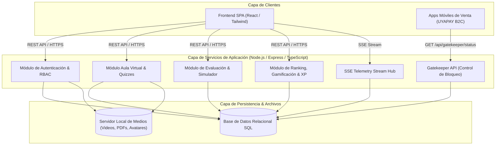

# Arquitectura Técnica del Sistema: Capacitador Interactivo UYAPAY B2C

## 1. Visión General de la Arquitectura

El sistema es una plataforma web modular monolítica desacoplada (Frontend SPA + Backend REST/SSE) orientada a la capacitación y evaluación de la fuerza de ventas de **UYAPAY B2C**.



---

## 2. Esquema Físico de Base de Datos (DDL SQL Relacional)

El modelo de datos está normalizado en 3FN, compuesto por 18 tablas relacionales que soportan los 12 flujos funcionales, telemetría SSE y la bolsa de XP proporcional.

```sql
-- ============================================================================
-- 1. GESTIÓN DE USUARIOS, AUDITORÍA Y SEGURIDAD (Flujos 1, 8, 10)
-- ============================================================================

CREATE TABLE users (
    id VARCHAR(36) PRIMARY KEY,
    username VARCHAR(50) NOT NULL UNIQUE,
    password_hash VARCHAR(255) NOT NULL,
    full_name VARCHAR(150) NOT NULL,
    role VARCHAR(20) NOT NULL CHECK (role IN ('participante', 'revisor', 'editor', 'administrador')),
    application VARCHAR(50) NOT NULL DEFAULT 'UYAPAY B2C',
    status VARCHAR(20) NOT NULL DEFAULT 'Activo' CHECK (status IN ('Activo', 'Inactivo')),
    avatar_url VARCHAR(255) NULL,
    pinned_badge_id VARCHAR(36) NULL,
    created_at TIMESTAMP WITH TIME ZONE DEFAULT CURRENT_TIMESTAMP,
    deactivated_at TIMESTAMP WITH TIME ZONE NULL,
    updated_at TIMESTAMP WITH TIME ZONE DEFAULT CURRENT_TIMESTAMP
);

CREATE INDEX idx_users_username ON users(username);
CREATE INDEX idx_users_role_status ON users(role, status);

CREATE TABLE audit_logs (
    id BIGSERIAL PRIMARY KEY,
    user_id VARCHAR(36) NULL REFERENCES users(id) ON DELETE SET NULL,
    action VARCHAR(50) NOT NULL,
    entity_type VARCHAR(50) NOT NULL,
    entity_id VARCHAR(50) NOT NULL,
    payload_json JSONB NULL,
    ip_address VARCHAR(45) NULL,
    created_at TIMESTAMP WITH TIME ZONE DEFAULT CURRENT_TIMESTAMP
);

-- ============================================================================
-- 2. AULA VIRTUAL Y RECURSOS MULTIMEDIA (Flujos 3, 11)
-- ============================================================================

CREATE TABLE training_folders (
    id VARCHAR(36) PRIMARY KEY,
    parent_id VARCHAR(36) NULL REFERENCES training_folders(id) ON DELETE CASCADE,
    title VARCHAR(150) NOT NULL,
    description TEXT NULL,
    icon_color VARCHAR(30) DEFAULT '#059669',
    sort_order INT NOT NULL DEFAULT 1,
    created_by VARCHAR(36) REFERENCES users(id),
    created_at TIMESTAMP WITH TIME ZONE DEFAULT CURRENT_TIMESTAMP,
    updated_at TIMESTAMP WITH TIME ZONE DEFAULT CURRENT_TIMESTAMP
);

CREATE INDEX idx_training_folders_parent ON training_folders(parent_id);

CREATE TABLE training_resources (
    id VARCHAR(36) PRIMARY KEY,
    folder_id VARCHAR(36) NOT NULL REFERENCES training_folders(id) ON DELETE CASCADE,
    resource_type VARCHAR(20) NOT NULL CHECK (resource_type IN ('VIDEO', 'PDF', 'ARTICLE')),
    title VARCHAR(200) NOT NULL,
    description TEXT NULL,
    file_path_or_url VARCHAR(500) NULL,
    duration_seconds INT NULL DEFAULT 0,
    category VARCHAR(100) NULL,
    article_content TEXT NULL,
    sort_order INT NOT NULL DEFAULT 1,
    created_by VARCHAR(36) REFERENCES users(id),
    created_at TIMESTAMP WITH TIME ZONE DEFAULT CURRENT_TIMESTAMP,
    updated_at TIMESTAMP WITH TIME ZONE DEFAULT CURRENT_TIMESTAMP
);

CREATE INDEX idx_resources_folder ON training_resources(folder_id);

-- ============================================================================
-- 3. QUIZZES DE CAPACITACIÓN (Flujos 4, 11)
-- ============================================================================

CREATE TABLE quizzes (
    id VARCHAR(36) PRIMARY KEY,
    resource_id VARCHAR(36) NOT NULL UNIQUE REFERENCES training_resources(id) ON DELETE CASCADE,
    title VARCHAR(200) NOT NULL,
    time_limit_seconds INT NOT NULL DEFAULT 600,
    max_xp_reward NUMERIC(5,2) NOT NULL DEFAULT 20.00,
    is_active BOOLEAN NOT NULL DEFAULT TRUE,
    created_at TIMESTAMP WITH TIME ZONE DEFAULT CURRENT_TIMESTAMP,
    updated_at TIMESTAMP WITH TIME ZONE DEFAULT CURRENT_TIMESTAMP
);

CREATE TABLE quiz_questions (
    id VARCHAR(36) PRIMARY KEY,
    quiz_id VARCHAR(36) NOT NULL REFERENCES quizzes(id) ON DELETE CASCADE,
    question_text TEXT NOT NULL,
    explanation TEXT NOT NULL,
    time_limit_seconds INT NOT NULL DEFAULT 60,
    sort_order INT NOT NULL DEFAULT 1,
    created_at TIMESTAMP WITH TIME ZONE DEFAULT CURRENT_TIMESTAMP
);

CREATE TABLE quiz_options (
    id VARCHAR(36) PRIMARY KEY,
    question_id VARCHAR(36) NOT NULL REFERENCES quiz_questions(id) ON DELETE CASCADE,
    option_text TEXT NOT NULL,
    is_correct BOOLEAN NOT NULL DEFAULT FALSE,
    sort_order INT NOT NULL DEFAULT 1
);

CREATE TABLE quiz_attempts (
    id VARCHAR(36) PRIMARY KEY,
    quiz_id VARCHAR(36) NOT NULL REFERENCES quizzes(id) ON DELETE CASCADE,
    user_id VARCHAR(36) NOT NULL REFERENCES users(id) ON DELETE CASCADE,
    attempt_number INT NOT NULL DEFAULT 1,
    score_vigesimal NUMERIC(4,2) NOT NULL,
    xp_awarded NUMERIC(5,2) NOT NULL DEFAULT 0.00,
    time_taken_seconds INT NOT NULL,
    status VARCHAR(20) NOT NULL CHECK (status IN ('APPROVED', 'FAILED', 'TIMEOUT')),
    revealed_answers_at TIMESTAMP WITH TIME ZONE NULL,
    created_at TIMESTAMP WITH TIME ZONE DEFAULT CURRENT_TIMESTAMP
);

CREATE INDEX idx_quiz_attempts_user ON quiz_attempts(user_id, quiz_id);

-- ============================================================================
-- 4. CUESTIONARIOS TEÓRICOS DE EVALUACIÓN (Flujos 6, 12)
-- ============================================================================

CREATE TABLE evaluation_questionnaires (
    id VARCHAR(36) PRIMARY KEY,
    title VARCHAR(200) NOT NULL,
    description TEXT NULL,
    time_limit_minutes INT NOT NULL DEFAULT 20,
    total_questions INT NOT NULL DEFAULT 0,
    max_xp_reward NUMERIC(5,2) NOT NULL DEFAULT 40.00,
    created_by VARCHAR(36) REFERENCES users(id),
    is_active BOOLEAN NOT NULL DEFAULT TRUE,
    created_at TIMESTAMP WITH TIME ZONE DEFAULT CURRENT_TIMESTAMP,
    updated_at TIMESTAMP WITH TIME ZONE DEFAULT CURRENT_TIMESTAMP
);

CREATE TABLE questionnaire_questions (
    id VARCHAR(36) PRIMARY KEY,
    questionnaire_id VARCHAR(36) NOT NULL REFERENCES evaluation_questionnaires(id) ON DELETE CASCADE,
    question_text TEXT NOT NULL,
    question_type VARCHAR(30) NOT NULL CHECK (question_type IN ('SINGLE_CHOICE', 'MULTI_CHOICE', 'BOOLEAN')),
    sort_order INT NOT NULL DEFAULT 1
);

CREATE TABLE questionnaire_options (
    id VARCHAR(36) PRIMARY KEY,
    question_id VARCHAR(36) NOT NULL REFERENCES questionnaire_questions(id) ON DELETE CASCADE,
    option_text TEXT NOT NULL,
    is_correct BOOLEAN NOT NULL DEFAULT FALSE,
    sort_order INT NOT NULL DEFAULT 1
);

-- ============================================================================
-- 5. PROGRAMACIÓN EN CALENDARIO, ASIGNACIONES Y GATEKEEPER (Flujos 6, 12)
-- ============================================================================

CREATE TABLE evaluation_events (
    id VARCHAR(36) PRIMARY KEY,
    event_type VARCHAR(30) NOT NULL CHECK (event_type IN ('SIMULATOR', 'QUESTIONNAIRE')),
    simulator_level VARCHAR(20) NULL CHECK (simulator_level IN ('BASICO', 'INTERMEDIO', 'AVANZADO')),
    questionnaire_id VARCHAR(36) NULL REFERENCES evaluation_questionnaires(id) ON DELETE SET NULL,
    title VARCHAR(200) NOT NULL,
    start_date TIMESTAMP WITH TIME ZONE NOT NULL,
    end_date TIMESTAMP WITH TIME ZONE NOT NULL,
    max_attempts INT NOT NULL DEFAULT 1,
    is_active BOOLEAN NOT NULL DEFAULT TRUE,
    created_by VARCHAR(36) REFERENCES users(id),
    created_at TIMESTAMP WITH TIME ZONE DEFAULT CURRENT_TIMESTAMP
);

CREATE INDEX idx_eval_events_dates ON evaluation_events(start_date, end_date);

CREATE TABLE evaluation_assignments (
    id VARCHAR(36) PRIMARY KEY,
    event_id VARCHAR(36) NOT NULL REFERENCES evaluation_events(id) ON DELETE CASCADE,
    user_id VARCHAR(36) NOT NULL REFERENCES users(id) ON DELETE CASCADE,
    status VARCHAR(20) NOT NULL DEFAULT 'PENDIENTE' CHECK (status IN ('PENDIENTE', 'EN_CURSO', 'COMPLETADO')),
    attempts_count INT NOT NULL DEFAULT 0,
    max_score_vigesimal NUMERIC(4,2) DEFAULT 0.00,
    total_xp_earned NUMERIC(5,2) DEFAULT 0.00,
    completed_at TIMESTAMP WITH TIME ZONE NULL,
    created_at TIMESTAMP WITH TIME ZONE DEFAULT CURRENT_TIMESTAMP,
    updated_at TIMESTAMP WITH TIME ZONE DEFAULT CURRENT_TIMESTAMP,
    CONSTRAINT uq_event_user UNIQUE (event_id, user_id)
);

CREATE INDEX idx_eval_assign_user_status ON evaluation_assignments(user_id, status);

-- ============================================================================
-- 6. SIMULADOR MÓVIL Y TELEMETRÍA EN VIVO (Flujos 5, 6, 9)
-- ============================================================================

CREATE TABLE simulator_rules (
    id VARCHAR(36) PRIMARY KEY,
    rule_code VARCHAR(50) NOT NULL UNIQUE,
    category VARCHAR(30) NOT NULL CHECK (category IN ('CLIC_INDEBIDO', 'DATO_INCORRECTO', 'ERROR_OPERATIVO')),
    name VARCHAR(150) NOT NULL,
    active_screen_scope JSONB NOT NULL,
    penalty_points NUMERIC(3,2) NOT NULL DEFAULT 1.00,
    is_blocking BOOLEAN NOT NULL DEFAULT FALSE,
    description TEXT NOT NULL,
    resolution_flow_json JSONB NOT NULL,
    is_active BOOLEAN NOT NULL DEFAULT TRUE,
    created_at TIMESTAMP WITH TIME ZONE DEFAULT CURRENT_TIMESTAMP,
    updated_at TIMESTAMP WITH TIME ZONE DEFAULT CURRENT_TIMESTAMP
);

CREATE INDEX idx_simulator_rules_code ON simulator_rules(rule_code);

CREATE TABLE simulator_attempts (
    id VARCHAR(36) PRIMARY KEY,
    assignment_id VARCHAR(36) NOT NULL REFERENCES evaluation_assignments(id) ON DELETE CASCADE,
    user_id VARCHAR(36) NOT NULL REFERENCES users(id) ON DELETE CASCADE,
    level VARCHAR(20) NOT NULL CHECK (level IN ('BASICO', 'INTERMEDIO', 'AVANZADO')),
    attempt_number INT NOT NULL DEFAULT 1,
    total_cases INT NOT NULL,
    cases_completed INT NOT NULL DEFAULT 0,
    total_errors INT NOT NULL DEFAULT 0,
    duration_seconds INT NOT NULL DEFAULT 0,
    score_vigesimal NUMERIC(4,2) NOT NULL DEFAULT 0.00,
    xp_earned NUMERIC(5,2) NOT NULL DEFAULT 0.00,
    is_passed BOOLEAN NOT NULL DEFAULT FALSE,
    completed_at TIMESTAMP WITH TIME ZONE NULL,
    created_at TIMESTAMP WITH TIME ZONE DEFAULT CURRENT_TIMESTAMP
);

CREATE TABLE simulator_telemetry_events (
    id BIGSERIAL PRIMARY KEY,
    attempt_id VARCHAR(36) NOT NULL REFERENCES simulator_attempts(id) ON DELETE CASCADE,
    user_id VARCHAR(36) NOT NULL REFERENCES users(id) ON DELETE CASCADE,
    case_code VARCHAR(30) NOT NULL,
    step_name VARCHAR(50) NOT NULL,
    event_type VARCHAR(30) NOT NULL CHECK (event_type IN ('CLICK_INDEBIDO', 'DATO_INCORRECTO', 'PASO_COMPLETADO', 'CASO_INICIADO', 'CASO_FINALIZADO')),
    description TEXT NOT NULL,
    payload_json JSONB NULL,
    timestamp TIMESTAMP WITH TIME ZONE DEFAULT CURRENT_TIMESTAMP
);

CREATE INDEX idx_telemetry_attempt ON simulator_telemetry_events(attempt_id, timestamp);

-- ============================================================================
-- 7. GAMIFICACIÓN, INSIGNIAS Y BOLSA DE XP (Flujos 7, 8)
-- ============================================================================

CREATE TABLE badges (
    id VARCHAR(36) PRIMARY KEY,
    code VARCHAR(50) NOT NULL UNIQUE CHECK (code IN (
        'bdg-basic',
        'bdg-intermediate',
        'bdg-advanced',
        'bdg-quiz-master',
        'bdg-zero-errors',
        'bdg-speedster'
    )),
    name VARCHAR(100) NOT NULL,
    description TEXT NOT NULL,
    icon_asset_path VARCHAR(255) NOT NULL,
    created_at TIMESTAMP WITH TIME ZONE DEFAULT CURRENT_TIMESTAMP
);

CREATE TABLE user_badges (
    id VARCHAR(36) PRIMARY KEY,
    user_id VARCHAR(36) NOT NULL REFERENCES users(id) ON DELETE CASCADE,
    badge_id VARCHAR(36) NOT NULL REFERENCES badges(id) ON DELETE CASCADE,
    awarded_at TIMESTAMP WITH TIME ZONE DEFAULT CURRENT_TIMESTAMP,
    metadata_json JSONB NULL,
    CONSTRAINT uq_user_badge UNIQUE (user_id, badge_id)
);

CREATE TABLE user_xp_ledger (
    id BIGSERIAL PRIMARY KEY,
    user_id VARCHAR(36) NOT NULL REFERENCES users(id) ON DELETE CASCADE,
    source_type VARCHAR(30) NOT NULL CHECK (source_type IN ('TRAINING', 'QUIZ', 'SIMULATOR', 'QUESTIONNAIRE')),
    source_id VARCHAR(36) NOT NULL,
    score_vigesimal NUMERIC(4,2) NOT NULL,
    xp_awarded NUMERIC(6,2) NOT NULL,
    created_at TIMESTAMP WITH TIME ZONE DEFAULT CURRENT_TIMESTAMP
);

CREATE INDEX idx_user_xp_ledger ON user_xp_ledger(user_id, source_type);

CREATE TABLE podium_settings (
    id INT PRIMARY KEY DEFAULT 1,
    is_published BOOLEAN NOT NULL DEFAULT TRUE,
    active_cycle_label VARCHAR(50) DEFAULT 'Ciclo Mensual Activo',
    updated_by VARCHAR(36) REFERENCES users(id),
    updated_at TIMESTAMP WITH TIME ZONE DEFAULT CURRENT_TIMESTAMP,
    CONSTRAINT chk_single_row CHECK (id = 1)
);
```

---

## 3. Contratos de la API REST (OpenAPI / Swagger-like)

### 3.1 Módulo Autenticación y Perfil (`/api/auth`, `/api/profile`)

#### `POST /api/auth/login`
Inicia sesión validando credenciales PBKDF2 y estado del usuario.
* **Request Body:**
  ```json
  {
    "username": "juan.perez",
    "password": "Password123!"
  }
  ```
* **Response 200 OK:**
  ```json
  {
    "token": "eyJhbGciOiJIUzI1NiIsInR5cCI6IkpXVCJ9...",
    "user": {
      "id": "usr-9921",
      "username": "juan.perez",
      "fullName": "Juan Carlos Pérez",
      "role": "participante",
      "application": "UYAPAY B2C",
      "avatarUrl": "/uploads/avatars/usr-9921.jpg",
      "pinnedBadge": "bdg-speedster"
    }
  }
  ```
* **Response 403 Forbidden (Inactivo):**
  ```json
  {
    "error": "USER_INACTIVE",
    "message": "Tu usuario ha sido dado de baja o desactivado. Comunícate con el área de TI o tu supervisor."
  }
  ```

#### `PATCH /api/profile/avatar`
Actualiza la foto de perfil (Multipart Form-Data, autocrop a 256x256 WebP).
* **Request:** `file: binary (image/jpeg, image/png)`
* **Response 200 OK:**
  ```json
  { "avatarUrl": "/uploads/avatars/usr-9921_cropped.webp" }
  ```

#### `PATCH /api/profile/pinned-badge`
Fija una insignia ganada en el marco del avatar para mostrar en ranking.
* **Request Body:** `{ "badgeCode": "bdg-speedster" }`
* **Response 200 OK:** `{ "status": "PINNED", "pinnedBadge": "bdg-speedster" }`

---

### 3.2 Módulo Nómina y Usuarios (`/api/users`) - Editor / Administrador

#### `GET /api/users`
Listado con filtros por estado y rol.
* **Query Params:** `?role=participante&status=Activo&search=Juan`
* **Response 200 OK:**
  ```json
  {
    "users": [
      {
        "id": "usr-9921",
        "username": "juan.perez",
        "fullName": "Juan Carlos Pérez",
        "role": "participante",
        "application": "UYAPAY B2C",
        "status": "Activo",
        "createdAt": "2026-09-01T08:00:00Z",
        "deactivatedAt": null
      }
    ]
  }
  ```

#### `POST /api/users`
Creación de usuario con contraseña asignada directamente y validación de unicidad.
* **Request Body:**
  ```json
  {
    "username": "maria.gomez",
    "password": "Password2026!",
    "fullName": "María Gómez Rojas",
    "role": "participante",
    "application": "UYAPAY B2C"
  }
  ```
* **Response 201 Created:** `{ "id": "usr-9922", "status": "CREATED" }`
* **Response 409 Conflict:** `{ "error": "USERNAME_EXISTS", "message": "El nombre de usuario ya se encuentra registrado." }`

#### `PATCH /api/users/{id}/status`
Baja o reactivación de usuario.
* **Request Body:** `{ "status": "Inactivo" }`
* **Response 200 OK:** `{ "id": "usr-9922", "status": "Inactivo", "deactivatedAt": "2026-09-24T15:00:00Z" }`

---

### 3.3 Módulo Aula Virtual & Quizzes (`/api/training`)

#### `GET /api/training/folders`
Retorna el árbol jerárquico de carpetas con el porcentaje de avance del usuario autenticado.

#### `POST /api/training/resources` (Editor / Admin)
Creación de recurso con video en servidor del cliente, PDF o artículo, y su Quiz.
* **Request Body:**
  ```json
  {
    "folderId": "fld-101",
    "resourceType": "VIDEO",
    "title": "Registro de Visita con Geocerca",
    "description": "Procedimiento obligatorio a 50m del comercio",
    "filePathOrUrl": "/media/videos/visita_geocerca_v1.mp4",
    "durationSeconds": 180,
    "quiz": {
      "timeLimitSeconds": 180,
      "questions": [
        {
          "questionText": "¿A qué distancia máxima se habilita el botón de inicio presencial?",
          "explanation": "La política de seguridad comercial exige estar dentro de los 50 metros de geocerca.",
          "timeLimitSeconds": 60,
          "options": [
            { "text": "A 50 metros", "isCorrect": true },
            { "text": "A 200 metros", "isCorrect": false },
            { "text": "A cualquier distancia", "isCorrect": false }
          ]
        }
      ]
    }
  }
  ```

#### `POST /api/training/quizzes/{quizId}/submit`
Califica el quiz, calcula nota vigesimal y XP proporcional, aplicando la regla de mayor nota en reintentos.
* **Request Body:**
  ```json
  {
    "timeTakenSeconds": 95,
    "answers": [
      { "questionId": "q-1", "selectedOptionId": "opt-1" },
      { "questionId": "q-2", "selectedOptionId": "opt-4" }
    ]
  }
  ```
* **Response 200 OK:**
  ```json
  {
    "scoreVigesimal": 20.00,
    "isPassed": true,
    "xpAwarded": 20.00,
    "canRevealAnswers": true,
    "highestScoreRetained": 20.00
  }
  ```

---

### 3.4 Módulo Gatekeeper para Apps Móviles (`/api/gatekeeper`)

#### `GET /api/gatekeeper/status`
Endpoint ultraligero consultado por la app móvil al iniciar sesión para verificar bloqueo por evaluación pendiente.
* **Query Params:** `?userId=usr-9921&date=2026-09-24`
* **Response 200 OK (Bloqueado por Evaluación Pendiente):**
  ```json
  {
    "userId": "usr-9921",
    "date": "2026-09-24",
    "has_blocking_evaluation": true,
    "status": "LOCKED",
    "evaluation": {
      "eventId": "evt-771",
      "type": "SIMULATOR",
      "title": "Evaluación Mensual Nivel Básico",
      "deadline": "2026-09-24T23:59:59Z"
    }
  }
  ```
* **Response 200 OK (Desbloqueado tras Rendir la Evaluación):**
  ```json
  {
    "userId": "usr-9921",
    "date": "2026-09-24",
    "has_blocking_evaluation": false,
    "status": "UNLOCKED"
  }
  ```

---

## 4. Especificación del Canal Server-Sent Events (SSE)

### `GET /api/live-monitor/stream`
* **Encabezados HTTP:**
  * `Content-Type: text/event-stream`
  * `Cache-Control: no-cache`
  * `Connection: keep-alive`
* **Mecanismo de Despacho:**
  * **Keep-alive / Heartbeat:** Cada 15 segundos (`: ping

`).
  * **Mensajes en Vivo:**
    ```text
    event: telemetry_event
    data: {"timestamp":"15:42:10","userId":"usr-9921","userName":"Juan Pérez","caseCode":"CP-02","step":"T3: Precios","eventType":"CLIC_INDEBIDO","description":"Intento de aplicar descuento 15% fuera de rango"}

    event: active_sessions_update
    data: {"connectedUsers":28,"activeEvaluations":14,"passedCount":10,"failedCount":4}
    ```

---

## 5. Algoritmos Centrales en Pseudocódigo

### Algoritmo 1: Cálculo de XP Proporcional con Retención de Mayor Nota
```python
def calculate_and_award_xp(user_id, activity_type, activity_id, new_score, max_possible_score, max_configured_xp):
    # 1. Obtener la calificación más alta histórica previa
    previous_highest_score = get_user_highest_score(user_id, activity_type, activity_id) or 0.0

    # 2. Regla de conservación de mayor nota
    effective_score = max(previous_highest_score, new_score)

    # 3. Calcular XP total acumulable para la calificación efectiva (proporcional)
    effective_xp = (effective_score / max_possible_score) * max_configured_xp

    # 4. Calcular el XP ya percibido previamente por la nota anterior
    previously_awarded_xp = (previous_highest_score / max_possible_score) * max_configured_xp

    # 5. Otorgar únicamente el delta positivo
    delta_xp = max(0.0, effective_xp - previously_awarded_xp)

    if delta_xp > 0:
        insert_xp_ledger(user_id, activity_type, activity_id, new_score, delta_xp)
        increment_user_total_xp(user_id, delta_xp)

    return {
        "score_vigesimal": new_score,
        "effective_highest_score": effective_score,
        "delta_xp_awarded": delta_xp,
        "total_xp_for_activity": effective_xp
    }
```

### Algoritmo 2: Desempate Determinista en Ranking General
```python
def sort_ranking_participants(participants_list):
    # Orden jerárquico estricto:
    # 1. Total XP descendente (-xp)
    # 2. Total errores cometidos ascendente (+errors)
    # 3. Timestamp de finalización de última evaluación ascendente (+completed_at)
    return sorted(
        participants_list,
        key=lambda p: (
            -p.total_xp,
            p.total_simulator_errors,
            p.last_evaluation_completed_at or "9999-12-31T23:59:59Z"
        )
    )
```

### Algoritmo 3: Evaluación de Desbloqueo Gatekeeper
```python
def check_gatekeeper_status(user_id, current_date):
    active_assignments = query_assignments_for_date(user_id, current_date)
    
    for assign in active_assignments:
        # Si la prueba sigue PENDIENTE o EN_CURSO, se mantiene el bloqueo
        if assign.status in ('PENDIENTE', 'EN_CURSO'):
            return {
                "has_blocking_evaluation": True,
                "status": "LOCKED",
                "evaluation": {
                    "eventId": assign.event_id,
                    "title": assign.event_title,
                    "type": assign.event_type
                }
            }

    # Si todas las evaluaciones asignadas fueron COMPLETADAS (aprobadas o no), desbloquea
    return {
        "has_blocking_evaluation": False,
        "status": "UNLOCKED"
    }
```
