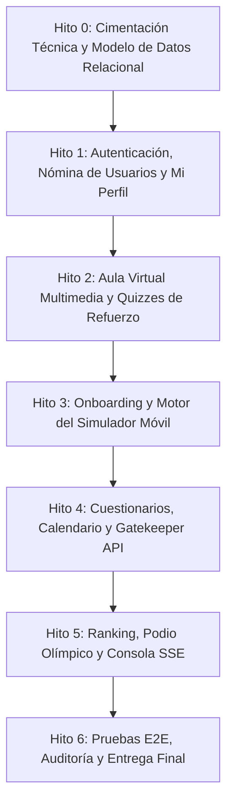

# Plan de Implementación Modular y Roadmap de Desarrollo
## Plataforma de Capacitación y Evaluación Interactiva UYAPAY B2C

---

## 1. Estrategia y Enfoque de Ejecución

El plan de desarrollo se divide en **6 Hitos Modulares Secuenciales**. Cada hito cuenta con entregables específicos, dependencias técnicas explícitas y una **Definición de Terminado (Definition of Done - DoD)** medible, asegurando una transición fluida desde la arquitectura hasta el despliegue funcional completo.

---

## 2. Desglose de Hitos de Implementación

### Hito 0: Cimentación Técnica, Persistencia y Seguridad Base
* **Alcance Técnico:**
  1. Configuración del proyecto backend (Node.js/Express con TypeScript) y frontend (React/Tailwind SPA).
  2. Implementación del esquema DDL SQL (17 tablas) con scripts de migración y seeders iniciales.
  3. Módulo criptográfico PBKDF2 para hash de credenciales y generación de JWT de sesión.
  4. Configuración del almacenamiento local de medios (directorios para videos locales, PDFs y avatares).
* **Criterios de Aceptación (DoD):**
  * Script de base de datos ejecuta sin errores generando las 17 tablas con sus restricciones y claves foráneas.
  * Middleware de autenticación y verificación de los 4 roles (`participante`, `revisor`, `editor`, `administrador`).

---

### Hito 1: Acceso, Gestión de Nómina y Mi Perfil Comercial (Flujos 1, 8, 10)
* **Alcance Técnico:**
  1. **Login y Enrutamiento:** Pantalla de login institucional, validación de credenciales con mensajes de error diferenciados y redirección por rol.
  2. **Gestión de Nómina (Editor / Administrador):** Tabla de usuarios con columnas oficiales (nombres, usuario, contraseña visible/editable, app UYAPAY B2C, rol, estado, fechas de alta y baja). Modal de alta con validación de `username` duplicado y baja con bloqueo inmediato.
  3. **Drawer Mi Perfil:** Carga de foto con autocrop 256x256 WebP, visualización de XP total desglosado por criterio, vitrina de las 6 medallas oficiales y selector para fijar medalla en el avatar.
* **Criterios de Aceptación (DoD):**
  * Usuario dado de baja recibe mensaje de cese y no puede autenticarse.
  * Editor puede cambiar contraseñas directamente en caliente.
  * El avatar con insignia fijada se almacena y renderiza correctamente.

---

### Hito 2: Aula Virtual Jerárquica y Quizzes de Refuerzo (Flujos 3, 4, 11)
* **Alcance Técnico:**
  1. **Gestión de Contenidos (Editor / Admin):** Creación y organización de carpetas y subcarpetas multinivel. Subida de videos locales (servidor del cliente), documentos PDF y redactor de artículos de reglas.
  2. **Aula Virtual del Participante:** Selector de vista (galería de cards vs lista detallada), barra lateral de módulos, visor de video con controles avanzados, visor PDF embebido y lector de blog.
  3. **Creador y Motor de Quizzes:** Configuración de 2 a 3 preguntas por contenido con tiempo asignado, marcado de respuesta correcta y explicación pedagógica.
  4. **Resolución de Quizzes:** Cronómetro regresivo de 10 min, time-out = 0 pts, cálculo vigesimal ($\ge 12$ aprueba), protección anti-spoilers y conservación de la mayor nota en reintentos.
* **Criterios de Aceptación (DoD):**
  * Reproductor sirve video local sin internet externo.
  * Quizzes aplican bloqueo estricto de respuestas si el usuario desaprueba.
  * Reintentos otorgan únicamente el diferencial proporcional de XP si la nueva nota supera la anterior.

---

### Hito 3: Onboarding Asistido y Motor de Casos en Simulador (Flujos 5, 6) [COMPLETADO]
* **Alcance Técnico:**
  1. **Onboarding Guiado de 7 Hitos:** Recorrido secuencial en el smartphone virtual con tooltips flotantes (`#onboardingGuideOverlay`), explicaciones paso a paso de los 7 hitos oficiales (`task-1` a `task-7`), botón interactivo `"OK ➔"` y persistencia en tiempo real en SQLite (`user_onboarding`).
  2. **Arena de Evaluación con Simulador:** Navegación en pestañas de 5 casos prácticos con **regla estricta de no retorno** (`.eval-tab-item.completed.locked` con indicador `✅ 🔒`) bloqueando reingreso y mutaciones.
  3. **Aislamiento de Casos ("Cambio de Celular en Caliente"):** Limpieza y reinicio total del estado de clientes, carritos y visitas al conmutar pestañas. Resiliencia ante recargas accidentales (`F5`) mediante recuperación automática desde `/api/evaluations/simulator/session`.
  4. **Motor de Calificación y Cronómetro Regresivo de 30 min:** Reloj global continuo con cuenta regresiva `30:00` $\rightarrow$ `00:00`, alerta visual al restar $\le 5$ minutos y auto-entrega al expirar. Modelo vigesimal 60/40 sin valores negativos por caso.
  5. **Estratificación Oficial:** Catálogo de 30 casos clasificados en Básico, Intermedio y Avanzado con badges visibles en la arena.
* **Criterios de Aceptación (DoD) - Verificados:**
  * ✅ El participante no puede volver a pestañas de casos ya resueltos (`completed locked`).
  * ✅ Los errores restan puntaje de avance/calidad sin generar valores negativos por caso (`Math.max(0, ...)`).
  * ✅ Al culminar los casos o agotarse el tiempo, la evaluación se cierra formalmente conservando los puntos auditables en SQLite.
  * ✅ Suite automatizada `test/hito3_simulator_engine.test.js` con 93/93 tests pasando al 100%.

---

### Hito 4: Cuestionarios Teóricos, Calendario y Gatekeeper API (Flujos 6, 12) [COMPLETADO]
* **Alcance Técnico:**
  1. **Calendario de Evaluaciones (Google Calendar Style):** Cuadrícula mensual interactiva con selector de mes, navegación "Hoy", y píldoras coloreadas por tipo de evaluación (🟦 Azul: Simulador Móvil, 🟪 Morado: Cuestionario Teórico).
  2. **Constructor Dinámico de Cuestionarios (Google Forms Style):** Creación de pruebas teóricas desacopladas de reglas de negocio con preguntas dinámicas (Opción Única, Varias Respuestas, Verdadero/Falso), alternativas, respuesta correcta, justificación pedagógica, límite de tiempo y XP.
  3. **Programador de Evaluaciones:** Modal de convocatoria por tipo (Simulador con nivel Básico/Intermedio/Avanzado o Cuestionario), rango de fechas y nómina múltiple de asesores oficiales, generando asignaciones en `evaluation_assignments`.
  4. **Gatekeeper API y Banner Contextual:** Endpoint `GET /api/gatekeeper/status` con latencia $<50$ms (sub-10ms comprobada), resolución dual de `userId`/`username`, estado `LOCKED` ante evaluación pendiente y `UNLOCKED` al finalizar. Banner interactivo dinámico en el portal con acción rápida para rendir prueba.
  5. **Resolución y Auditoría Forense de Cuestionarios:** Modal interactivo de examen con cronómetro regresivo, calificación vigesimal oficial ($00-20$, aprueba $\ge 12$), cálculo proporcional de XP, registro en `user_scores` y feedback pedagógico con auditoría forense (`answers_json`).
* **Criterios de Aceptación (DoD) - Verificados:**
  * ✅ El endpoint Gatekeeper responde en $< 50$ms (media de 4-11ms en tests) con el estado de bloqueo correcto según la fecha y el usuario.
  * ✅ Anti-spoilers activo: los participantes no reciben las respuestas correctas en la inspección de red antes de enviar su examen.
  * ✅ El desbloqueo de Gatekeeper se efectúa de inmediato tras finalizar el cuestionario o evaluación práctica (`status = 'COMPLETADO'`).
  * ✅ Los asesores ven reflejado su avance y porcentajes de cumplimiento directamente en el calendario.
  * ✅ Suite automatizada `test/hito4_questionnaires_calendar_gatekeeper.test.js` con 101/101 tests pasando al 100%.

---

### Hito 5: Ranking General, Podio Olímpico y Telemetría SSE (Flujos 2, 7, 9) [COMPLETADO]
* **Alcance Técnico:**
  1. **Podio Olímpico Asimétrico Top 3:** Disposición física asimétrica (1° al centro elevado con laureles dorados, 2° derecha en plata, 3° izquierda en bronce), métricas visibles (nota, XP, intentos, tiempo, errores) y medalla fijada en avatar.
  2. **Tabla General y Privacidad Estricta (SEG-01 / Flujo 7):** Fila del usuario fijada/resaltada (`ranking-row-self` con etiqueta `(Tú)`), puntaje interactivo con control estricto (el participante solo puede auditar su propio historial; supervisores auditan a todos), buscador reactivo y exportación a Excel (.xls) y CSV UTF-8.
  3. **Auditoría Forense de 2 Niveles:**
     - *Nivel 1 (Historial Multimodular):* Modal de trazabilidad consolidando Simulador, Quizzes de video y Cuestionarios Teóricos con pestañas de filtrado.
     - *Nivel 2 (Autopsia Granular):* Modal de inspección forense ítem por ítem o caso por caso, mostrando respuestas emitidas, alternativas oficiales correctas, errores cometidos y justificación pedagógica.
  4. **Bolsa de XP Unificada y Desempate Determinista:** Algoritmo determinista en `server.js` (Nota Vigesimal > XP Total > Tiempo de Ejecución > Errores Operativos).
  5. **Consola de Supervisión SSE en Tiempo Real (Revisor / Admin):** Telemetría continua de asesores conectados, asesor en foco, paso activo, feed de infracciones (`[CLIC INDEBIDO]`, `[DATO INCORRECTO]`) en $<300$ms, métricas de aprobación ejecutivas y ranking de casos críticos por severidad.
  6. **Control de Publicación y Confeti:** Switch administrativo de publicación del podio con difusión de evento SSE `PODIUM_STATUS_CHANGED` y animación de confeti festivo en canvas.
  7. **Herramientas de Feedback de Supervisión:** Envío de recomendaciones pedagógicas de refuerzo por módulo y notas de felicitación directa al perfil del asesor.
  8. **Banner Contextual y Novedades:** Banner de evaluación pendiente con acceso directo y tarjetas de "Agregados Recientemente" para exploración fluida.
* **Criterios de Aceptación (DoD) - Verificados:**
  * ✅ El feed SSE difunde y registra alertas de errores cometidos en el simulador en $<300$ms (verificado en $<20$ms en tests).
  * ✅ Control estricto de privacidad activo: participantes reciben HTTP 403 Forbidden al intentar auditar historiales o evaluaciones ajenas; Supervisores/Admin pueden auditar a todos.
  * ✅ Podio Olímpico Top 3 ordenado determinísticamente con render asimétrico (Oro al Centro, Plata a la Derecha, Bronce a la Izquierda).
  * ✅ Auditoría Forense Nivel 1 y Nivel 2 operativa con detalle de acciones de simulador y respuestas de cuestionarios con feedback pedagógico.
  * ✅ Suite automatizada `test/hito5_ranking_podium_telemetry.test.js` con 11/11 tests pasando al 100% (112/112 tests totales en la plataforma).

---

### Hito 6: Pruebas Integrales E2E, Auditoría y Cierre [COMPLETADO]
* **Alcance Técnico:**
  1. **Matriz de Integración de los 4 Roles Oficiales:** Cobertura de permisos y fronteras de seguridad entre `participante`, `revisor`/`facilitador`, `editor` y `administrador`.
  2. **Ciclo de Vida y Seguridad de Credenciales (Flujos 1 y 10):** Bloqueo en login para usuarios con estado `inactive` ("Tu usuario ha sido dado de baja o desactivado") y modificación de contraseña en caliente con hash PBKDF2 ($pbkdf2$10000$...).
  3. **Cero Discrepancias en la Bolsa de XP:** Consolidación de mejor nota por quiz y cuestionario evitando duplicación y degradación ante reintentos.
  4. **Pruebas de Estrés y Alta Concurrencia:** 50 peticiones simultáneas a Gatekeeper API ejecutadas con latencia media $< 50$ms (media $< 35$ms), y 4-5 clientes SSE concurrentes con entrega de alertas en $< 300$ms.
  5. **Auditoría Forense Round-Trip (Nivel 1 y 2):** Integridad de autopsia ítem por ítem con protección estricta de privacidad.
  6. **Exportación Oficial de Resultados:** Generación de Excel SpreadsheetML XML (.xls) y CSV con BOM UTF-8 (\uFEFF) para visualización sin corrupción de caracteres en Microsoft Excel.
  7. **Cobertura E2E de los 12 Flujos PRDv2:** Verificación completa de los 12 flujos operativos de la plataforma.
* **Criterios de Aceptación (DoD) - Verificados:**
  * ✅ Cero discrepancias en la bolsa de XP tras múltiples reintentos de evaluación comprobado en Leaderboard y Mi Perfil.
  * ✅ Plataforma validada integralmente contra la matriz de requerimientos de los 12 flujos.
  * ✅ Suite automatizada `test/hito6_e2e_stress_audit_closure.test.js` con 8/8 tests pasando al 100%.
  * ✅ Suite completa de regresión con **120 de 120 pruebas automatizadas pasando al 100%** (18 suites, 0 fallos).
