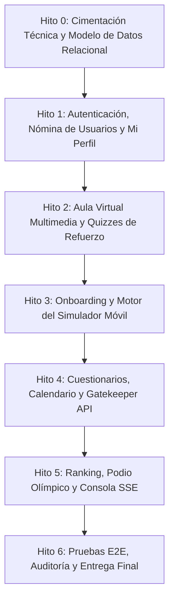

# Plan de Implementación Modular y Roadmap de Desarrollo
## Plataforma de Capacitación y Evaluación Interactiva UYAPAY B2C

---

## 1. Estrategia y Enfoque de Ejecución

El plan de desarrollo se divide en **6 Hitos Modulares Secuenciales**. Cada hito cuenta con entregables específicos, dependencias técnicas explícitas y una **Definición de Terminado (Definition of Done - DoD)** medible, asegurando una transición fluida desde la arquitectura hasta el despliegue funcional completo.

---

## 2. Desglose de Hitos de Implementación

### Hito 0: Cimentación Técnica, Persistencia y Seguridad Base
* **Alcance Técnico:**
  1. Configuración del proyecto backend (Node.js/Express con TypeScript) y frontend (React/Tailwind SPA).
  2. Implementación del esquema DDL SQL (17 tablas) con scripts de migración y seeders iniciales.
  3. Módulo criptográfico PBKDF2 para hash de credenciales y generación de JWT de sesión.
  4. Configuración del almacenamiento local de medios (directorios para videos locales, PDFs y avatares).
* **Criterios de Aceptación (DoD):**
  * Script de base de datos ejecuta sin errores generando las 17 tablas con sus restricciones y claves foráneas.
  * Middleware de autenticación y verificación de los 4 roles (`participante`, `revisor`, `editor`, `administrador`).

---

### Hito 1: Acceso, Gestión de Nómina y Mi Perfil Comercial (Flujos 1, 8, 10)
* **Alcance Técnico:**
  1. **Login y Enrutamiento:** Pantalla de login institucional, validación de credenciales con mensajes de error diferenciados y redirección por rol.
  2. **Gestión de Nómina (Editor / Administrador):** Tabla de usuarios con columnas oficiales (nombres, usuario, contraseña visible/editable, app UYAPAY B2C, rol, estado, fechas de alta y baja). Modal de alta con validación de `username` duplicado y baja con bloqueo inmediato.
  3. **Drawer Mi Perfil:** Carga de foto con autocrop 256x256 WebP, visualización de XP total desglosado por criterio, vitrina de las 6 medallas oficiales y selector para fijar medalla en el avatar.
* **Criterios de Aceptación (DoD):**
  * Usuario dado de baja recibe mensaje de cese y no puede autenticarse.
  * Editor puede cambiar contraseñas directamente en caliente.
  * El avatar con insignia fijada se almacena y renderiza correctamente.

---

### Hito 2: Aula Virtual Jerárquica y Quizzes de Refuerzo (Flujos 3, 4, 11)
* **Alcance Técnico:**
  1. **Gestión de Contenidos (Editor / Admin):** Creación y organización de carpetas y subcarpetas multinivel. Subida de videos locales (servidor del cliente), documentos PDF y redactor de artículos de reglas.
  2. **Aula Virtual del Participante:** Selector de vista (galería de cards vs lista detallada), barra lateral de módulos, visor de video con controles avanzados, visor PDF embebido y lector de blog.
  3. **Creador y Motor de Quizzes:** Configuración de 2 a 3 preguntas por contenido con tiempo asignado, marcado de respuesta correcta y explicación pedagógica.
  4. **Resolución de Quizzes:** Cronómetro regresivo de 10 min, time-out = 0 pts, cálculo vigesimal ($\ge 12$ aprueba), protección anti-spoilers y conservación de la mayor nota en reintentos.
* **Criterios de Aceptación (DoD):**
  * Reproductor sirve video local sin internet externo.
  * Quizzes aplican bloqueo estricto de respuestas si el usuario desaprueba.
  * Reintentos otorgan únicamente el diferencial proporcional de XP si la nueva nota supera la anterior.

---

### Hito 3: Onboarding Asistido y Motor de Casos en Simulador (Flujos 5, 6) [COMPLETADO]
* **Alcance Técnico:**
  1. **Onboarding Guiado de 7 Hitos:** Recorrido secuencial en el smartphone virtual con tooltips flotantes (`#onboardingGuideOverlay`), explicaciones paso a paso de los 7 hitos oficiales (`task-1` a `task-7`), botón interactivo `"OK ➔"` y persistencia en tiempo real en SQLite (`user_onboarding`).
  2. **Arena de Evaluación con Simulador:** Navegación en pestañas de 5 casos prácticos con **regla estricta de no retorno** (`.eval-tab-item.completed.locked` con indicador `✅ 🔒`) bloqueando reingreso y mutaciones.
  3. **Aislamiento de Casos ("Cambio de Celular en Caliente"):** Limpieza y reinicio total del estado de clientes, carritos y visitas al conmutar pestañas. Resiliencia ante recargas accidentales (`F5`) mediante recuperación automática desde `/api/evaluations/simulator/session`.
  4. **Motor de Calificación y Cronómetro Regresivo de 30 min:** Reloj global continuo con cuenta regresiva `30:00` $\rightarrow$ `00:00`, alerta visual al restar $\le 5$ minutos y auto-entrega al expirar. Modelo vigesimal 60/40 sin valores negativos por caso.
  5. **Estratificación Oficial:** Catálogo de 30 casos clasificados en Básico, Intermedio y Avanzado con badges visibles en la arena.
* **Criterios de Aceptación (DoD) - Verificados:**
  * ✅ El participante no puede volver a pestañas de casos ya resueltos (`completed locked`).
  * ✅ Los errores restan puntaje de avance/calidad sin generar valores negativos por caso (`Math.max(0, ...)`).
  * ✅ Al culminar los casos o agotarse el tiempo, la evaluación se cierra formalmente conservando los puntos auditables en SQLite.
  * ✅ Suite automatizada `test/hito3_simulator_engine.test.js` con 93/93 tests pasando al 100%.

---

### Hito 4: Cuestionarios Teóricos, Calendario y Gatekeeper API (Flujos 6, 12)
* **Alcance Técnico:**
  1. **Calendario de Evaluaciones:** Vista estilo Google Calendar con eventos diferenciados por color (azul: simulador, morado: cuestionario).
  2. **Creador de Cuestionarios:** Constructor dinámico estilo Google Forms para exámenes teóricos de reglas de negocio.
  3. **Programador de Evaluaciones:** Modal de asignación por fecha, intentos y selección de participantes.
  4. **Gatekeeper API:** Endpoint `GET /api/gatekeeper/status` con lógica de bloqueo (`LOCKED`) y desbloqueo automático (`UNLOCKED`) una vez culminada la prueba (aprobada o no).
* **Criterios de Aceptación (DoD):**
  * El endpoint Gatekeeper responde en menos de 50ms con el estado de bloqueo correcto según la fecha y el usuario.
  * El desbloqueo se efectúa de inmediato tras presionar "Finalizar Evaluación".

---

### Hito 5: Ranking General, Podio Olímpico y Telemetría SSE (Flujos 2, 7, 9)
* **Alcance Técnico:**
  1. **Podio y Ranking General:** Tarjetas asimétricas del Top 3 (1° al centro, 2° derecha, 3° izquierda), tabla general con fila del usuario fijada y modal de desglose de 2 niveles.
  2. **Bolsa de XP Proporcional:** Algoritmo de consolidación de puntos y desempate determinista (XP > Errores > Tiempo).
  3. **Consola de Supervisión SSE (Revisor / Admin):** Transmisión en tiempo real de participantes conectados, asesor en foco, caso/paso activo, feed de infracciones y ranking analítico de casos críticos.
  4. **Control de Podio:** Switch de publicación del podio para congelar o exhibir resultados.
* **Criterios de Aceptación (DoD):**
  * El feed SSE muestra alertas de errores cometidos en el simulador en menos de 300ms.
  * Los participantes solo pueden ver el desglose de su propio puntaje; Revisor/Admin pueden auditar a todos.

---

### Hito 6: Pruebas Integrales E2E, Auditoría y Cierre
* **Alcance Técnico:**
  1. Pruebas end-to-end automatizadas de los 12 flujos de usuario simulando los 4 roles.
  2. Pruebas de estrés y concurrencia sobre el canal de telemetría SSE y la API Gatekeeper.
  3. Validación de integridad de auditoría forense y exportación a Excel / PDF.
* **Criterios de Aceptación (DoD):**
  * Cero discrepancias en la bolsa de XP tras múltiples reintentos de evaluación.
  * Plataforma validada contra la matriz de requerimientos de los 12 flujos.
